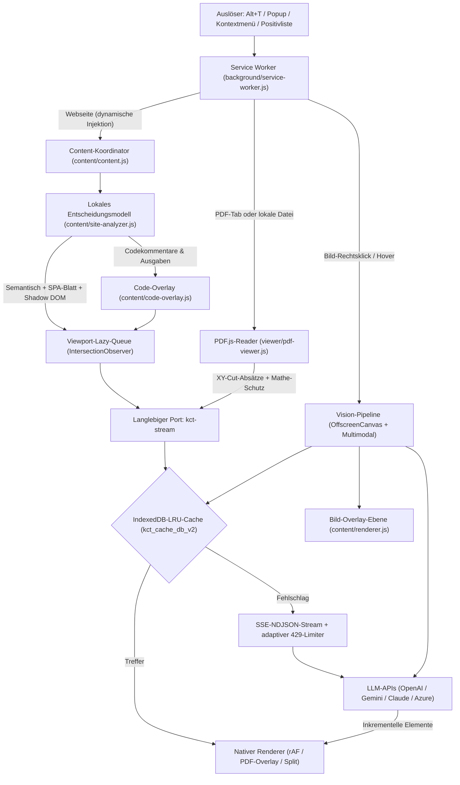
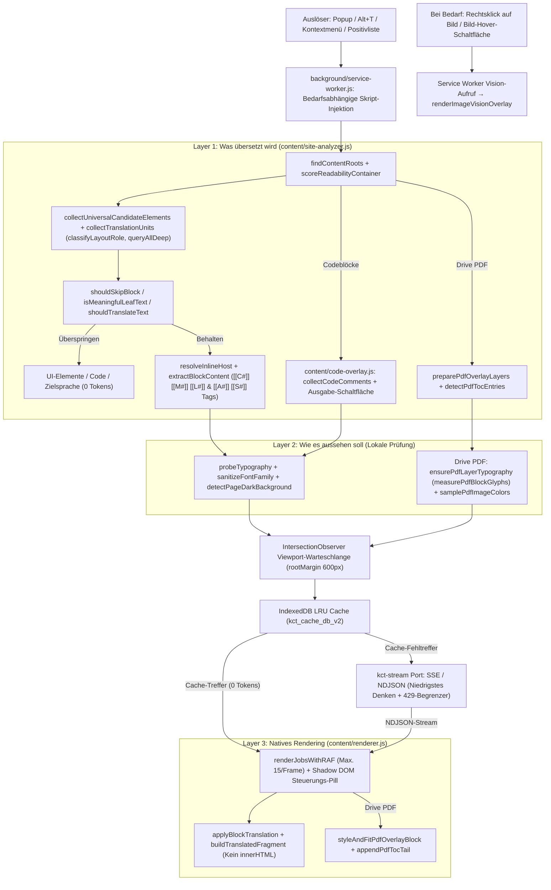

# NativeRead

[English](README.md) · [繁體中文](README.zh-TW.md) · [简体中文](README.zh-CN.md) · [日本語](README.ja.md) · [한국어](README.ko.md) · [Español](README.es.md) · [Français](README.fr.md) · **Deutsch**

**NativeRead (v2.8.1)** ist eine Manifest-V3-Browser-Erweiterung und mobile PWA, die Webseiten, PDFs, Codekommentare und eingebettete Infografiken übersetzt und dabei die ursprüngliche Typografie und das Seitenlayout beibehält. Sie bleibt standardmäßig inaktiv, läuft bei Bedarf mit Ihrem eigenen LLM-API-Schlüssel und streamt Übersetzungen Absatz für Absatz, ohne den Lesefluss zu unterbrechen.

---

## 1. Produktübersicht & Schnellstart

### Kernfunktionen

| Funktion | Funktionsweise | Leseerlebnis |
| --- | --- | --- |
| **Standardmäßig stille Web-Übersetzung** | Keine statischen `content_scripts`; wird bei Bedarf dynamisch über `chrome.scripting` injiziert (`Alt+T`, Popup-Button, Kontextmenü oder seitenweise Positivliste `autoTranslateHosts`). | Kein Overhead, keine schwebende UI und kein API-Verbrauch auf Seiten, die Sie nicht übersetzen. |
| **Integrierter PDF.js-Reader** | Bündelt lokales Apache-2.0 `PDF.js` (`vendor/pdfjs/`) in `viewer/pdf-viewer.html`; unterstützt Remote-PDFs, Google-Drive-Links und lokales `.pdf`-Drag-and-Drop. | Wechsel zwischen den Modi **Overlay**, **Split** und **Original** (`1` / `2` / `3`); Abbildungen, Tabellen und abgesetzte Formeln bleiben erhalten. |
| **Google-Drive-PDF-In-Page-Overlay** | Erkennt `.ndfHFb-c4YZDc-cYSp0e-DARUcf`-Viewer-Ebenen direkt auf der Seite, führt Textboxen derselben Spalte zusammen, baut Inhaltsverzeichnis-Führungspunkte neu auf und misst native Glyphenmetriken aus Seiten-Rastern. | Übersetzt mehrseitige Drive-PDFs direkt in Google Drive, ohne den Tab zu verlassen. |
| **On-Demand-Bild- & Infografik-Overlay** | Strikt auf Abruf per Rechtsklick (**NativeRead Translate Image Text**) oder Hover-Pill (**譯圖**) auf Bildern `>= 200x140` px; scannt niemals automatisch Seitenbilder. | Ersetzt Textblöcke direkt an Ort und Stelle mit abgetasteten Hintergrund-/Vordergrundfarben, während 3D-Diagramme und Illustrationen erhalten bleiben. |
| **Codekommentare & Notebook-Ausgaben** | Zerstörungsfreier CSS-`attr()`-Tausch für statische `<pre>`-Blöcke (Pygments, Prism, Highlight.js, GitHub `.pl-c`), schreibgeschütztes Overlay für CodeMirror 6 (`.cm-editor`) und Schnellübersetzungs-Buttons für Jupyter-Ausgaben. | Code bleibt editierbar und ausführbar; Overlays blenden automatisch aus, wenn Sie einen Editor fokussieren oder in den Originalmodus wechseln. |
| **Mobil & Plattformübergreifend** | Liefert eine eigenständige mobile PWA (`docs/`), ein universelles Userscript (`docs/nativeread.user.js`), ein Android-Erweiterungs-ZIP (`docs/nativeread-android-extension.zip`) und lokalen QR-Code-`#nr_sync`-Abgleich. | Vollständiger Übersetzungs-Workflow unter iOS Safari und in Android-Browsern ohne erneutes Eintippen von API-Schlüsseln. |

### Schnellstart (Desktop-Erweiterung)

Erfordert Chromium 119+ (Chrome, Edge, Brave oder kompatible Browser).

1. Repository klonen:
   ```bash
   git clone https://github.com/Chih-Kai-Wang/native-read.git
   ```
2. Öffnen Sie `chrome://extensions/` (oder `edge://extensions/`) und aktivieren Sie den **Entwicklermodus**.
3. Klicken Sie auf **Entpackte Erweiterung laden** und wählen Sie das geklonte Verzeichnis `native-read` aus.
4. Klicken Sie auf das **NativeRead**-Symbolleisten-Icon → **Options**, wählen Sie einen Modellanbieter, geben Sie Ihren API-Schlüssel ein, klicken Sie auf **Fetch model list** und wählen Sie ein Modell aus, klicken Sie dann auf **Test Connection** und speichern Sie.
5. Starten Sie die Übersetzung auf einer beliebigen Webseite oder einem PDF-Tab mit **`Alt+T`** (**⌥ Option+T** unter macOS; das Popup zeigt Ihr konfiguriertes Tastenkürzel an, anpassbar unter `chrome://extensions/shortcuts`), dem Popup-Button oder dem Kontextmenü. Klicken Sie auf `☆` / `★` im Popup oder in der schwebenden Pill, um die aktuelle Domain zur Auto-Übersetzungs-Positivliste hinzuzufügen oder daraus zu entfernen.

### Unterstützte Modellanbieter

Konfiguriert in `shared/config.js` (`PROVIDER_PRESETS`) als datengesteuertes Verzeichnis mit 32 Voreinstellungen in vier Gruppen (dargestellt mit `<optgroup>` in den Optionen und der PWA, wobei `scripts/build-mobile.js` `docs/providers.js` aus derselben Quelle generiert). Nutzer können verfügbare Modelle live vom konfigurierten Endpunkt abrufen; lokale Endpunkte (`localhost`, `127.0.0.1`, `0.0.0.0`) benötigen keinen API-Schlüssel, und jeder andere OpenAI-kompatible Dienst funktioniert über `custom`.

| Gruppe | Anbieter-ID | Protokoll | Basis-URL |
| --- | --- | --- | --- |
| Nativ | `gemini` | Gemini Native | `https://generativelanguage.googleapis.com/v1beta` |
| Nativ | `anthropic` | Anthropic Messages | `https://api.anthropic.com/v1` |
| International | `openai` | OpenAI | `https://api.openai.com/v1` |
| International | `azure` | OpenAI (api-key header) | `https://YOUR-RESOURCE.openai.azure.com/openai/v1` |
| International | `openrouter` | OpenAI | `https://openrouter.ai/api/v1` |
| International | `groq` | OpenAI | `https://api.groq.com/openai/v1` |
| International | `mistral` | OpenAI | `https://api.mistral.ai/v1` |
| International | `xai` | OpenAI | `https://api.x.ai/v1` |
| International | `together` | OpenAI | `https://api.together.xyz/v1` |
| International | `fireworks` | OpenAI | `https://api.fireworks.ai/inference/v1` |
| International | `cerebras` | OpenAI | `https://api.cerebras.ai/v1` |
| International | `deepinfra` | OpenAI | `https://api.deepinfra.com/v1/openai` |
| International | `huggingface` | OpenAI | `https://router.huggingface.co/v1` |
| International | `novita` | OpenAI | `https://api.novita.ai/openai` |
| International | `deepseek` | OpenAI | `https://api.deepseek.com/v1` |
| International | `qwen-intl` | OpenAI | `https://dashscope-intl.aliyuncs.com/compatible-mode/v1` |
| International | `moonshot-intl` | OpenAI | `https://api.moonshot.ai/v1` |
| International | `zai` | OpenAI | `https://api.z.ai/api/paas/v4` |
| International | `minimax-intl` | OpenAI | `https://api.minimax.io/v1` |
| International | `siliconflow-intl` | OpenAI | `https://api.siliconflow.com/v1` |
| Festlandchina | `qwen` | OpenAI | `https://dashscope.aliyuncs.com/compatible-mode/v1` |
| Festlandchina | `moonshot` | OpenAI | `https://api.moonshot.cn/v1` |
| Festlandchina | `zhipu` | OpenAI | `https://open.bigmodel.cn/api/paas/v4` |
| Festlandchina | `siliconflow` | OpenAI | `https://api.siliconflow.cn/v1` |
| Festlandchina | `volcengine` | OpenAI | `https://ark.cn-beijing.volces.com/api/v3` |
| Festlandchina | `qianfan` | OpenAI | `https://qianfan.baidubce.com/v2` |
| Festlandchina | `hunyuan` | OpenAI | `https://api.hunyuan.cloud.tencent.com/v1` |
| Festlandchina | `minimax` | OpenAI | `https://api.minimaxi.com/v1` |
| Festlandchina | `stepfun` | OpenAI | `https://api.stepfun.com/v1` |
| Lokal & benutzerdefiniert | `ollama` | OpenAI | `http://localhost:11434/v1` |
| Lokal & benutzerdefiniert | `lmstudio` | OpenAI | `http://localhost:1234/v1` |
| Lokal & benutzerdefiniert | `custom` | OpenAI | `http://localhost:11434/v1` |

- **Modellauswahl & Live-Liste**: `gemini` ist der Standardanbieter und nur `gemini` (`gemini-3.5-flash-lite`), `anthropic` (`claude-opus-5-5`) sowie `openrouter` (`google/gemini-2.5-flash`) behalten ein Standardmodell; alle anderen Voreinstellungen starten leer, sodass Sie über **Fetch model list** auswählen können (`LIST_MODELS` fragt Gemini `GET /v1beta/models` mit `generateContent`, Anthropic `GET /v1/models` mit `after_id`-Paginierung oder OpenAI-kompatibles `GET {baseUrl}/models` ab), mit Warnung bei nicht gelistetem aktuellem Modell, Aufforderung zur Modellauswahl vor dem Übersetzen oder Testen bei leerem Feld und Hinweis zur Neuauswahl bei 400/404/410/422-Fehlern wegen nicht gefundenem oder veraltetem Modell, ohne gespeicherte Einstellungen zu überschreiben.
- **Anthropic Claude (`anthropic`)**: Nutzt die native Messages API in Erweiterung, Userscript und PWA (Streaming-SSE, Batch-/Einzelübersetzung, Test Connection sowie On-Demand-Bildübersetzung über Base64-Bildblöcke), mit den empfohlenen Modellen `claude-sonnet-5-5` und `claude-haiku-5-5`, und prüft `stop_reason`, sodass Ablehnungen als klare Fehlermeldungen erscheinen.
- **Azure OpenAI (`azure`)**: Unterstützt Endpunkte unter `*.openai.azure.com`, `*.services.ai.azure.com` und `*.cognitiveservices.azure.com`; tragen Sie Ihren Deployment-Namen in das Modellfeld ein (von der Live-Modellliste ausgeschlossen) – der API-Schlüssel wird automatisch im `api-key`-Header gesendet.
- **Hinweis zur Verifizierung**: Jede gehostete voreingestellte Basis-URL (alle außer der `azure`-Vorlage und den lokalen Endpunkten `ollama` / `lmstudio` / `custom`) wurde live auf Endpunkt-Verfügbarkeit geprüft, während die Request-/Response-Unterstützung für Anthropic Claude und Azure OpenAI mit Offline-Fixture-Tests (Endpunkt, Header, Request-Body sowie Response-/Stream-Parsing) verifiziert und noch nicht gegen die Live-APIs getestet wurde.
- **Zielsprachen**: `zh-TW` (Standard), `zh-CN`, `ja`, `ko`, `es`, `fr`, `de`, `vi`, `pt`, plus benutzerdefinierte Sprach-Prompts.
- **Denkaufwand (`thinkingEffort`)**: `fastest` (Standard), `balanced` oder `deep`. Ordnet automatisch Gemini 3.x/4.x auf `thinkingLevel` (`MINIMAL` / `LOW` / `MEDIUM`), Gemini 2.5 Flash auf `thinkingBudget` (`0` / `512` / `2048`), OpenAI `o1`/`o3`/`o4` auf `reasoning_effort: "low"`, DashScope `qwen3` im Modus `fastest` auf `enable_thinking: false` (unter Entfernen von `thought`-Teilen aus Antworten) und Anthropic Claude auf `output_config.effort` (`low` / `medium` / `high`) bei unterstützten Modellen zu, ohne `temperature`, `top_p`, `top_k` oder eine Thinking-Konfiguration zu senden.

### Mobil- & Plattformübergreifende Unterstützung

- **Mobile PWA (`https://chih-kai-wang.github.io/native-read/`)**: Installierbar auf dem Home-Bildschirm unter iOS Safari und Android Chrome. Enthält einen mobilen PDF.js-Reader (Overlay / Split / Original, mit Auflösung von Google-Drive-Links, einem 15 s-Timeout für vollständige Downloads und einem Fallback-Button „PDF in neuem Tab öffnen“), einen Web-URL- & Direkt-Einfüge-Artikelübersetzer, Streaming-Übersetzung über unterstützte Anbieter einschließlich Claude, eine Offline-App-Shell (`docs/sw.js`) und lokales IndexedDB-Caching.
- **Universelles Userscript (`https://chih-kai-wang.github.io/native-read/nativeread.user.js`)**: Läuft in iOS Safari (über *Stay* oder *Userscripts*) und Android-Browsern (*Tampermonkey*, *Lemur*, *Kiwi*, *Firefox*). Injiziert einen verschiebbaren Shadow-DOM-`NR`-Rand-Tab und fällt auf `GM_xmlhttpRequest` zurück, wenn strenge Seiten-CSPs `fetch` blockieren.
- **Android-Erweiterungs-ZIP (`https://chih-kai-wang.github.io/native-read/nativeread-android-extension.zip`)**: Vollständiges MV3-Paket für Chromium-basierte Android-Browser (*Lemur*, *Kiwi*, *Quetta*, *Edge Android*) mit Touch-Auswahl-Übersetzung (`touchend` / `selectionchange`).
- **Lokaler QR-Code-`#nr_sync`-Abgleich**: Erzeugen Sie einen Sync-Link und QR-Code auf der Desktop-Optionsseite; durch Scannen auf dem Mobilgerät werden Anbieter, API-Schlüssel, Modell und Einstellungen in die PWA, das Userscript oder die Android-Erweiterung importiert und das URL-Fragment sofort gelöscht.

### Updates

- **Userscript**: Enthält `@updateURL` (`docs/nativeread.meta.js`), `@downloadURL` (`docs/nativeread.user.js`), `@homepageURL` und `@supportURL`, sodass Tampermonkey, Violentmonkey und Stay automatisch aktualisieren können.
- **Mobile PWA**: Nutzt einen versionierten Service-Worker-Cache (`nativeread-pwa-v<version>`). Sobald ein neuer Service Worker die Kontrolle über eine geöffnete Seite übernimmt, erscheint ein Update-Banner, und ein Neuladen aktiviert die neue Version.
- **Desktop-Erweiterung (Entpackt) & Android-Erweiterungs-ZIP**: Beim Öffnen prüft das Erweiterungs-Popup `version.json` auf GitHub Pages (höchstens einmal alle 24 Stunden; umschaltbar über `checkForUpdates` in den Optionen) und zeigt `有新版本 vX（目前 vY）/ 查看更新` mit Link zum GitHub-README an, sobald eine neuere Version verfügbar ist. Da diese Installationen nicht über einen Web Store verwaltet werden, erfordert ein Update weiterhin eine manuelle Neuinstallation (aktuelles Repo pullen und neu laden bzw. das aktualisierte Android-ZIP erneut importieren).

---

## 2. Technische Architektur



### 2.1 Lokales Zero-Latency-Entscheidungsmodell

Sämtliche Seitensegmentierungs-, Filter- und Typografieentscheidungen laufen lokal in `content/site-analyzer.js` und `content/renderer.js` ohne zusätzliche LLM-Aufrufe:

NativeRead führt eine einzige universelle dreischichtige lokale Pipeline aus – ohne seitenspezifische Verzweigungen oder Adapter –, um zu entscheiden, was übersetzt werden soll, die native Typografie anzupassen und Streams nahtlos ohne zusätzliche LLM-Aufrufe zu rendern.



- **Hauptinhalts-Erkennung (`findContentRoots`, `scoreReadabilityContainer`)**: Priorisiert eingebettete Jupyter-/Notebook-Zellen (`LESSON_CELL_SELECTOR`), Google-Drive-PDF-Viewer-Seiten (`.ndfHFb-c4YZDc-cYSp0e-DARUcf`) und semantische Container (`article`, `main`, `[role="main"]`, `.markdown-body`, `.prose`, `#mw-content-text`). Container werden nach `textLen + pCount * 40` bewertet, bei `linkRatio > 0.55` abgewertet, für Artikel-/Dokument-Container um `1.25x` aufgewertet und auf engere innere Container verfeinert, wenn diese `>= 65%` des Textes behalten. Oberste `#firstHeading`- / `h1`-Überschriften bleiben erhalten.
- **Layout-Modell-Segmentierung (`collectUniversalCandidateElements`, `collectTranslationUnits`, `classifyLayoutRole`)**: Die Segmentierung rät Übersetzungseinheiten nicht mehr anhand von Tag-Namen; `collectTranslationUnits` (aufgerufen von `collectUniversalCandidateElements`) folgt dem CSS-Formatierungsmodell und behandelt den In-Flow-Inline-Inhalt eines Block-Containers (eines Inline-Formatierungskontexts) als eine einzelne Übersetzungseinheit.
  - *Layout-Rollenklassifizierung (`classifyLayoutRole`)*: Klassifiziert jedes Element anhand von `getComputedStyle` (einmal pro Element und Scan zwischengespeichert) als `BOX` (Block-Level- oder Flex/Grid-Item), `INLINE` (inline, inline-block…), `CONTENTS` (`display: contents`, transparent) oder `OUT` (nicht gerendert, `visibility: hidden`, visuell versteckter Screenreader-Text, absolut/fest positionierte oder gefloatete Boxen, Formularsteuerelemente, Icon-Fonts). Versteckte Inhalte (`display: none`, visuell versteckt) werden nicht zur Übersetzung gesendet, während Floats und positionierte Boxen mit echtem Fließtext als eigene Container durchlaufen werden.
  - *Zellenisolierung, gemischte Runs & atomare Inline-Inhalte*: Container, deren Text in nebeneinanderliegenden Zellen sitzt (z. B. eine Forenzeile: Titel | Autor | Stimmen | Kommentaranzahl), werden niemals zu einem Satz zusammengeführt – jede Zelle wird zu ihrer eigenen Einheit. Container mit Text neben einem Block-Kind werden in Runs aufgeteilt: Ein Run, der ein einzelnes Inline-Element ist, wird zu einer Einheit, während reiner Text neben einem Block unübersetzt bleibt, anstatt seiteneigene Textknoten zu umschließen (gezählt als `mixedSkipped` in `getLastSegmentationStats`). Atomare Inline-Inhalte (`code`, Formeln, Zitationen) teilen niemals einen Absatz, selbst wenn eine abgesetzte Formel `display: block` verwendet.
  - *Legacy-Referenz*: Der vorherige zweistufige Scan wird nur noch zu Vergleichszwecken als `collectUniversalCandidateElementsLegacy` beibehalten.
- **Shadow-DOM-Traversierung (`queryAllDeep`, `ensureShadowModeStyle`)**: Traversiert offene `shadowRoot`-Bäume bis Tiefe 5, überspringt dabei Code-Editoren und UI-Knoten (`SHADOW_SKIP_SELECTOR`) und injiziert `:host-context(html.kct-mode-*)`-Regeln, damit das Umschalten zwischen Ersetzen / Original / Zweisprachig auch im Shadow DOM funktioniert.
- **Inline-Struktur & Schutz-Tokens (`extractBlockContent`, `buildTranslatedFragment`, `resolveInlineHost`, `validateTranslatedTokens`)**: Erzeugt atomare Tokens `[[C#]]` (Inline-Code `code, kbd, var`), `[[M#]]` (Mathematik und Zitationen `.katex, .MathJax, mjx-container, math, .mwe-math-element, sup.reference`) und `[[L#]]` (nicht-übersetzbare `<a href>`-Links wie Bezeichner, URLs oder Zitationsmarker) sowie gepaarte `[[A#]]…[[/A#]]` (übersetzbare klickbare Links) und `[[S#]]…[[/S#]]` (Inline-Hervorhebung: bold/strong/italic/em/u/mark/s/small/sub/sup); `buildTranslatedFragment` stellt atomare Tokens als tiefe Klone (`cloneNode(true)`) und gepaarte Tags als flache Klone (`cloneNode(false)`, unter Beibehaltung von `href`/`class` ohne `id`) in einem `DocumentFragment` wieder her. Befindet sich der Text eines Blocks in einer einzigen Inline-Kette (z. B. `li > a > b`), steigt `resolveInlineHost` in diese hinab, sodass die Übersetzung direkt im ursprünglichen Link oder der Hervorhebung gerendert wird, ohne auf das Modell angewiesen zu sein. Vor dem Rendern prüft `validateTranslatedTokens`, ob jeder Platzhalter genau einmal mit ausgewogenen, korrekt verschachtelten gepaarten Tags vorkommt; andernfalls wird der Block mit `data-kct-structure-fallback="1"` gerendert, wodurch das klickbare Original neben der Übersetzung sichtbar bleibt, statt Links stillschweigend zu verwerfen.
- **Stilerhaltung & Flex/Grid-Hosts (`[[S#]]`, `.kct-trans-wrap`, `resolveInlineHost`, `data-kct-flex-host`)**: Jedes Inline-Element, das anders aussieht als sein Elternelement (Schriftgröße, -stärke, -stil oder -familie, Farbe, Dekoration, eine Inline-Überschrift oder ein reines Screenreader-Label), wird als gepaartes `[[S#]]`-Tag beibehalten. Die Typografie, die jedes beibehaltene Element an seiner ursprünglichen Position hatte, wird bei der Extraktion erfasst und erneut auf seinen Klon angewendet, falls das CSS der Website (z. B. Kindselektoren wie `.titleline > a`) innerhalb von `.kct-trans-wrap` nicht mehr greift. Darüber hinaus steigt `resolveInlineHost` niemals in Flex/Grid-Container hinab, und ein Flex/Grid-Host hält die gesamte Übersetzung in einer Layout-Zelle (`data-kct-flex-host`). Nichts Sichtbares wird jemals verworfen oder zusammengeführt: gerenderte, aber nicht übersetzbare Inline-Inhalte (Icons, Icon-Fonts, `aria-hidden`-Elemente, Bilder, per CSS gezeichnete Elemente) sowie Block-Level- oder Out-of-Flow-Nachkommen bleiben als atomare `[[C#]]`-Tokens an Ort und Stelle (der zweisprachige Modus blendet doppelte Medienkopien aus), interaktive Steuerelemente und Medien (Eingabefelder, Schaltflächen, `video`, `canvas`, `iframe`, zugewiesene `slot`s) werden niemals Teil einer Übersetzungseinheit, ausgeblendeter Text (`display: none`, `visibility: hidden`, reine Screenreader-Labels) wird niemals gesendet, und eine Einheit enthält niemals eine andere Einheit.
- **Sprachfilterung (`shouldTranslateText`)**: Filtert URLs, E-Mails, Dateipfade, Jupyter-`In[]`/`Out[]`-Prompts, einwortige ASCII-Code-Bezeichner sowie Text heraus, der bereits in der Zielsprache vorliegt, anhand von Unicode-Skriptanteilen (für `zh-TW`/`zh-CN` wird Han-Anteil `>= 0.55` mit `< 6` lateinischen Wörtern übersprungen, während japanischer Text mit Kana-Anteil `>= 0.12` weiterhin übersetzt wird).
- **Schriftarten-Gen-Paarung (`probeTypography`, `detectRenderedSerif`, `sanitizeFontFamily`, `content/content.css`)**: Klassifiziert jeden Block anhand von `fontFamily` als `serif`, `sans` oder `mono` – und wenn eine Website-Schriftart nicht namentlich erkannt wird (z. B. die `CMS` Computer Modern Webfont, die einen `sans-serif`-Fallback deklariert), zeichnet `detectRenderedSerif` ein `"I"` auf ein Canvas, um auf Serifen zu prüfen (pro Familie zwischengespeichert), sodass Serif-Websites Serif-CJK-Schriften erhalten –, entfernt dann generische CSS-Sammelfamilien (`serif`, `sans-serif`, `monospace`, `system-ui` usw.), sodass bis zu 5 seitenspezifische lateinische Schriften in `--kct-orig-font` erhalten bleiben, und hängt den passenden Zielsprachen-Stack an (`var(--kct-orig-font), var(--kct-font-serif|sans|mono)`). Dichte, nicht abgeschnittene Fließtextblöcke mit `lineHeight / fontSize < 1.62` erhalten eine selektive `line-height: 1.72`-Anhebung (`data-kct-lh-lift="1"`).

### 2.2 Duale PDF-Native-Layout-Pipelines

NativeRead unterhält zwei spezialisierte PDF-Pipelines, zugeschnitten auf die jeweilige PDF-Darstellung im Browser:

| Phase | Integrierter PDF.js-Reader (`viewer/pdf-viewer.js`) | Google-Drive-In-Page-Overlay (`site-analyzer.js` + `renderer.js`) |
| --- | --- | --- |
| **Text- & Geometrie-Quelle** | `pdfPage.getTextContent()` transformiert in CSS-Viewport-Koordinaten; überspringt gedrehten Text (`\|angle\| > 0.25`). | Prozentual positionierte versteckte `<p>`-Knoten innerhalb von `.ndfHFb-c4YZDc-cYSp0e-DARUcf-Df1ZY-bN97Pc-haAclf`. |
| **Spalten- & Absatzgruppierung** | Baseline-Zeilen-Clustering, geometrische Hoch-/Tiefstellungs-Absorption, zusammenhängende Spaltensteg-Trennung, Silbentrennungs-Auflösung und rekursive XY-Cut-Lesereihenfolge (Y-Cut → X-Cut → Aufteilung von X-Tal-Überschreitern). | Gruppenübergreifende Spaltenzusammenführung (`leftDiff <= 3.6%`, `hRatio <= 0.36`), Silbentrennungs-Auflösung und `nearestBelowTop`-Sicherheitshöhen-Begrenzung; absorbierte `<p>`-Knoten über `data-kct-pdf-merged="absorbed"` ausgeblendet. |
| **Mathe- & Inhaltsverzeichnis-Behandlung** | Überspringt abgesetzte Gleichungen (`isDisplayedMathBlock`), schützt Inline-Mathe mit `[[M#]]` und normalisiert durchgesickertes LaTeX zu Unicode (`cleanLatexMathInText`). | `detectPdfTocEntries` erkennt `>= 3` rechtsbündige TOC-Zeilen (innerhalb `1.2%`), übersetzt nur Titel und baut native Flex-Zeilen mit CSS-Führungspunkten (`.kct-pdf-toc-leader`) und tabellarischen Seitenzahlen neu auf. |
| **Typografie & Strichstärken-Bestimmung** | Liest PDF-Schriftmetadaten (`isSerif`, `isBold`, `isItalic`, `isMono`, `isMathFont`) aus `styles` und `commonObjs`. | `ensurePdfLayerTypography` misst x-Höhen-Tintenbänder (`0.53` Latein / `0.88` CJK) und Strichstärkenverhältnisse (`>= 1.3x` Median = fett) direkt aus Seiten-``-Rastern und clustert nahezu gleiche Größen (`1.08x`-Toleranz) auf einen gemeinsamen Median. |
| **Farb- & Kollisionsschutz** | Einmaliges `ctx.getImageData` pro Seite tastet den Rand-Median `bg` + WCAG-Kontrast-`fg` ab; `refineMaxHeightWithCanvasInk` scannt unterhalb jedes Absatzes, um Überlappungen mit Abbildungen/Linien zu vermeiden, und erkennt kompakte Diagrammbeschriftungen. | `samplePdfImageColors` tastet Rand-Median `bg` und kontrastangepasstes `fg` aus jedem Seiten-`` ab (gebunden an `img.currentSrc \|\| img.src`), mit `2px`-Box-Shadow-Halo und `:hover`-Erweiterung. |
| **Anzeigemodi** | **Overlay**, **Split** (Canvas + übersetzte Karten), **Original**, plus Klick-zum-Vergleichen-Popover. | **Replace**, **Original** und **Bilingual** (kompaktes In-Place-Overlay, das sich beim Hovern zu einer zweisprachigen Karte entfaltet). |

### 2.3 On-Demand-Multimodale Bild-Overlay-Pipeline

1. **Expliziter Benutzerauslöser**: Wird nur aktiviert, wenn der Benutzer ein Bild rechtsklickt (**NativeRead 翻譯圖片文字**) oder auf die Hover-Pill (**譯圖**) bei Inhaltsbildern `>= 200x140` px klickt (ausgenommen Nav/Header/Footer und Google-Drive-PDF-Seitenraster).
2. **Hintergrund-Abruf & Herunterskalierung (`background/service-worker.js`)**: `prepareImagePayloadForVision` lädt `http(s):`-Bilder über den Service Worker (vermeidet Canvas-CORS-Tainting auf der Seite; 16 MB-Limit, 20 s-Timeout, Magic-Byte-MIME-Sniffing) oder akzeptiert `data:`-URLs für lokale/Blob-Bilder. Mit `createImageBitmap` + `OffscreenCanvas` wird ein `~480px`-Alpha-erhaltender Sample-Puffer erzeugt und Bilder über `1600px` oder `4 MB` neu kodiert.
3. **Strukturierte Vision-Inferenz, Tinten-Verfeinerung & Farb-Sampling**: `callVisionImageLLM` sendet eine einzelne multimodale Anfrage (Gemini `inlineData`, OpenAI `image_url` oder Anthropic Messages Base64-`image`-Block; 60 s-Timeout, nutzt für zuverlässigere Boxen stets mindestens die Denkstufe `balanced`) und erhält `{"blocks":[{"box_2d":[ymin,xmin,ymax,xmax],"text":"...","role":"title|badge|body"}]}` in 0–1000-Koordinaten. `refineImageBoxToInk` erweitert jede Box je Seite um höchstens `~0.6 ×` eine Zeilenhöhe, um abgeschnittene Glyphenränder abzudecken, überbrückt dabei nur Zeichenabstände und stoppt an festen Rahmen oder Illustrationskanten. `sampleImageBoxColors` berechnet den modalen Rand-`bg` und WCAG-geprüften Innen-`fg` je Box, entfernt vereinzelte Leerzeichen/Zeilenumbrüche zwischen CJK-Zeichen und speichert das Ergebnis in IndexedDB unter versionierten `img:v4:`-Schlüsseln sowohl nach SHA-256-Digest als auch nach normalisierter URL.
4. **In-Place-Overlay-Rendering (`content/renderer.js`)**: `renderImageVisionOverlay` umschließt das `` mit `.kct-img-overlay-host`, richtet `.kct-img-overlay-layer` exakt an den Bildabmessungen aus, platziert jeden Block mit adaptiver Schriftverkleinerung (`fitVisionOverlayBlock`) bei gleichzeitiger Vereinheitlichung der Schriftgröße über Labels derselben Rolle (`title` / `badge` / `body`) und ermöglicht das Umschalten zwischen **原圖 / 顯示譯圖** nach Bedarf.

### 2.4 Streaming, Viewport-Lazy-Loading, Rate-Limiting & LRU-Cache

- **SSE-/NDJSON-Streaming & fehlertoleranter Fallback**: Content-Scripts und der PDF-Viewer verbinden sich über einen langlebigen `kct-stream`-Port. Der Service Worker streamt Gemini- (`:streamGenerateContent?alt=sse`), OpenAI- (`stream: true`) oder Anthropic-Messages-SSE-NDJSON-Zeilen (`{"i":0,"t":"..."}`), die inkrementell über `createIncrementalJsonScanner` geparst werden. Fehlende Elemente oder abgebrochene Streams fallen auf Batch-JSON (`TRANSLATE_BATCH`) mit rekursiver Bisektion (`translateItemsWithFallback`, bis Tiefe 3) zurück.
- **rAF-Micro-Batching & Viewport-Lazy-Loading**: Gestreamte Web-Übersetzungen werden über `renderJobsWithRAF` in Slices von bis zu `15` Elementen pro Animation Frame geflusht (`scheduler.yield()` zwischen Slices, sofern unterstützt). Off-Screen-Blöcke werden über `IntersectionObserver` zurückgestellt (`rootMargin: 600px 0px` für Web; `500px 0px` für PDF.js) und Viewport-first mit bis zu `3` parallelen Batch-Workern (`batchSize: 20`, `maxBatchChars: 5500`) abgearbeitet.
- **Frame-übergreifender adaptiver 429-Rate-Limiter**: `background/service-worker.js` erzwingt ein globales Parallelitätslimit von `3` über alle Frames hinweg. Bei HTTP `429` parst er `Retry-After` / `retryDelay`, löst ein 90 s-adaptives Pacing-Fenster (Parallelität `1`, `4.3s` Abstand zwischen Anfragen) samt globalem Cooldown aus und trennt tägliche/Null-Kontingenterschöpfung (`QUOTA_EXCEEDED`) von temporären RPM-Limits (`RATE_LIMITED`).
- **IndexedDB-LRU-Cache (`shared/cache-db.js`)**: Speichert bis zu `20,000` Einträge in `kct_cache_db_v2` (Store `entries`, indiziert nach `ts`), geschlüsselt nach `protocol:model:thinkingEffort:targetLang:customLang:glossaryHash`. Cache-Treffer aktualisieren `ts` entprellt (`60s`-Schwelle, `250ms`-Debounce), sodass bei Überlauf die am längsten nicht genutzten Einträge entfernt werden.

### 2.5 Projektstruktur

```text
native-read/
├── manifest.json                 # MV3-Manifest, Versions-Single-Source-of-Truth, Berechtigungen, Alt+T-Befehl
├── shared/
│   ├── config.js                 # Schema-v5-Einstellungen, 32-Anbieter-Verzeichnis (PROVIDER_PRESETS), Thinking-Konfiguration, URL-/PDF-Helfer
│   ├── cache-db.js               # IndexedDB kct_cache_db_v2 LRU-Cache für 20.000 Einträge
│   └── pdf-layout.mjs            # Reine PDF-Geometrie-Engine, Formel-/LaTeX-Schutz, Computer-Modern-Serif-Erkennung & Anti-Echo-Wächter
├── background/
│   └── service-worker.js         # Dynamischer Injektor, SSE/NDJSON-Streamer, 429-Limiter, Vision-Engine, #nr_sync-Guard
├── content/
│   ├── site-analyzer.js          # Lokales Entscheidungsmodell (Readability, 2-Pass-SPA, Shadow DOM, Drive-PDF-Merge/TOC)
│   ├── code-overlay.js           # Statischer <pre>-Kommentar-Tausch, CodeMirror-6-Overlay, Jupyter-Ausgaben-Übersetzer
│   ├── renderer.js               # Sicherer DOM-Renderer, Schriftarten-Gen-Paarung, Drive-PDF-Rastermetriken, Bild-Overlays
│   ├── content.js                # Viewport-Lazy-Queue, kct-stream-Client, Shadow-DOM-Pill/Auswahl/Bild-UI
│   └── content.css               # Replace/Original/Bilingual-Modi, Schrift-Stacks, Drive-PDF- & Bild-Overlay-Styles
├── viewer/                       # Integrierter PDF.js-Reader (pdf-viewer.html / .css / .js)
├── popup/                        # Erweiterungs-Popup-Steuerung, Positivlisten-Toggle, Update-Hinweis, PDF-Reader-Starter
├── options/                      # Einstellungsseite, Anbieter-/Modellkonfig, Glossar, lokaler QR-Sync, Cache-Steuerung
├── icons/                        # Erweiterungs-Icons (16 / 48 / 128 px)
├── scripts/
│   └── build-mobile.js           # Stempelt Version; erzeugt Userscript, meta.js, version.json, Android-ZIP, PDF.js/Icons
├── docs/                         # GitHub-Pages-Mobil-PWA (index.html, app.js, app.css, sw.js, generierte providers.js & Bundles)
├── tests/                        # Offline-Regressions-Fixtures (inkl. tests/fixtures/inline-structure/ für Link-/Hervorhebungserhalt)
├── LICENSE                       # MIT-Lizenz
└── README*.md                    # Mehrsprachige Produkt-, Architektur- und Sicherheitsdokumentation
```

---

## 3. Datenschutz- & Sicherheitsarchitektur

| Bereich | Implementierung |
| --- | --- |
| **Lokale Speicherung** | Erweiterungseinstellungen und API-Schlüssel liegen ausschließlich in `chrome.storage.local` (`kct_settings_v1`); PWA-Einstellungen in `localStorage`; Userscript-Einstellungen in `GM_getValue`/`GM_setValue` (`localStorage`-Fallback). Übersetzungs-Caches liegen lokal in IndexedDB (`kct_cache_db_v2`) und können jederzeit geleert werden. |
| **Netzwerk-Endpunkte** | Der Datenverkehr von Erweiterung und Userscript geht direkt an Ihren konfigurierten LLM-Endpunkt – einschließlich `api.anthropic.com` oder Azure-OpenAI-Hosts, sofern ausgewählt – wobei API-Schlüssel strikt in HTTP-Headern (`x-goog-api-key`, `Authorization: Bearer`, `x-api-key` + `anthropic-version: 2026-10-21` + `anthropic-dangerous-direct-browser-access: true` für Anthropic oder `api-key` für Azure) platziert und aus Fehlermeldungen geschwärzt werden (`redactApiKey`). Remote-PDFs und On-Demand-Bilder werden direkt von ihren Quell-URLs durch den Service Worker abgerufen. |
| **Update-Prüfung** | Beim Öffnen des Erweiterungs-Popups (sofern `checkForUpdates` aktiviert ist, standardmäßig an) wird `https://chih-kai-wang.github.io/native-read/version.json` höchstens einmal alle 24 Stunden abgerufen (gecacht in `chrome.storage.local` unter `nr_update_check_v1`, 5 s-Timeout, `credentials: 'omit'`, keine zusätzlichen Berechtigungen, keine Hintergrund-Timer). Die JSON-Nutzlast wird streng validiert und niemals als URL verwendet; der Update-Link ist fest auf das GitHub-README verdrahtet. Deaktivieren Sie `checkForUpdates` in den Optionen, um die Prüfung vollständig abzuschalten. |
| **Modellliste** | Ein Klick auf **Fetch model list** in Options sendet `LIST_MODELS` (nur Erweiterung, `isExtensionSender`) direkt an den konfigurierten Anbieter (`GET /v1beta/models`, `GET /v1/models` oder `GET {baseUrl}/models`; 10 s Timeout, Azure ausgeschlossen) und speichert ausschließlich die zurückgegebenen Modell-IDs (niemals den API-Schlüssel, max. 20 Endpunkte) im Cache unter `chrome.storage.local` (`nr_model_list_v1`). |
| **`#nr_sync`-Fragment-Behandlung** | Sync-Nutzlasten liegen ausschließlich im URL-`#`-Fragment (niemals `?query`), das Browser nicht in HTTP-Anfragen übertragen. `background/service-worker.js` akzeptiert `#nr_sync` nur vom Erweiterungs-Origin oder `https://chih-kai-wang.github.io/native-read`, lehnt Endpunkt-Änderungen (`baseUrl` / `protocol` / `providerId`) ab, sofern kein expliziter `apiKey` enthalten ist, validiert `http:`/`https:`-Schemas und löscht das Fragment sofort per `history.replaceState`. |
| **Zero-`innerHTML`-DOM-Sicherheit** | Alle übersetzten Zeichenketten, Popovers und Overlays werden über `document.createTextNode` und `.textContent` geschrieben. Atomare Platzhalter (`[[C#]]`, `[[M#]]`, `[[L#]]`) stellen ausschließlich geklonte, bereits vorhandene DOM-Knoten wieder her, gepaarte Tags (`[[A#]]`, `[[S#]]`) rekonstruieren nur flache Klone (`cloneNode(false)`) bereits vorhandener Elemente, und der Strukturwächter `validateTranslatedTokens` hält das Original bei Abweichungen sichtbar, sodass niemals ein Link verloren geht. |
| **MV3-CSP- & PDF.js-Härtung** | PDF.js wird lokal mit `isEvalSupported: false` sowohl in `viewer/pdf-viewer.js` als auch in `docs/app.js` gebündelt. Privilegierte Service-Worker-Aktionen (`ENSURE_AND_COMMAND`, `TEST_CONNECTION`, `LIST_MODELS`, `OPEN_PDF_VIEWER`, `GET_SW_DEBUG`, `CLEAR_CACHE`) erzwingen `isExtensionSender(sender)`. |
| **UI- & QR-Isolierung** | Schwebende Pills, Auswahl-Popovers, Bild-Hover-Auslöser und Userscript-Steuerelemente sind im Shadow DOM isoliert (`all: initial`). Sync-QR-Codes werden lokal auf der Optionsseite erzeugt, ohne externe QR-Dienste aufzurufen. |

> **Hinweis zur mobilen PWA (`docs/app.js`)**: Bei PDF-URLs löst NativeRead Google-Drive-Links auf und nutzt ausschließlich direkten Browser-Fetch (15 s-Timeout für vollständige Downloads, kein `api.allorigins.win`-Relay, plus Fallback-Button „PDF in neuem Tab öffnen“ und Hinweis für lokale Dateien), sodass private PDF-URLs/-Bytes niemals an ein Drittanbieter-Relay gesendet werden. Im optionalen **Web URL**-Tab der PWA nutzt die Cross-Origin-Extraktion öffentlicher Artikel (`fetchReadableArticleFromUrl`) derzeit `r.jina.ai` (mit `api.allorigins.win` als Fallback); falls Sie mobil keinerlei Drittanbieter-Relays wünschen, fügen Sie Artikeltext direkt im Web-Tab ein oder nutzen Sie stattdessen das Userscript bzw. die Android-Erweiterung.

---

## Entwicklung

Mobile Distributionsartefakte bauen und Syntaxprüfungen über alle JavaScript-Dateien ausführen:

```bash
node scripts/build-mobile.js
for f in shared/*.js background/*.js content/*.js popup/*.js options/*.js viewer/*.js scripts/*.js docs/app.js docs/sw.js docs/nativeread.user.js; do node --check "$f" || exit 1; done
```

`manifest.json` `"version"` ist die einzige Quelle der Wahrheit (`MAJOR.MINOR.PATCH`). Der Aufruf von `node scripts/build-mobile.js` validiert die Version und stempelt sie in `@version` des Userscripts, `CACHE_NAME` in `docs/sw.js` (`nativeread-pwa-v<version>`) sowie das PWA-Badge in `docs/index.html`.

`docs/nativeread.user.js`, `docs/nativeread.meta.js`, `docs/version.json`, `docs/nativeread-android-extension.zip`, `docs/vendor/pdfjs/`, `docs/icons/` und `docs/.nojekyll` werden von `scripts/build-mobile.js` generiert – bearbeiten Sie die Quellmodule unter `shared/`, `content/`, `viewer/` und `docs/app.js` und führen Sie anschließend das Build-Skript erneut aus.

**Release-Ablauf (Maintainer)**: `"version"` in `manifest.json` hochzählen → `node scripts/build-mobile.js` ausführen → committen und pushen, damit GitHub Pages die aktualisierte PWA, das Userscript, Metadaten, `version.json` und das Android-ZIP ausliefert.

**Regressionskorpus (`tests/corpus/`)**: `capture.sh` erstellt Snapshots realer Seiten über ego-browser (serialisiert DOM und CSS aus `document.styleSheets`, verwürfelt jedes Wort zu einem gleich langen Pseudowort und ersetzt Links/Bilder; Snapshots sind git-ignoriert), während `run.sh [git-rev]` jeden Snapshot sowie die handgeschriebene `fixtures/edge-cases.html` mit einem 1:1-Fake-Übersetzer rendert und pro Seite segmenter-unabhängige Invarianten meldet: zusammengeführte Zellen, Nicht-Inline-Boxen innerhalb von Übersetzungen, verlorene Links, geänderte Typografie (`styleLost`), Fallbacks, nicht erfüllte `data-expect`-Erwartungen, horizontaler Überlauf, Einheitenanzahl und Abdeckung. Es reproduziert den Kaggle-Bug aus v2.5.0 und läuft mit v2.6.0 auf 8 Websites (Kaggle, Wikipedia, colah, MDN, Hacker News, Stack Overflow, GitHub, arXiv) fehlerfrei.

---

## Roadmap / Noch nicht unterstützt

- **Browser-Web-Stores**: Noch nicht im Chrome Web Store oder bei Edge Add-ons veröffentlicht; die Desktop-Installation erfordert derzeit **Entpackte Erweiterung laden** ohne Store-Auto-Updates.
- **Cloud-PDF-Link-Resolver**: Dropbox-, OneDrive- und Box-PDF-Links werden noch nicht umgewandelt (Google-Drive-Links werden unterstützt).
- **Weitere Medien & Formate**: Keine Video-Untertitelübersetzung, kein OCR für gescannte PDFs und keine Unterstützung für EPUB oder Office-Dokumente.
- **UI-Lokalisierung**: Die Oberflächentexte von Erweiterung und PWA liegen derzeit nur auf Traditionellem Chinesisch vor.
- **Weitere Desktop-Browser**: Desktop-Firefox und Safari werden offiziell nicht unterstützt.

---

## Lizenz

Veröffentlicht unter der [MIT-Lizenz](LICENSE). Das gebündelte PDF.js (`vendor/pdfjs/` und `docs/vendor/pdfjs/`) steht unter der Apache-2.0-Lizenz (siehe [docs/vendor/pdfjs/LICENSE](docs/vendor/pdfjs/LICENSE)).