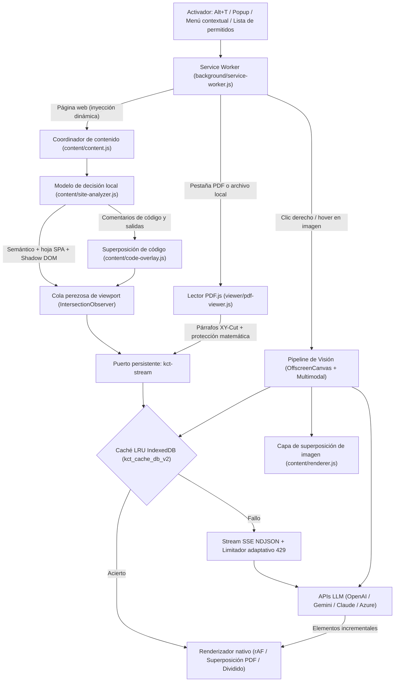
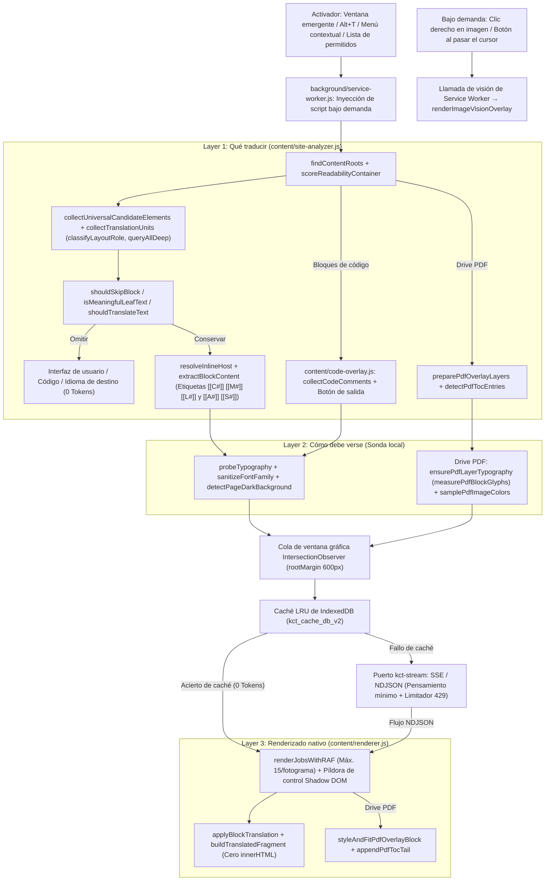

# NativeRead

[English](README.md) · [繁體中文](README.zh-TW.md) · [简体中文](README.zh-CN.md) · [日本語](README.ja.md) · [한국어](README.ko.md) · **Español** · [Français](README.fr.md) · [Deutsch](README.de.md)

**NativeRead (v2.6.1)** es una extensión de navegador Manifest V3 y una PWA móvil que traduce páginas web, PDFs, comentarios de código e infografías integradas preservando la tipografía y el diseño originales de la página. Permanece silenciosa por defecto, se ejecuta bajo demanda con tu propia clave de API de LLM y transmite las traducciones párrafo por párrafo en streaming sin interrumpir el ritmo de lectura.

---

## 1. Descripción general del producto e inicio rápido

### Capacidades principales

| Característica | Cómo funciona | Experiencia de lectura |
| --- | --- | --- |
| **Traducción web silenciosa por defecto** | Cero `content_scripts` estáticos; se inyecta dinámicamente mediante `chrome.scripting` bajo demanda (`Alt+T`, botón del popup, menú contextual o lista de permitidos por sitio `autoTranslateHosts`). | Cero sobrecarga, cero interfaz flotante y cero consumo de API en los sitios que no traduces. |
| **Lector PDF.js integrado** | Incluye `PDF.js` local bajo licencia Apache-2.0 (`vendor/pdfjs/`) dentro de `viewer/pdf-viewer.html`; admite PDFs remotos, enlaces de Google Drive y arrastrar y soltar `.pdf` locales. | Alterna entre los modos **Superpuesto**, **Dividido** y **Original** (`1` / `2` / `3`); las figuras, tablas y ecuaciones en bloque permanecen intactas. |
| **Superposición en página para PDFs de Google Drive** | Detecta las capas del visor `.ndfHFb-c4YZDc-cYSp0e-DARUcf` en el sitio, fusiona cuadros de texto de la misma columna, reconstruye los puntos de relleno del índice (TOC) y mide las métricas nativas de los glifos desde los rásteres de página. | Traduce PDFs de Drive de múltiples páginas directamente dentro de Google Drive sin salir de la pestaña. |
| **Superposición de imágenes e infografías bajo demanda** | Estrictamente bajo demanda mediante clic derecho (**NativeRead Translate Image Text**) o píldora flotante (**譯圖**) en imágenes `>= 200x140` px; nunca escanea automáticamente las imágenes de la página. | Reemplaza los bloques de texto en su lugar usando colores de fondo y primer plano muestreados mientras preserva diagramas 3D e ilustraciones. |
| **Comentarios de código y salidas de Notebook** | Intercambio CSS no destructivo con `attr()` para bloques `<pre>` estáticos (Pygments, Prism, Highlight.js, `.pl-c` de GitHub), superposición de solo lectura para CodeMirror 6 (`.cm-editor`) y botones de traducción rápida en salidas de Jupyter. | El código sigue siendo editable y ejecutable; las superposiciones se ocultan automáticamente al enfocar un editor o cambiar al modo original. |
| **Móvil y multiplataforma** | Incluye una PWA móvil independiente (`docs/`), un Userscript universal (`docs/nativeread.user.js`), un ZIP de extensión para Android (`docs/nativeread-android-extension.zip`) y sincronización local `#nr_sync` mediante código QR. | Flujo completo de traducción en iOS Safari y navegadores Android sin volver a escribir claves de API. |

### Inicio rápido (Extensión de escritorio)

Requiere Chromium 119+ (Chrome, Edge, Brave o navegadores compatibles).

1. Clona el repositorio:
   ```bash
   git clone https://github.com/Chih-Kai-Wang/native-read.git
   ```
2. Abre `chrome://extensions/` (o `edge://extensions/`) y habilita el **Modo de desarrollador**.
3. Haz clic en **Cargar descomprimida** y selecciona el directorio `native-read` clonado.
4. Haz clic en el icono de **NativeRead** en la barra de herramientas → **Options**, elige un proveedor de modelos, introduce tu clave de API, haz clic en **Fetch model list** y selecciona un modelo, luego haz clic en **Test Connection** y guarda.
5. Activa la traducción en cualquier página web o pestaña de PDF con **`Alt+T`** (**⌥ Option+T** en macOS; el popup muestra tu atajo configurado, personalizable en `chrome://extensions/shortcuts`), el botón del popup o el menú contextual. Haz clic en `☆` / `★` en el popup o en la píldora flotante para añadir o quitar el dominio actual de tu lista de traducción automática.

### Proveedores de modelos compatibles

Configurados en `shared/config.js` (`PROVIDER_PRESETS`) como un registro basado en datos de 32 preajustes repartidos en cuatro grupos (renderizados con `<optgroup>` en Opciones y en la PWA, donde `scripts/build-mobile.js` genera `docs/providers.js` desde la misma fuente). Los usuarios pueden obtener los modelos disponibles en vivo desde el endpoint configurado; los endpoints locales (`localhost`, `127.0.0.1`, `0.0.0.0`) no requieren clave de API, y cualquier otro servicio compatible con OpenAI funciona mediante `custom`.

| Grupo | ID del proveedor | Protocolo | URL base |
| --- | --- | --- | --- |
| Nativo | `gemini` | Gemini Native | `https://generativelanguage.googleapis.com/v1beta` |
| Nativo | `anthropic` | Anthropic Messages | `https://api.anthropic.com/v1` |
| Internacional | `openai` | OpenAI | `https://api.openai.com/v1` |
| Internacional | `azure` | OpenAI (api-key header) | `https://YOUR-RESOURCE.openai.azure.com/openai/v1` |
| Internacional | `openrouter` | OpenAI | `https://openrouter.ai/api/v1` |
| Internacional | `groq` | OpenAI | `https://api.groq.com/openai/v1` |
| Internacional | `mistral` | OpenAI | `https://api.mistral.ai/v1` |
| Internacional | `xai` | OpenAI | `https://api.x.ai/v1` |
| Internacional | `together` | OpenAI | `https://api.together.xyz/v1` |
| Internacional | `fireworks` | OpenAI | `https://api.fireworks.ai/inference/v1` |
| Internacional | `cerebras` | OpenAI | `https://api.cerebras.ai/v1` |
| Internacional | `deepinfra` | OpenAI | `https://api.deepinfra.com/v1/openai` |
| Internacional | `huggingface` | OpenAI | `https://router.huggingface.co/v1` |
| Internacional | `novita` | OpenAI | `https://api.novita.ai/openai` |
| Internacional | `deepseek` | OpenAI | `https://api.deepseek.com/v1` |
| Internacional | `qwen-intl` | OpenAI | `https://dashscope-intl.aliyuncs.com/compatible-mode/v1` |
| Internacional | `moonshot-intl` | OpenAI | `https://api.moonshot.ai/v1` |
| Internacional | `zai` | OpenAI | `https://api.z.ai/api/paas/v4` |
| Internacional | `minimax-intl` | OpenAI | `https://api.minimax.io/v1` |
| Internacional | `siliconflow-intl` | OpenAI | `https://api.siliconflow.com/v1` |
| China continental | `qwen` | OpenAI | `https://dashscope.aliyuncs.com/compatible-mode/v1` |
| China continental | `moonshot` | OpenAI | `https://api.moonshot.cn/v1` |
| China continental | `zhipu` | OpenAI | `https://open.bigmodel.cn/api/paas/v4` |
| China continental | `siliconflow` | OpenAI | `https://api.siliconflow.cn/v1` |
| China continental | `volcengine` | OpenAI | `https://ark.cn-beijing.volces.com/api/v3` |
| China continental | `qianfan` | OpenAI | `https://qianfan.baidubce.com/v2` |
| China continental | `hunyuan` | OpenAI | `https://api.hunyuan.cloud.tencent.com/v1` |
| China continental | `minimax` | OpenAI | `https://api.minimaxi.com/v1` |
| China continental | `stepfun` | OpenAI | `https://api.stepfun.com/v1` |
| Local y personalizado | `ollama` | OpenAI | `http://localhost:11434/v1` |
| Local y personalizado | `lmstudio` | OpenAI | `http://localhost:1234/v1` |
| Local y personalizado | `custom` | OpenAI | `http://localhost:11434/v1` |

- **Selección de modelo y lista en vivo**: `gemini` es el proveedor predeterminado y solo `gemini` (`gemini-3.5-flash-lite`), `anthropic` (`claude-opus-5-5`) y `openrouter` (`google/gemini-2.5-flash`) conservan un modelo predeterminado; todos los demás preajustes comienzan vacíos para que puedas elegir mediante **Fetch model list** (`LIST_MODELS` consulta `GET /v1beta/models` de Gemini con `generateContent`, `GET /v1/models` de Anthropic con paginación `after_id`, o `GET {baseUrl}/models` compatible con OpenAI), advirtiendo si el modelo actual no está en la lista, pidiendo elegir un modelo antes de traducir o probar cuando está vacío, y sugiriendo volver a elegir ante errores 400/404/410/422 de modelo no encontrado o obsoleto sin sobrescribir la configuración guardada.
- **Anthropic Claude (`anthropic`)**: Utiliza la API nativa de Messages en la extensión, Userscript y PWA (streaming SSE, traducción por lotes/individual, Test Connection y traducción de imágenes bajo demanda mediante bloques de imagen en base64), con los modelos sugeridos `claude-sonnet-5-5` y `claude-haiku-5-5`, y verifica `stop_reason` para que los rechazos se muestren como errores claros.
- **Azure OpenAI (`azure`)**: Admite endpoints `*.openai.azure.com`, `*.services.ai.azure.com` y `*.cognitiveservices.azure.com`; introduce el nombre de tu despliegue en el campo del modelo (excluido de la lista de modelos en vivo) y la clave de API se enviará automáticamente en la cabecera `api-key`.
- **Nota de verificación**: Cada URL base preestablecida alojada (todas excepto la plantilla de `azure` y los endpoints locales `ollama` / `lmstudio` / `custom`) se probó en vivo para comprobar la disponibilidad del endpoint, mientras que la compatibilidad de solicitud/respuesta con Anthropic Claude y Azure OpenAI se verificó mediante pruebas de fixtures sin conexión (endpoint, cabeceras, cuerpo de la solicitud y análisis de respuesta/stream) y aún no se ha probado contra las APIs en vivo.
- **Idiomas de destino**: `zh-TW` (predeterminado), `zh-CN`, `ja`, `ko`, `es`, `fr`, `de`, `vi`, `pt`, además de prompts de idioma personalizados.
- **Esfuerzo de razonamiento (`thinkingEffort`)**: `fastest` (predeterminado), `balanced` o `deep`. Mapea automáticamente Gemini 3.x/4.x a `thinkingLevel` (`MINIMAL` / `LOW` / `MEDIUM`), Gemini 2.5 Flash a `thinkingBudget` (`0` / `512` / `2048`), OpenAI `o1`/`o3`/`o4` a `reasoning_effort: "low"`, DashScope `qwen3` a `enable_thinking: false` en modo `fastest` eliminando las partes `thought` de las respuestas, y Anthropic Claude a `output_config.effort` (`low` / `medium` / `high`) en los modelos compatibles sin enviar `temperature`, `top_p`, `top_k` ni configuración de thinking.

### Soporte móvil y multiplataforma

- **PWA móvil (`https://chih-kai-wang.github.io/native-read/`)**: Instalable en la pantalla de inicio en iOS Safari y Android Chrome. Incluye un lector PDF.js móvil (superpuesto / dividido / original, con resolución de enlaces de Google Drive, tiempo de espera de descarga completa de 15 s y un botón alternativo para «abrir PDF en una pestaña nueva»), un traductor de URL web y texto pegado directamente, traducción en streaming en los proveedores compatibles incluido Claude, un App Shell sin conexión (`docs/sw.js`) y caché local en IndexedDB.
- **Userscript universal (`https://chih-kai-wang.github.io/native-read/nativeread.user.js`)**: Funciona en iOS Safari (mediante *Stay* o *Userscripts*) y navegadores Android (*Tampermonkey*, *Lemur*, *Kiwi*, *Firefox*). Inyecta una pestaña lateral arrastrable `NR` en Shadow DOM y recurre a `GM_xmlhttpRequest` cuando las políticas CSP estrictas de la página bloquean `fetch`.
- **ZIP de extensión para Android (`https://chih-kai-wang.github.io/native-read/nativeread-android-extension.zip`)**: Paquete MV3 completo para navegadores Android basados en Chromium (*Lemur*, *Kiwi*, *Quetta*, *Edge Android*) con traducción por selección táctil (`touchend` / `selectionchange`).
- **Sincronización local `#nr_sync` mediante código QR**: Genera un enlace de sincronización y un código QR en la página Options de escritorio; al escanearlo en el móvil se importan tu proveedor, clave de API, modelo y preferencias en la PWA, el Userscript o la extensión de Android, y se borra inmediatamente el fragmento de la URL.

### Actualizaciones

- **Userscript**: Incluye `@updateURL` (`docs/nativeread.meta.js`), `@downloadURL` (`docs/nativeread.user.js`), `@homepageURL` y `@supportURL` para que Tampermonkey, Violentmonkey y Stay puedan actualizarse automáticamente.
- **PWA móvil**: Utiliza una caché de Service Worker versionada (`nativeread-pwa-v<version>`). Cuando un nuevo Service Worker toma el control de una página abierta, aparece un banner de actualización y al recargar se aplica la nueva versión.
- **Extensión de escritorio (descomprimida) y ZIP de extensión para Android**: Al abrirse, el popup de la extensión consulta `version.json` en GitHub Pages (como máximo una vez cada 24 horas; configurable mediante `checkForUpdates` en Options) y muestra `有新版本 vX（目前 vY）/ 查看更新` con enlace al README de GitHub cuando hay una versión más reciente disponible. Dado que estas instalaciones no están gestionadas por una tienda web, la actualización sigue requiriendo reinstalación manual (hacer pull del último repositorio y recargar, o volver a importar el ZIP de Android actualizado).

---

## 2. Arquitectura técnica



### 2.1 Modelo de decisión local de latencia cero

Toda la segmentación de página, el filtrado y las decisiones tipográficas se ejecutan localmente en `content/site-analyzer.js` y `content/renderer.js` sin llamadas adicionales al LLM:

NativeRead ejecuta una única canalización local universal de tres capas —sin bifurcaciones ni adaptadores por sitio— para decidir qué traducir, igualar la tipografía nativa y renderizar flujos sin interrupciones con cero llamadas adicionales al LLM.



- **Detección de contenido principal (`findContentRoots`, `scoreReadabilityContainer`)**: Prioriza celdas de Jupyter/notebook integradas (`LESSON_CELL_SELECTOR`), páginas del visor PDF de Google Drive (`.ndfHFb-c4YZDc-cYSp0e-DARUcf`) y contenedores semánticos (`article`, `main`, `[role="main"]`, `.markdown-body`, `.prose`, `#mw-content-text`). Los contenedores se puntúan mediante `textLen + pCount * 40`, se penalizan cuando `linkRatio > 0.55`, reciben un impulso de `1.25x` para contenedores de artículos/documentación y se refinan hacia contenedores internos más ajustados cuando conservan `>= 65%` del texto. Se preservan los encabezados superiores `#firstHeading` / `h1`.
- **Segmentación basada en el modelo de diseño (`collectUniversalCandidateElements`, `collectTranslationUnits`, `classifyLayoutRole`)**: La segmentación ya no adivina las unidades de traducción a partir de los nombres de etiqueta; `collectTranslationUnits` (invocada por `collectUniversalCandidateElements`) sigue el modelo de formato CSS, tratando el contenido en línea en flujo (in-flow) de un contenedor de bloque (un contexto de formato en línea) como una única unidad de traducción.
  - *Clasificación de rol de diseño (`classifyLayoutRole`)*: Clasifica cada elemento a partir de `getComputedStyle` (almacenado en caché una vez por elemento y escaneo) como `BOX` (nivel de bloque o elemento flex/grid), `INLINE` (inline, inline-block…), `CONTENTS` (`display: contents`, transparente) o `OUT` (no renderizado, `visibility: hidden`, texto para lectores de pantalla oculto visualmente, cajas flotantes o con posicionamiento absoluto/fijo, controles de formulario, fuentes de iconos). El contenido oculto (`display: none`, oculto visualmente) no se envía a traducir, mientras que los elementos flotantes y las cajas posicionadas con prosa real se recorren como sus propios contenedores.
  - *Aislamiento de celdas, secuencias mixtas y contenido en línea atómico*: Los contenedores cuyo texto se encuentra en celdas contiguas (p. ej., una fila de foro: título | autor | votos | número de comentarios) nunca se fusionan en una sola oración; cada celda se convierte en su propia unidad. Los contenedores con texto junto a un hijo de bloque se dividen en secuencias (runs): una secuencia que es un único elemento en línea se convierte en una unidad, mientras que el texto suelto junto a un bloque se deja sin traducir en lugar de envolver nodos de texto propiedad de la página (contabilizado como `mixedSkipped` en `getLastSegmentationStats`). El contenido en línea atómico (`code`, fórmulas, citas) nunca divide un párrafo, incluso cuando una fórmula en bloque usa `display: block`.
  - *Referencia heredada*: El escaneo anterior en dos pasadas se conserva como `collectUniversalCandidateElementsLegacy` únicamente para comparación.
- **Recorrido de Shadow DOM (`queryAllDeep`, `ensureShadowModeStyle`)**: Recorre árboles `shadowRoot` abiertos hasta una profundidad de 5 omitiendo editores de código y nodos de UI (`SHADOW_SKIP_SELECTOR`), e inyecta reglas `:host-context(html.kct-mode-*)` para que el cambio entre Reemplazar / Original / Bilingüe funcione dentro de Shadow DOM.
- **Estructura en línea y tokens de protección (`extractBlockContent`, `buildTranslatedFragment`, `resolveInlineHost`, `validateTranslatedTokens`)**: Emite los tokens atómicos `[[C#]]` (código en línea `code, kbd, var`), `[[M#]]` (fórmulas matemáticas y citas `.katex, .MathJax, mjx-container, math, .mwe-math-element, sup.reference`) y `[[L#]]` (enlaces `<a href>` no traducibles como identificadores, URL o marcadores de citas), además de las etiquetas emparejadas `[[A#]]…[[/A#]]` (enlaces traducibles clicables) y `[[S#]]…[[/S#]]` (énfasis en línea: bold/strong/italic/em/u/mark/s/small/sub/sup); `buildTranslatedFragment` restaura los tokens atómicos como clones profundos (`cloneNode(true)`) y las etiquetas emparejadas como clones superficiales (`cloneNode(false)`, conservando `href`/`class` y eliminando `id`) dentro de un `DocumentFragment`. Cuando el texto de un bloque reside dentro de una única cadena en línea (p. ej. `li > a > b`), `resolveInlineHost` desciende hasta ella para que la traducción se renderice dentro del enlace o énfasis original sin depender del modelo. Antes de renderizar, `validateTranslatedTokens` verifica que cada marcador aparezca una vez con etiquetas emparejadas equilibradas y correctamente anidadas; de lo contrario, el bloque se renderiza con `data-kct-structure-fallback="1"`, manteniendo visible el original clicable junto a la traducción en lugar de perder enlaces silenciosamente.
- **Preservación de estilos y hosts flex/grid (`[[S#]]`, `.kct-trans-wrap`, `resolveInlineHost`, `data-kct-flex-host`)**: Cualquier elemento en línea que se vea diferente de su padre (tamaño de fuente, peso, estilo o familia, color, decoración, un encabezado en línea o una etiqueta solo para lectores de pantalla) se conserva como una etiqueta emparejada `[[S#]]`. La tipografía que cada elemento conservado tenía en su posición original se registra durante la extracción y se vuelve a aplicar a su clon si el CSS del sitio (p. ej., selectores de hijos como `.titleline > a`) deja de coincidir dentro de `.kct-trans-wrap`. Además, `resolveInlineHost` nunca desciende dentro de contenedores flex/grid, y un host flex/grid mantiene toda la traducción en una sola celda de diseño (`data-kct-flex-host`). Nunca se descarta ni se fusiona nada visible: el contenido en línea renderizado pero intraducible (iconos, fuentes de iconos, elementos visuales `aria-hidden`, imágenes, elementos dibujados con CSS) y los descendientes de nivel de bloque o fuera del flujo se mantienen en su lugar como tokens atómicos `[[C#]]` (el modo bilingüe oculta las copias multimedia duplicadas), los controles activos y los medios (entradas, botones, `video`, `canvas`, `iframe`, `slot`s asignados) nunca pasan a formar parte de una unidad de traducción, el texto oculto (`display: none`, `visibility: hidden`, etiquetas solo para lectores de pantalla) nunca se envía y una unidad nunca contiene otra unidad.
- **Filtrado de idioma (`shouldTranslateText`)**: Filtra URLs, correos electrónicos, rutas de archivos, prompts `In[]`/`Out[]` de Jupyter, identificadores de código ASCII de un solo token y texto ya escrito en el idioma de destino usando proporciones de escritura Unicode (para `zh-TW`/`zh-CN`, omite una proporción Han `>= 0.55` con `< 6` palabras latinas, mientras sigue traduciendo texto japonés con proporción Kana `>= 0.12`).
- **Emparejamiento tipográfico (`probeTypography`, `detectRenderedSerif`, `sanitizeFontFamily`, `content/content.css`)**: Clasifica cada bloque como `serif`, `sans` o `mono` a partir del `fontFamily` computado —y cuando una fuente del sitio no se reconoce por su nombre (p. ej. la fuente web `CMS` Computer Modern que declara un respaldo `sans-serif`), `detectRenderedSerif` dibuja `"I"` en un lienzo para comprobar si tiene gracias (en caché por familia) y así asignar fuentes CJK con gracias a sitios serif—, luego elimina las familias genéricas de CSS (`serif`, `sans-serif`, `monospace`, `system-ui`, etc.) para que permanezcan hasta 5 fuentes latinas específicas del sitio en `--kct-orig-font`, y añade la pila correspondiente al idioma de destino (`var(--kct-orig-font), var(--kct-font-serif|sans|mono)`). Los bloques de prosa densos sin límite de líneas con `lineHeight / fontSize < 1.62` reciben un aumento selectivo a `line-height: 1.72` (`data-kct-lh-lift="1"`).

### 2.2 Pipelines duales de diseño nativo para PDF

NativeRead mantiene dos pipelines especializados para PDF adaptados a cómo se renderizan los PDFs en el navegador:

| Etapa | Lector PDF.js integrado (`viewer/pdf-viewer.js`) | Superposición en página de Google Drive (`site-analyzer.js` + `renderer.js`) |
| --- | --- | --- |
| **Fuente de texto y geometría** | `pdfPage.getTextContent()` transformado a coordenadas CSS del viewport; omite texto rotado (`\|angle\| > 0.25`). | Nodos `<p>` ocultos posicionados en porcentaje dentro de `.ndfHFb-c4YZDc-cYSp0e-DARUcf-Df1ZY-bN97Pc-haAclf`. |
| **Agrupación de columnas y párrafos** | Agrupación de filas por línea base, absorción geométrica de superíndices/subíndices, división de columnas por medianiles contiguos, eliminación de guiones y orden de lectura XY-Cut recursivo (Y-Cut → X-Cut → división de elementos que cruzan valles X internos). | Fusión de misma columna entre grupos (`leftDiff <= 3.6%`, `hRatio <= 0.36`), eliminación de guiones y limitación de altura segura `nearestBelowTop`; los nodos `<p>` absorbidos se ocultan mediante `data-kct-pdf-merged="absorbed"`. |
| **Manejo de matemáticas e índices (TOC)** | Omite ecuaciones en bloque (`isDisplayedMathBlock`), protege matemáticas en línea con `[[M#]]` y normaliza LaTeX filtrado a Unicode (`cleanLatexMathInText`). | `detectPdfTocEntries` detecta `>= 3` filas de índice alineadas a la derecha (dentro de `1.2%`), traduce solo los títulos y reconstruye filas flex nativas con puntos de relleno CSS (`.kct-pdf-toc-leader`) y números de página tabulares. |
| **Tipografía y tamaño de peso** | Lee los metadatos de fuente del PDF (`isSerif`, `isBold`, `isItalic`, `isMono`, `isMathFont`) desde `styles` y `commonObjs`. | `ensurePdfLayerTypography` mide bandas de tinta de altura x (`0.53` latín / `0.88` CJK) y proporciones de trazo (`>= 1.3x` mediana = negrita) directamente desde los rásteres `` de página, agrupando tamaños casi iguales (tolerancia `1.08x`) a una mediana compartida. |
| **Color y protección contra colisiones** | Un único `ctx.getImageData` por página muestrea la mediana perimetral `bg` + `fg` con contraste WCAG; `refineMaxHeightWithCanvasInk` escanea debajo de cada párrafo para evitar solapar figuras/reglas y detecta etiquetas compactas de diagramas. | `samplePdfImageColors` muestrea la mediana perimetral `bg` y `fg` ajustado por contraste desde cada `` de página (vinculado a `img.currentSrc \|\| img.src`), con halo `box-shadow` de `2px` y expansión `:hover`. |
| **Modos de visualización** | **Superpuesto**, **Dividido** (lienzo + tarjetas traducidas), **Original**, además de popover de comparación al hacer clic. | **Reemplazar**, **Original** y **Bilingüe** (superposición compacta en el sitio que se expande en una tarjeta bilingüe al pasar el cursor). |

### 2.3 Pipeline multimodal de superposición de imágenes bajo demanda

1. **Activación explícita del usuario**: Se activa únicamente cuando el usuario hace clic derecho en una imagen (**NativeRead 翻譯圖片文字**) o hace clic en la píldora flotante (**譯圖**) sobre imágenes de contenido `>= 200x140` px (excluyendo nav/header/footer y rásteres de página de PDF de Google Drive).
2. **Descarga en segundo plano y reducción de escala (`background/service-worker.js`)**: `prepareImagePayloadForVision` descarga imágenes `http(s):` desde el Service Worker (evitando la contaminación CORS del Canvas de la página; límite de 16 MB, tiempo de espera de 20 s, detección de MIME por bytes mágicos) o acepta URLs `data:` para imágenes locales/blob. Mediante `createImageBitmap` + `OffscreenCanvas`, crea un búfer de muestra que preserva el canal alfa de `~480px` y recodifica imágenes que superen `1600px` o `4 MB`.
3. **Inferencia de Visión estructurada, refinamiento de tinta y muestreo de color**: `callVisionImageLLM` envía una única solicitud multimodal (Gemini `inlineData`, OpenAI `image_url` o bloque `image` en base64 de Anthropic Messages; tiempo de espera de 60 s, usando siempre al menos el nivel de razonamiento `balanced` para obtener cuadros más fiables) devolviendo `{"blocks":[{"box_2d":[ymin,xmin,ymax,xmax],"text":"...","role":"title|badge|body"}]}` en coordenadas 0–1000. `refineImageBoxToInk` expande cada cuadro por lado como máximo `~0.6 ×` una altura de línea para cubrir bordes de glifos cortados mientras puentea solo el espaciado entre letras y se detiene ante bordes sólidos o bordes de ilustración. `sampleImageBoxColors` calcula el `bg` modal perimetral y el `fg` interior verificado por WCAG para cada cuadro, elimina espacios/saltos de línea sueltos entre caracteres CJK y almacena el resultado en IndexedDB bajo claves versionadas `img:v4:` tanto por resumen SHA-256 como por URL normalizada.
4. **Renderizado de superposición en el sitio (`content/renderer.js`)**: `renderImageVisionOverlay` envuelve el `` en `.kct-img-overlay-host`, alinea `.kct-img-overlay-layer` a las dimensiones exactas de la imagen, coloca cada bloque con reducción adaptativa de fuente (`fitVisionOverlayBlock`) unificando el tamaño de fuente entre etiquetas del mismo rol (`title` / `badge` / `body`), y permite a los usuarios alternar **原圖 / 顯示譯圖** bajo demanda.

### 2.4 Streaming, carga perezosa en viewport, limitación de tasa y caché LRU

- **Streaming SSE / NDJSON y respaldo resiliente**: Los scripts de contenido y el visor PDF se conectan mediante un puerto persistente `kct-stream`. El Service Worker transmite líneas SSE NDJSON de Gemini (`:streamGenerateContent?alt=sse`), OpenAI (`stream: true`) o Anthropic Messages (`{"i":0,"t":"..."}`), analizadas incrementalmente mediante `createIncrementalJsonScanner`. Los elementos faltantes o streams interrumpidos recurren a JSON por lotes (`TRANSLATE_BATCH`) con bisección recursiva (`translateItemsWithFallback`, hasta profundidad 3).
- **Micro-lotes rAF y carga perezosa en viewport**: Las traducciones web en streaming se vacían mediante `renderJobsWithRAF` en porciones de hasta `15` elementos por fotograma de animación (`scheduler.yield()` entre porciones cuando es compatible). Los bloques fuera de pantalla se difieren mediante `IntersectionObserver` (`rootMargin: 600px 0px` para web; `500px 0px` para PDF.js), encolados primero por viewport con hasta `3` workers de lote concurrentes (`batchSize: 20`, `maxBatchChars: 5500`).
- **Limitador adaptativo de tasa 429 entre marcos**: `background/service-worker.js` aplica un límite global de concurrencia de `3` entre marcos. Ante un HTTP `429`, analiza `Retry-After` / `retryDelay`, activa una ventana de ritmo adaptativo de 90 s (concurrencia `1`, intervalo entre solicitudes de `4.3s`) más enfriamiento global, y separa el agotamiento de cuota diaria/cero (`QUOTA_EXCEEDED`) de los límites temporales de RPM (`RATE_LIMITED`).
- **Caché LRU en IndexedDB (`shared/cache-db.js`)**: Almacena hasta `20,000` entradas en `kct_cache_db_v2` (almacén `entries`, indexado por `ts`), con clave `protocol:model:thinkingEffort:targetLang:customLang:glossaryHash`. Los aciertos de caché actualizan `ts` con debounce (umbral de `60s`, debounce de `250ms`) para que el desalojo por desbordamiento elimine los registros menos usados recientemente.

### 2.5 Estructura del proyecto

```text
native-read/
├── manifest.json                 # Manifiesto MV3, fuente de verdad de versión, permisos, comando Alt+T
├── shared/
│   ├── config.js                 # Configuración de Schema v5, registro de 32 proveedores (PROVIDER_PRESETS), configuración de pensamiento, utilidades de URL/PDF
│   ├── cache-db.js               # Caché LRU IndexedDB kct_cache_db_v2 de 20,000 entradas
│   └── pdf-layout.mjs            # Motor puro de geometría PDF, protección matemática/LaTeX, detección serif Computer Modern y anti-eco
├── background/
│   └── service-worker.js         # Inyector dinámico, streamer SSE/NDJSON, limitador 429, motor de Visión, guardia #nr_sync
├── content/
│   ├── site-analyzer.js          # Modelo de decisión local (Readability, SPA 2 pasadas, Shadow DOM, fusión/TOC PDF Drive)
│   ├── code-overlay.js           # Intercambio de comentarios <pre> estáticos, superposición CodeMirror 6, traductor de salidas Jupyter
│   ├── renderer.js               # Renderizador DOM seguro, emparejamiento tipográfico, métricas ráster PDF Drive, superposiciones de imagen
│   ├── content.js                # Cola perezosa de viewport, cliente kct-stream, UI Shadow DOM píldora/selección/imagen
│   └── content.css               # Modos Reemplazar/Original/Bilingüe, pilas de fuentes, estilos de superposición PDF Drive e imagen
├── viewer/                       # Lector PDF.js integrado (pdf-viewer.html / .css / .js)
├── popup/                        # Controles del popup de la extensión, alternador de lista de permitidos, aviso de actualización, lanzador PDF
├── options/                      # Página de ajustes, config de proveedor/modelo, glosario, sincronización QR local, controles de caché
├── icons/                        # Iconos de la extensión (16 / 48 / 128 px)
├── scripts/
│   └── build-mobile.js           # Estampa la versión; genera Userscript, meta.js, version.json, ZIP Android, PDF.js/iconos
├── docs/                         # PWA móvil en GitHub Pages (index.html, app.js, app.css, sw.js, providers.js y paquetes generados)
├── tests/                        # Fixtures de regresión sin conexión (incluye tests/fixtures/inline-structure/ para preservación de enlaces/énfasis)
├── LICENSE                       # Licencia MIT
└── README*.md                    # Documentación multilingüe de producto, arquitectura y seguridad
```

---

## 3. Privacidad y arquitectura de seguridad

| Área | Implementación |
| --- | --- |
| **Almacenamiento local** | Los ajustes y claves de API de la extensión residen únicamente en `chrome.storage.local` (`kct_settings_v1`); los de la PWA en `localStorage`; los del Userscript en `GM_getValue`/`GM_setValue` (con respaldo en `localStorage`). Las cachés de traducción residen localmente en IndexedDB (`kct_cache_db_v2`) y pueden borrarse en cualquier momento. |
| **Endpoints de red** | El tráfico de la extensión y del Userscript va directamente a tu endpoint de LLM configurado—incluidos `api.anthropic.com` o hosts de Azure OpenAI cuando se seleccionan—con las claves de API colocadas estrictamente en cabeceras HTTP (`x-goog-api-key`, `Authorization: Bearer`, `x-api-key` + `anthropic-version: 2026-10-21` + `anthropic-dangerous-direct-browser-access: true` para Anthropic, o `api-key` para Azure) y redactadas en los mensajes de error (`redactApiKey`). Los PDFs remotos y las imágenes bajo demanda se descargan directamente desde sus URLs de origen mediante el Service Worker. |
| **Comprobación de actualizaciones** | Al abrir el popup de la extensión (y si `checkForUpdates` está habilitado, activado por defecto), consulta `https://chih-kai-wang.github.io/native-read/version.json` como máximo una vez cada 24 horas (almacenado en caché en `chrome.storage.local` bajo `nr_update_check_v1`, tiempo de espera de 5 s, `credentials: 'omit'`, sin permisos adicionales ni temporizadores en segundo plano). La carga útil JSON se valida estrictamente y nunca se usa como URL; el enlace de actualización está codificado de forma fija al README de GitHub. Desmarca `checkForUpdates` en Options para desactivarlo por completo. |
| **Lista de modelos** | Al hacer clic en **Fetch model list** en Options se envía `LIST_MODELS` (solo extensión, `isExtensionSender`) directamente al proveedor configurado (`GET /v1beta/models`, `GET /v1/models` o `GET {baseUrl}/models`; tiempo de espera de 10 s, Azure excluido) y se almacenan en caché únicamente los ID de modelo devueltos (nunca la clave de API, máximo 20 endpoints) en `chrome.storage.local` bajo `nr_model_list_v1`. |
| **Manejo del fragmento `#nr_sync`** | Las cargas útiles de sincronización residen exclusivamente en el fragmento `#` de la URL (nunca en `?query`), el cual los navegadores no transmiten en solicitudes HTTP. `background/service-worker.js` acepta `#nr_sync` únicamente desde el origen de la extensión o `https://chih-kai-wang.github.io/native-read`, rechaza mutaciones de endpoint (`baseUrl` / `protocol` / `providerId`) a menos que se incluya un `apiKey` explícito, valida los esquemas `http:`/`https:` y borra inmediatamente el fragmento con `history.replaceState`. |
| **Seguridad DOM sin `innerHTML`** | Todas las cadenas traducidas, popovers y superposiciones se escriben mediante `document.createTextNode` y `.textContent`. Los marcadores de posición atómicos (`[[C#]]`, `[[M#]]`, `[[L#]]`) restauran únicamente nodos DOM preexistentes clonados, las etiquetas emparejadas (`[[A#]]`, `[[S#]]`) reconstruyen solo clones superficiales (`cloneNode(false)`) de elementos preexistentes, y la guarda de estructura `validateTranslatedTokens` mantiene visible el original en caso de discrepancia para que nunca se pierda un enlace. |
| **Endurecimiento MV3 CSP y PDF.js** | PDF.js se empaqueta localmente con `isEvalSupported: false` tanto en `viewer/pdf-viewer.js` como en `docs/app.js`. Las acciones privilegiadas del Service Worker (`ENSURE_AND_COMMAND`, `TEST_CONNECTION`, `LIST_MODELS`, `OPEN_PDF_VIEWER`, `GET_SW_DEBUG`, `CLEAR_CACHE`) exigen `isExtensionSender(sender)`. |
| **Aislamiento de UI y QR** | Las píldoras flotantes, popovers de selección, activadores al pasar el cursor sobre imágenes y controles del Userscript están aislados dentro de Shadow DOM (`all: initial`). Los códigos QR de sincronización se generan localmente en la página Options sin llamar a servicios QR externos. |

> **Nota sobre la PWA móvil (`docs/app.js`)**: Para URLs de PDF, NativeRead resuelve enlaces de Google Drive y utiliza únicamente fetch directo del navegador (tiempo de espera de descarga completa de 15 s, sin relé `api.allorigins.win`, además de un botón alternativo para «abrir PDF en una pestaña nueva» y guía para archivos locales) de modo que las URLs/bytes de PDFs privados nunca se envíen a un relé de terceros. En la pestaña opcional **Web URL** de la PWA, la extracción de artículos públicos entre orígenes (`fetchReadableArticleFromUrl`) utiliza actualmente `r.jina.ai` (con respaldo `api.allorigins.win`); si necesitas cero relés de terceros en el móvil, pega el texto del artículo directamente en la pestaña Web o utiliza el Userscript / la extensión de Android en su lugar.

---

## Desarrollo

Compila los artefactos de distribución móvil y ejecuta comprobaciones de sintaxis en todos los archivos JavaScript:

```bash
node scripts/build-mobile.js
for f in shared/*.js background/*.js content/*.js popup/*.js options/*.js viewer/*.js scripts/*.js docs/app.js docs/sw.js docs/nativeread.user.js; do node --check "$f" || exit 1; done
```

`"version"` en `manifest.json` es la única fuente de verdad (`MAJOR.MINOR.PATCH`). Al ejecutar `node scripts/build-mobile.js` se valida la versión y se estampa en `@version` del Userscript, en `CACHE_NAME` de `docs/sw.js` (`nativeread-pwa-v<version>`) y en la insignia de la PWA en `docs/index.html`.

`docs/nativeread.user.js`, `docs/nativeread.meta.js`, `docs/version.json`, `docs/nativeread-android-extension.zip`, `docs/vendor/pdfjs/`, `docs/icons/` y `docs/.nojekyll` son generados por `scripts/build-mobile.js`—edita los módulos fuente bajo `shared/`, `content/`, `viewer/` y `docs/app.js`, y luego vuelve a ejecutar el script de compilación.

**Flujo de lanzamiento (mantenedores)**: incrementa `"version"` en `manifest.json` → ejecuta `node scripts/build-mobile.js` → haz commit y push para que GitHub Pages sirva la PWA, el Userscript, los metadatos, `version.json` y el ZIP de Android actualizados.

**Corpus de regresión (`tests/corpus/`)**: `capture.sh` toma instantáneas de páginas reales a través de ego-browser (serializando el DOM y el CSS desde `document.styleSheets`, mezclando cada palabra en una pseudopalabra de la misma longitud y reemplazando enlaces/imágenes; las instantáneas están ignoradas por git), mientras que `run.sh [git-rev]` renderiza cada instantánea más el archivo escrito a mano `fixtures/edge-cases.html` con un traductor ficticio 1:1 e informa, por página, invariantes independientes del segmentador: celdas fusionadas, cajas no en línea dentro de las traducciones, enlaces perdidos, tipografía modificada (`styleLost`), respaldos (fallbacks), expectativas `data-expect` no cumplidas, desbordamiento horizontal, recuento de unidades y cobertura. Reproduce el error de Kaggle de la v2.5.0 y pasa limpiamente en 8 sitios (Kaggle, Wikipedia, colah, MDN, Hacker News, Stack Overflow, GitHub, arXiv) con la v2.6.0.

---

## Hoja de ruta / Aún no compatible

- **Tiendas web de navegadores**: Aún no publicado en Chrome Web Store ni en Edge Add-ons; la instalación en escritorio requiere actualmente **Cargar descomprimida** sin actualizaciones automáticas de tienda.
- **Resolvedores de enlaces PDF en la nube**: Los enlaces PDF de Dropbox, OneDrive y Box aún no se convierten (los enlaces de Google Drive sí son compatibles).
- **Medios y formatos adicionales**: Sin traducción de subtítulos de vídeo, sin OCR para PDFs escaneados y sin soporte para documentos EPUB u Office.
- **Localización de la interfaz**: Las cadenas de la interfaz de la extensión y de la PWA están actualmente solo en chino tradicional.
- **Otros navegadores de escritorio**: Firefox y Safari de escritorio no cuentan con soporte oficial.

---

## Licencia

Publicado bajo la [Licencia MIT](LICENSE). El PDF.js incluido (`vendor/pdfjs/` y `docs/vendor/pdfjs/`) está bajo la Licencia Apache-2.0 (consulta [docs/vendor/pdfjs/LICENSE](docs/vendor/pdfjs/LICENSE)).