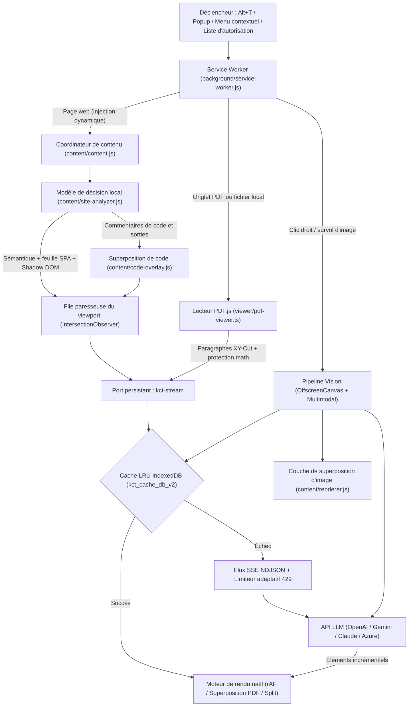
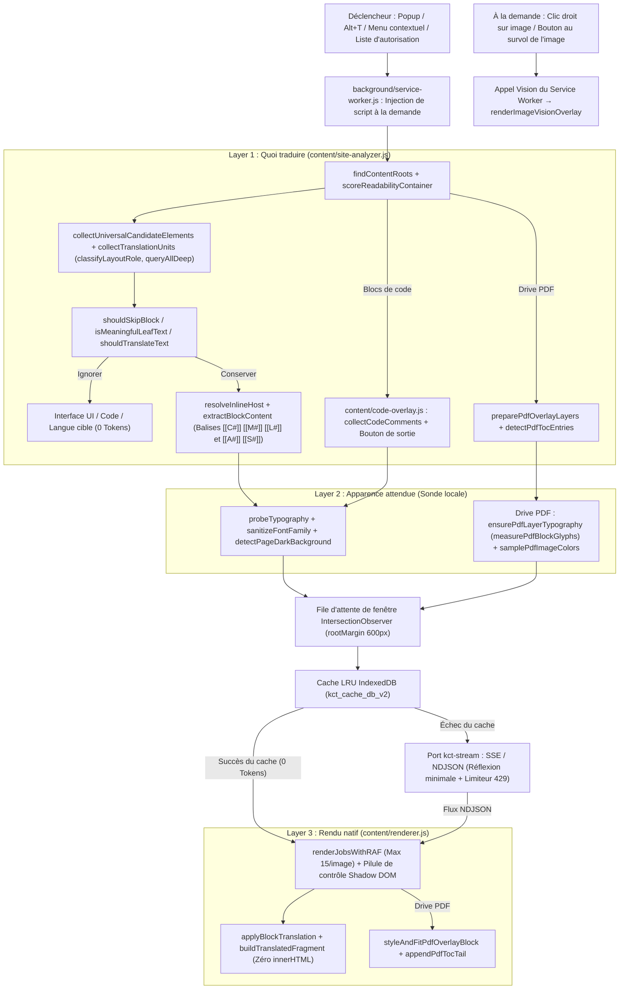

# NativeRead

[English](README.md) · [繁體中文](README.zh-TW.md) · [简体中文](README.zh-CN.md) · [日本語](README.ja.md) · [한국어](README.ko.md) · [Español](README.es.md) · **Français** · [Deutsch](README.de.md)

**NativeRead (v2.9.0)** est une extension Manifest V3, une app native iOS/macOS avec extension Safari, un APK natif Android et une PWA mobile qui traduit les pages web, les PDF, les commentaires de code et les infographies intégrées tout en préservant la typographie et la mise en page d'origine. Elle reste silencieuse par défaut, s'exécute à la demande avec votre propre clé API LLM et diffuse les traductions paragraphe par paragraphe sans interrompre le rythme de lecture.

---

## 1. Présentation du produit et démarrage rapide

### Fonctionnalités principales

| Fonctionnalité | Fonctionnement | Expérience de lecture |
| --- | --- | --- |
| **Traduction web silencieuse par défaut** | Aucun `content_scripts` statique ; injection dynamique via `chrome.scripting` à la demande (`Alt+T`, bouton de la popup, menu contextuel ou liste d'autorisation par site `autoTranslateHosts`). | Aucune surcharge, aucune interface flottante et aucune consommation d'API sur les sites que vous ne traduisez pas. |
| **Lecteur PDF.js intégré** | Embarque `PDF.js` local sous licence Apache-2.0 (`vendor/pdfjs/`) dans `viewer/pdf-viewer.html` ; prend en charge les PDF distants, les liens Google Drive et le glisser-déposer de `.pdf` locaux. | Basculez entre les modes **Overlay**, **Split** et **Original** (`1` / `2` / `3`) ; les figures, tableaux et équations affichées restent intacts. |
| **Superposition PDF Google Drive dans la page** | Détecte les couches du lecteur `.ndfHFb-c4YZDc-cYSp0e-DARUcf` sur place, fusionne les zones de texte d'une même colonne, reconstruit les points de suite des tables des matières et mesure les métriques natives des glyphes depuis les images raster de page. | Traduit les PDF Drive multipages directement dans Google Drive sans quitter l'onglet. |
| **Superposition d'images et d'infographies à la demande** | Uniquement à la demande via clic droit (**NativeRead Translate Image Text**) ou pastille au survol (**譯圖**) sur les images `>= 200x140` px ; ne scanne jamais automatiquement les images de la page. | Remplace les blocs de texte sur place en utilisant les couleurs d'arrière-plan et de premier plan échantillonnées tout en préservant les schémas 3D et les illustrations. |
| **Commentaires de code et sorties de notebooks** | Échange CSS `attr()` non destructif pour les blocs `<pre>` statiques (Pygments, Prism, Highlight.js, GitHub `.pl-c`), superposition en lecture seule pour CodeMirror 6 (`.cm-editor`) et boutons de traduction rapide sur les sorties Jupyter. | Le code reste modifiable et exécutable ; les superpositions se masquent automatiquement lorsque vous focalisez un éditeur ou passez en mode original. |
| **Mobile et multiplateforme** | Fournit une PWA mobile autonome (`docs/`), un Userscript universel (`docs/nativeread.user.js`), un ZIP d'extension Android (`docs/nativeread-android-extension.zip`) et une synchronisation locale par QR code `#nr_sync`. | Flux de traduction complet sur iOS Safari et les navigateurs Android sans ressaisir les clés API. |

### Démarrage rapide (extension de bureau)

Nécessite Chromium 119+ (Chrome, Edge, Brave ou navigateurs compatibles).

1. Clonez le dépôt :
   ```bash
   git clone https://github.com/Chih-Kai-Wang/native-read.git
   ```
2. Ouvrez `chrome://extensions/` (ou `edge://extensions/`) et activez le **Mode développeur**.
3. Cliquez sur **Charger l'extension non empaquetée** et sélectionnez le répertoire `native-read` cloné.
4. Cliquez sur l'icône **NativeRead** dans la barre d'outils → **Options**, choisissez un fournisseur de modèles, saisissez votre clé API, cliquez sur **Fetch model list** et sélectionnez un modèle, puis cliquez sur **Test Connection** et enregistrez.
5. Déclenchez la traduction sur n'importe quelle page web ou onglet PDF avec **`Alt+T`** (**⌥ Option+T** sur macOS ; la popup affiche votre raccourci configuré, personnalisable dans `chrome://extensions/shortcuts`), le bouton de la popup ou le menu contextuel. Cliquez sur `☆` / `★` dans la popup ou la pastille flottante pour ajouter ou retirer le domaine actuel de votre liste d'autorisation de traduction automatique.

### Fournisseurs de modèles pris en charge

Configurés dans `shared/config.js` (`PROVIDER_PRESETS`) sous la forme d'un registre piloté par les données de 32 préréglages répartis en quatre groupes (affichés avec `<optgroup>` dans les Options et la PWA, où `scripts/build-mobile.js` génère `docs/providers.js` à partir de la même source). Les utilisateurs peuvent récupérer en direct les modèles disponibles depuis le point de terminaison configuré ; les points de terminaison locaux (`localhost`, `127.0.0.1`, `0.0.0.0`) ne nécessitent pas de clé API, et tout autre service compatible OpenAI fonctionne via `custom`.

| Groupe | ID du fournisseur | Protocole | URL de base |
| --- | --- | --- | --- |
| Natif | `gemini` | Gemini Native | `https://generativelanguage.googleapis.com/v1beta` |
| Natif | `anthropic` | Anthropic Messages | `https://api.anthropic.com/v1` |
| International | `openai` | OpenAI | `https://api.openai.com/v1` |
| International | `azure` | OpenAI (api-key header) | `https://YOUR-RESOURCE.openai.azure.com/openai/v1` |
| International | `openrouter` | OpenAI | `https://openrouter.ai/api/v1` |
| International | `groq` | OpenAI | `https://api.groq.com/openai/v1` |
| International | `mistral` | OpenAI | `https://api.mistral.ai/v1` |
| International | `xai` | OpenAI | `https://api.x.ai/v1` |
| International | `together` | OpenAI | `https://api.together.xyz/v1` |
| International | `fireworks` | OpenAI | `https://api.fireworks.ai/inference/v1` |
| International | `cerebras` | OpenAI | `https://api.cerebras.ai/v1` |
| International | `deepinfra` | OpenAI | `https://api.deepinfra.com/v1/openai` |
| International | `huggingface` | OpenAI | `https://router.huggingface.co/v1` |
| International | `novita` | OpenAI | `https://api.novita.ai/openai` |
| International | `deepseek` | OpenAI | `https://api.deepseek.com/v1` |
| International | `qwen-intl` | OpenAI | `https://dashscope-intl.aliyuncs.com/compatible-mode/v1` |
| International | `moonshot-intl` | OpenAI | `https://api.moonshot.ai/v1` |
| International | `zai` | OpenAI | `https://api.z.ai/api/paas/v4` |
| International | `minimax-intl` | OpenAI | `https://api.minimax.io/v1` |
| International | `siliconflow-intl` | OpenAI | `https://api.siliconflow.com/v1` |
| Chine continentale | `qwen` | OpenAI | `https://dashscope.aliyuncs.com/compatible-mode/v1` |
| Chine continentale | `moonshot` | OpenAI | `https://api.moonshot.cn/v1` |
| Chine continentale | `zhipu` | OpenAI | `https://open.bigmodel.cn/api/paas/v4` |
| Chine continentale | `siliconflow` | OpenAI | `https://api.siliconflow.cn/v1` |
| Chine continentale | `volcengine` | OpenAI | `https://ark.cn-beijing.volces.com/api/v3` |
| Chine continentale | `qianfan` | OpenAI | `https://qianfan.baidubce.com/v2` |
| Chine continentale | `hunyuan` | OpenAI | `https://api.hunyuan.cloud.tencent.com/v1` |
| Chine continentale | `minimax` | OpenAI | `https://api.minimaxi.com/v1` |
| Chine continentale | `stepfun` | OpenAI | `https://api.stepfun.com/v1` |
| Local et personnalisé | `ollama` | OpenAI | `http://localhost:11434/v1` |
| Local et personnalisé | `lmstudio` | OpenAI | `http://localhost:1234/v1` |
| Local et personnalisé | `custom` | OpenAI | `http://localhost:11434/v1` |

- **Sélection du modèle et liste en direct** : `gemini` est le fournisseur par défaut et seuls `gemini` (`gemini-3.5-flash-lite`), `anthropic` (`claude-opus-5-5`) et `openrouter` (`google/gemini-2.5-flash`) conservent un modèle par défaut ; tous les autres préréglages démarrent vides afin que vous puissiez choisir via **Fetch model list** (`LIST_MODELS` interroge `GET /v1beta/models` de Gemini avec `generateContent`, `GET /v1/models` d'Anthropic avec pagination `after_id`, ou `GET {baseUrl}/models` compatible OpenAI), avec avertissement si le modèle actuel ne figure pas dans la liste, invite à choisir un modèle avant de traduire ou de tester lorsqu'il est vide, et suggestion de re-sélectionner en cas d'erreur 400/404/410/422 de modèle introuvable ou obsolète sans écraser les paramètres enregistrés.
- **Anthropic Claude (`anthropic`)** : utilise l'API Messages native dans l'extension, le Userscript et la PWA (streaming SSE, traduction par lots ou unitaire, Test Connection et traduction d'images à la demande via des blocs d'image en base64), avec les modèles suggérés `claude-sonnet-5-5` et `claude-haiku-5-5`, et vérifie `stop_reason` afin que les refus s'affichent comme des erreurs claires.
- **Azure OpenAI (`azure`)** : prend en charge les points de terminaison `*.openai.azure.com`, `*.services.ai.azure.com` et `*.cognitiveservices.azure.com` ; saisissez le nom de votre déploiement dans le champ modèle (exclu de la liste des modèles en direct), et la clé API est automatiquement envoyée dans l'en-tête `api-key`.
- **Note de vérification** : chaque URL de base prédéfinie hébergée (toutes sauf le modèle `azure` et les points de terminaison locaux `ollama` / `lmstudio` / `custom`) a été testée en direct pour vérifier la disponibilité du point de terminaison, tandis que la prise en charge des requêtes/réponses Anthropic Claude et Azure OpenAI a été vérifiée par des tests hors ligne sur fixtures (point de terminaison, en-têtes, corps de requête et analyse de réponse/flux) et n'a pas encore été testée sur les API en production.
- **Langues cibles** : `zh-TW` (par défaut), `zh-CN`, `ja`, `ko`, `es`, `fr`, `de`, `vi`, `pt`, ainsi que des prompts de langue personnalisés.
- **Effort de réflexion (`thinkingEffort`)** : `fastest` (par défaut), `balanced` ou `deep`. Mappe automatiquement Gemini 3.x/4.x vers `thinkingLevel` (`MINIMAL` / `LOW` / `MEDIUM`), Gemini 2.5 Flash vers `thinkingBudget` (`0` / `512` / `2048`), OpenAI `o1`/`o3`/`o4` vers `reasoning_effort: "low"`, DashScope `qwen3` vers `enable_thinking: false` en mode `fastest` tout en supprimant les parties `thought` des réponses, et Anthropic Claude vers `output_config.effort` (`low` / `medium` / `high`) sur les modèles compatibles sans envoyer `temperature`, `top_p`, `top_k` ni de configuration de réflexion.

### Prise en charge mobile et multiplateforme

- **PWA mobile (`https://chih-kai-wang.github.io/native-read/`)** : installable sur l'écran d'accueil sous iOS Safari et Android Chrome. Inclut un lecteur PDF.js mobile (overlay / split / original, avec résolution des liens Google Drive, délai maximal de téléchargement complet de 15 s et bouton de secours « open PDF in a new tab »), un traducteur d'URL web et d'articles collés directement, la traduction en streaming sur les fournisseurs pris en charge dont Claude, un App Shell hors ligne (`docs/sw.js`) et un cache local IndexedDB.
- **Userscript universel (`https://chih-kai-wang.github.io/native-read/nativeread.user.js`)** : fonctionne dans iOS Safari (via *Stay* ou *Userscripts*) et les navigateurs Android (*Tampermonkey*, *Lemur*, *Kiwi*, *Firefox*). Injecte un onglet latéral `NR` déplaçable en Shadow DOM et bascule sur `GM_xmlhttpRequest` lorsque les CSP strictes de la page bloquent `fetch`.
- **ZIP d'extension Android (`https://chih-kai-wang.github.io/native-read/nativeread-android-extension.zip`)** : paquet MV3 complet pour les navigateurs Android basés sur Chromium (*Lemur*, *Kiwi*, *Quetta*, *Edge Android*) avec traduction de sélection tactile (`touchend` / `selectionchange`).
- **Synchronisation locale par QR code `#nr_sync`** : générez un lien de synchronisation et un QR code dans la page Options sur ordinateur ; le scanner sur mobile importe votre fournisseur, clé API, modèle et préférences dans la PWA, le Userscript ou l'extension Android et efface immédiatement le fragment d'URL.

### Mises à jour

- **Userscript** : inclut `@updateURL` (`docs/nativeread.meta.js`), `@downloadURL` (`docs/nativeread.user.js`), `@homepageURL` et `@supportURL` afin que Tampermonkey, Violentmonkey et Stay puissent mettre à jour automatiquement.
- **PWA mobile** : utilise un cache Service Worker versionné (`nativeread-pwa-v<version>`). Lorsqu'un nouveau Service Worker prend le contrôle d'une page ouverte, une bannière de mise à jour s'affiche et l'actualisation applique la nouvelle version.
- **Extension de bureau (non empaquetée) et ZIP d'extension Android** : à l'ouverture, la popup de l'extension vérifie `version.json` sur GitHub Pages (au maximum une fois toutes les 24 heures ; désactivable via `checkForUpdates` dans Options) et affiche `有新版本 vX（目前 vY）/ 查看更新` pointant vers le README GitHub lorsqu'une version plus récente est disponible. Ces installations n'étant pas gérées par un store, la mise à jour nécessite toujours une réinstallation manuelle (tirer le dernier dépôt et recharger, ou réimporter le ZIP Android mis à jour).

---

## 2. Architecture technique



### 2.1 Modèle de décision local sans latence

Toutes les décisions de segmentation de page, de filtrage et de typographie s'exécutent localement dans `content/site-analyzer.js` et `content/renderer.js` sans aucun appel LLM supplémentaire :

NativeRead exécute un pipeline local universel unique à trois couches — sans branches ni adaptateurs spécifiques aux sites — pour décider quoi traduire, reproduire la typographie native et afficher les flux de manière fluide sans aucun appel LLM supplémentaire.



- **Détection du contenu principal (`findContentRoots`, `scoreReadabilityContainer`)** : donne la priorité aux cellules Jupyter/notebook intégrées (`LESSON_CELL_SELECTOR`), aux pages du lecteur PDF Google Drive (`.ndfHFb-c4YZDc-cYSp0e-DARUcf`) et aux conteneurs sémantiques (`article`, `main`, `[role="main"]`, `.markdown-body`, `.prose`, `#mw-content-text`). Les conteneurs sont évalués selon `textLen + pCount * 40`, pénalisés lorsque `linkRatio > 0.55`, bonifiés de `1.25x` pour les conteneurs d'articles/docs et affinés vers des conteneurs internes plus resserrés lorsqu'ils conservent `>= 65%` du texte. Les titres de premier niveau `#firstHeading` / `h1` sont préservés.
- **Segmentation par modèle de mise en page (`collectUniversalCandidateElements`, `collectTranslationUnits`, `classifyLayoutRole`)** : la segmentation ne devine plus les unités de traduction à partir des noms de balises ; `collectTranslationUnits` (appelée par `collectUniversalCandidateElements`) suit le modèle de formatage CSS, en traitant le contenu en ligne dans le flux (in-flow) d'un conteneur de bloc (un contexte de formatage en ligne) comme une seule unité de traduction.
  - *Classification des rôles de mise en page (`classifyLayoutRole`)* : classe chaque élément à partir de `getComputedStyle` (mis en cache une fois par élément et par analyse) en `BOX` (niveau bloc ou élément flex/grid), `INLINE` (inline, inline-block…), `CONTENTS` (`display: contents`, transparent) ou `OUT` (non rendu, `visibility: hidden`, texte pour lecteur d'écran masqué visuellement, boîtes flottantes ou en positionnement absolu/fixe, contrôles de formulaire, polices d'icônes). Le contenu masqué (`display: none`, masqué visuellement) n'est pas envoyé pour traduction, tandis que les éléments flottants et les boîtes positionnées contenant de la vraie prose sont parcourus comme leurs propres conteneurs.
  - *Isolation des cellules, séquences mixtes et contenu en ligne atomique* : les conteneurs dont le texte se trouve dans des cellules côte à côte (par ex. une ligne de forum : titre | auteur | votes | nombre de commentaires) ne sont jamais fusionnés en une seule phrase — chaque cellule devient sa propre unité. Les conteneurs avec du texte à côté d'un enfant de type bloc sont divisés en séquences (runs) : une séquence constituée d'un seul élément en ligne devient une unité, tandis que le texte brut à côté d'un bloc est laissé non traduit plutôt que d'envelopper des nœuds de texte appartenant à la page (comptabilisé comme `mixedSkipped` dans `getLastSegmentationStats`). Le contenu en ligne atomique (`code`, formules, citations) ne divise jamais un paragraphe, même lorsqu'une formule affichée utilise `display: block`.
  - *Référence héritée* : l'analyse précédente en deux passes est conservée sous le nom `collectUniversalCandidateElementsLegacy` uniquement à des fins de comparaison.
- **Parcours du Shadow DOM (`queryAllDeep`, `ensureShadowModeStyle`)** : parcourt les arbres `shadowRoot` ouverts jusqu'à une profondeur de 5 tout en ignorant les éditeurs de code et les nœuds d'interface (`SHADOW_SKIP_SELECTOR`), et injecte des règles `:host-context(html.kct-mode-*)` afin que le basculement Replace / Original / Bilingual fonctionne dans le Shadow DOM.
- **Structure en ligne et jetons de protection (`extractBlockContent`, `buildTranslatedFragment`, `resolveInlineHost`, `validateTranslatedTokens`)** : émet les jetons atomiques `[[C#]]` (code en ligne `code, kbd, var`), `[[M#]]` (formules mathématiques et citations `.katex, .MathJax, mjx-container, math, .mwe-math-element, sup.reference`) et `[[L#]]` (liens `<a href>` non traduisibles tels que des identifiants, URL ou marqueurs de citation), ainsi que les balises appariées `[[A#]]…[[/A#]]` (liens cliquables traduisibles) et `[[S#]]…[[/S#]]` (emphase en ligne : bold/strong/italic/em/u/mark/s/small/sub/sup) ; `buildTranslatedFragment` restaure les jetons atomiques sous forme de clones profonds (`cloneNode(true)`) et les balises appariées sous forme de clones superficiels (`cloneNode(false)`, en conservant `href`/`class` et en supprimant `id`) dans un `DocumentFragment`. Lorsqu'un texte de bloc réside dans une seule chaîne en ligne (par ex. `li > a > b`), `resolveInlineHost` y descend afin que la traduction s'affiche à l'intérieur du lien ou de l'emphase d'origine sans dépendre du modèle. Avant le rendu, `validateTranslatedTokens` vérifie que chaque espace réservé apparaît une fois avec des balises appariées équilibrées et correctement imbriquées ; sinon, le bloc est rendu avec `data-kct-structure-fallback="1"`, conservant l'original cliquable visible aux côtés de la traduction au lieu de perdre silencieusement des liens.
- **Préservation des styles et hôtes flex/grid (`[[S#]]`, `.kct-trans-wrap`, `resolveInlineHost`, `data-kct-flex-host`)** : tout élément en ligne ayant un aspect différent de son parent (taille de police, graisse, style ou famille, couleur, décoration, titre en ligne ou étiquette réservée aux lecteurs d'écran) est conservé sous forme de balise appariée `[[S#]]`. La typographie que chaque élément conservé avait à sa position d'origine est enregistrée lors de l'extraction et réappliquée à son clone si le CSS du site (par ex. des sélecteurs d'enfants comme `.titleline > a`) ne correspond plus à l'intérieur de `.kct-trans-wrap`. De plus, `resolveInlineHost` ne descend jamais dans les conteneurs flex/grid, et un hôte flex/grid conserve toute la traduction dans une seule cellule de mise en page (`data-kct-flex-host`). Rien de visible n'est jamais supprimé ni fusionné : le contenu en ligne rendu mais intraduisible (icônes, polices d'icônes, éléments visuels `aria-hidden`, images, éléments dessinés en CSS) et les descendants de niveau bloc ou hors flux sont conservés sur place sous forme de jetons atomiques `[[C#]]` (le mode bilingue masque les copies multimédias en double), les contrôles interactifs et les médias (champs de saisie, boutons, `video`, `canvas`, `iframe`, `slot`s assignés) ne font jamais partie d'une unité de traduction, le texte masqué (`display: none`, `visibility: hidden`, libellés réservés aux lecteurs d'écran) n'est jamais envoyé et une unité ne contient jamais une autre unité.
- **Filtrage linguistique (`shouldTranslateText`)** : filtre les URL, adresses e-mail, chemins de fichiers, invites Jupyter `In[]`/`Out[]`, identifiants de code ASCII à jeton unique et textes déjà rédigés dans la langue cible à l'aide des ratios de scripts Unicode (pour `zh-TW`/`zh-CN`, ignore un ratio Han `>= 0.55` avec `< 6` mots latins tout en traduisant le texte japonais avec un ratio Kana `>= 0.12`).
- **Appariement de gènes typographiques (`probeTypography`, `detectRenderedSerif`, `sanitizeFontFamily`, `content/content.css`)** : classe chaque bloc en `serif`, `sans` ou `mono` à partir de `fontFamily` calculé — et lorsqu'une police de site n'est pas reconnue par son nom (par ex. la police web `CMS` Computer Modern déclarant un repli `sans-serif`), `detectRenderedSerif` dessine `"I"` sur un canevas pour détecter les empattements (mis en cache par famille) afin que les sites serif reçoivent des polices CJK serif — puis supprime les familles CSS génériques (`serif`, `sans-serif`, `monospace`, `system-ui`, etc.) afin de conserver jusqu'à 5 polices latines propres au site dans `--kct-orig-font`, et ajoute la pile correspondante de la langue cible (`var(--kct-orig-font), var(--kct-font-serif|sans|mono)`). Les blocs de prose denses non contraints ayant `lineHeight / fontSize < 1.62` reçoivent une élévation sélective `line-height: 1.72` (`data-kct-lh-lift="1"`).

### 2.2 Double pipeline de mise en page native PDF

NativeRead maintient deux pipelines PDF spécialisés adaptés à la manière dont les PDF sont rendus dans le navigateur :

| Étape | Lecteur PDF.js intégré (`viewer/pdf-viewer.js`) | Superposition Google Drive dans la page (`site-analyzer.js` + `renderer.js`) |
| --- | --- | --- |
| **Source de texte et géométrie** | `pdfPage.getTextContent()` transformé en coordonnées viewport CSS ; ignore le texte pivoté (`\|angle\| > 0.25`). | Nœuds `<p>` masqués positionnés en pourcentage dans `.ndfHFb-c4YZDc-cYSp0e-DARUcf-Df1ZY-bN97Pc-haAclf`. |
| **Regroupement en colonnes et paragraphes** | Regroupement par ligne de base, absorption géométrique des exposants/indices, découpage des colonnes par gouttières contiguës, suppression des traits d'union et ordre de lecture XY-Cut récursif (Y-Cut → X-Cut → séparation des éléments chevauchant une vallée X interne). | Fusion inter-groupes d'une même colonne (`leftDiff <= 3.6%`, `hRatio <= 0.36`), suppression des traits d'union et bornage sécurisé de hauteur `nearestBelowTop` ; les nœuds `<p>` absorbés sont masqués via `data-kct-pdf-merged="absorbed"`. |
| **Gestion des maths et tables des matières** | Ignore les équations affichées (`isDisplayedMathBlock`), protège les maths en ligne avec `[[M#]]` et normalise le LaTeX résiduel en Unicode (`cleanLatexMathInText`). | `detectPdfTocEntries` détecte `>= 3` lignes de table des matières alignées à droite (à `1.2%` près), ne traduit que les titres et reconstruit des lignes flex natives avec points de suite CSS (`.kct-pdf-toc-leader`) et numéros de page tabulaires. |
| **Typographie et graisse** | Lit les métadonnées de police PDF (`isSerif`, `isBold`, `isItalic`, `isMono`, `isMathFont`) depuis `styles` et `commonObjs`. | `ensurePdfLayerTypography` mesure les bandes d'encre de hauteur d'x (`0.53` latin / `0.88` CJK) et les ratios de trait (`>= 1.3x` médiane = gras) directement depuis les images raster `` de page, en regroupant les tailles quasi égales (tolérance `1.08x`) vers une médiane partagée. |
| **Couleur et protection contre les collisions** | Un seul `ctx.getImageData` par page échantillonne le `bg` médian du périmètre + `fg` à contraste WCAG ; `refineMaxHeightWithCanvasInk` analyse sous chaque paragraphe pour éviter de chevaucher figures/filets et détecte les étiquettes compactes de schémas. | `samplePdfImageColors` échantillonne le `bg` médian du périmètre et le `fg` ajusté en contraste depuis chaque `` de page (lié à `img.currentSrc \|\| img.src`), avec halo `box-shadow` de `2px` et expansion au `:hover`. |
| **Modes d'affichage** | **Overlay**, **Split** (canevas + cartes traduites), **Original**, plus fenêtre contextuelle de comparaison au clic. | **Replace**, **Original** et **Bilingual** (superposition compacte sur place qui s'étend en carte bilingue au survol). |

### 2.3 Pipeline de superposition d'images multimodale à la demande

1. **Déclenchement explicite par l'utilisateur** : activé uniquement lorsque l'utilisateur fait un clic droit sur une image (**NativeRead 翻譯圖片文字**) ou clique sur la pastille au survol (**譯圖**) sur des images de contenu `>= 200x140` px (à l'exclusion des zones nav/header/footer et des images raster de pages PDF Google Drive).
2. **Récupération en arrière-plan et réduction d'échelle (`background/service-worker.js`)** : `prepareImagePayloadForVision` télécharge les images `http(s):` depuis le Service Worker (évitant le blocage CORS du Canvas de page ; plafond de 16 MB, délai maximal de 20 s, détection MIME par octets magiques) ou accepte les URL `data:` pour les images locales/blob. À l'aide de `createImageBitmap` + `OffscreenCanvas`, il crée un tampon d'échantillonnage de `~480px` préservant la transparence alpha et ré-encode les images dépassant `1600px` ou `4 MB`.
3. **Inférence Vision structurée, affinage à l'encre et échantillonnage des couleurs** : `callVisionImageLLM` envoie une requête multimodale unique (Gemini `inlineData`, OpenAI `image_url`, ou bloc `image` base64 Anthropic Messages ; délai maximal de 60 s, utilisant toujours au moins le niveau de réflexion `balanced` pour des boîtes plus fiables) renvoyant `{"blocks":[{"box_2d":[ymin,xmin,ymax,xmax],"text":"...","role":"title|badge|body"}]}` en coordonnées 0–1000. `refineImageBoxToInk` étend chaque boîte par côté d'au plus `~0.6 ×` une hauteur de ligne pour couvrir les bords de glyphes coupés tout en ne comblant que l'espacement entre lettres et en s'arrêtant aux bordures pleines ou bords d'illustrations. `sampleImageBoxColors` calcule le `bg` modal du périmètre et le `fg` intérieur vérifié WCAG pour chaque boîte, supprime les espaces/sauts de ligne parasites entre caractères CJK et met le résultat en cache dans IndexedDB sous des clés versionnées `img:v4:` par empreinte SHA-256 et URL normalisée.
4. **Rendu de superposition sur place (`content/renderer.js`)** : `renderImageVisionOverlay` enveloppe l'`` dans `.kct-img-overlay-host`, aligne `.kct-img-overlay-layer` aux dimensions exactes de l'image, place chaque bloc avec réduction adaptative de police (`fitVisionOverlayBlock`) tout en unifiant la taille de police entre étiquettes de même rôle (`title` / `badge` / `body`), et permet à l'utilisateur de basculer **原圖 / 顯示譯圖** à la demande.

### 2.4 Streaming, chargement paresseux du viewport, limitation de débit et cache LRU

- **Streaming SSE / NDJSON et repli résilient** : les scripts de contenu et le lecteur PDF se connectent via un port persistant `kct-stream`. Le Service Worker diffuse les lignes NDJSON SSE Gemini (`:streamGenerateContent?alt=sse`), OpenAI (`stream: true`) ou Anthropic Messages (`{"i":0,"t":"..."}`), analysées incrémentalement via `createIncrementalJsonScanner`. Les éléments manquants ou flux interrompus basculent vers du JSON par lots (`TRANSLATE_BATCH`) avec bissection récursive (`translateItemsWithFallback`, jusqu'à une profondeur de 3).
- **Micro-lots rAF et chargement paresseux du viewport** : les traductions web diffusées passent par `renderJobsWithRAF` par tranches allant jusqu'à `15` éléments par image d'animation (`scheduler.yield()` entre tranches lorsque pris en charge). Les blocs hors écran sont différés via `IntersectionObserver` (`rootMargin: 600px 0px` pour le web ; `500px 0px` pour PDF.js), mis en file d'attente en priorité pour le viewport avec jusqu'à `3` workers concurrents par lots (`batchSize: 20`, `maxBatchChars: 5500`).
- **Limiteur de débit adaptatif 429 inter-cadres** : `background/service-worker.js` applique un plafond global de concurrence de `3` entre les cadres. Sur HTTP `429`, il analyse `Retry-After` / `retryDelay`, déclenche une fenêtre de régulation adaptative de 90 s (concurrence `1`, intervalle de `4.3s` entre requêtes) plus un refroidissement global, et distingue l'épuisement de quota quotidien/nul (`QUOTA_EXCEEDED`) des limites RPM temporaires (`RATE_LIMITED`).
- **Cache LRU IndexedDB (`shared/cache-db.js`)** : stocke jusqu'à `20,000` entrées dans `kct_cache_db_v2` (store `entries`, indexé par `ts`), indexées par `protocol:model:thinkingEffort:targetLang:customLang:glossaryHash`. Les succès de cache actualisent `ts` avec anti-rebond (seuil `60s`, anti-rebond `250ms`) afin que l'éviction en cas de dépassement supprime les enregistrements les moins récemment utilisés.

### 2.5 Structure du projet

```text
native-read/
├── manifest.json                 # Manifeste MV3, source de vérité de la version, permissions, commande Alt+T
├── shared/
│   ├── config.js                 # Paramètres Schema v5, registre de 32 fournisseurs (PROVIDER_PRESETS), configuration de réflexion, utilitaires URL/PDF
│   ├── cache-db.js               # Cache LRU IndexedDB kct_cache_db_v2 à 20 000 entrées
│   └── pdf-layout.mjs            # Moteur pur de géométrie PDF, protection math/LaTeX, détection serif Computer Modern et anti-écho
├── background/
│   └── service-worker.js         # Injecteur dynamique, streamer SSE/NDJSON, limiteur 429, moteur Vision, garde #nr_sync
├── content/
│   ├── site-analyzer.js          # Modèle de décision local (Readability, SPA 2 passes, Shadow DOM, fusion/TOC PDF Drive)
│   ├── code-overlay.js           # Échange de commentaires <pre> statiques, superposition CodeMirror 6, traducteur sorties Jupyter
│   ├── renderer.js               # Moteur de rendu DOM sûr, appariement polices, métriques raster PDF Drive, superpositions d'images
│   ├── content.js                # File paresseuse viewport, client kct-stream, UI Shadow DOM pastille/sélection/image
│   └── content.css               # Modes Replace/Original/Bilingual, piles de polices, styles superposition PDF Drive & image
├── viewer/                       # Lecteur PDF.js intégré (pdf-viewer.html / .css / .js)
├── popup/                        # Contrôles popup extension, bascule liste d'autorisation, avis de mise à jour, lanceur PDF
├── options/                      # Page de paramètres, config fournisseur/modèle, glossaire, sync QR locale, contrôles cache
├── icons/                        # Icônes de l'extension (16 / 48 / 128 px)
├── scripts/
│   └── build-mobile.js           # Estampille la version ; génère Userscript, meta.js, version.json, ZIP Android, PDF.js/icônes
├── docs/                         # PWA mobile GitHub Pages (index.html, app.js, app.css, sw.js, providers.js et bundles générés)
├── tests/                        # Fixtures de régression hors ligne (inclut tests/fixtures/inline-structure/ pour la préservation des liens/emphase)
├── LICENSE                       # Licence MIT
└── README*.md                    # Documentation multilingue produit, architecture et sécurité
```

---

## 3. Architecture de confidentialité et de sécurité

| Domaine | Implémentation |
| --- | --- |
| **Stockage local** | Les paramètres et clés API de l'extension résident uniquement dans `chrome.storage.local` (`kct_settings_v1`) ; ceux de la PWA dans `localStorage` ; ceux du Userscript dans `GM_getValue`/`GM_setValue` (repli `localStorage`). Les caches de traduction résident localement dans IndexedDB (`kct_cache_db_v2`) et peuvent être effacés à tout moment. |
| **Points de terminaison réseau** | Le trafic de l'extension et du Userscript va directement vers votre point de terminaison LLM configuré — y compris `api.anthropic.com` ou les hôtes Azure OpenAI lorsqu'ils sont sélectionnés — avec les clés API placées strictement dans les en-têtes HTTP (`x-goog-api-key`, `Authorization: Bearer`, `x-api-key` + `anthropic-version: 2026-10-21` + `anthropic-dangerous-direct-browser-access: true` pour Anthropic, ou `api-key` pour Azure) et masquées des messages d'erreur (`redactApiKey`). Les PDF distants et images à la demande sont récupérés directement depuis leurs URL sources par le Service Worker. |
| **Vérification des mises à jour** | À l'ouverture de la popup de l'extension (et si `checkForUpdates` est activé, actif par défaut), elle récupère `https://chih-kai-wang.github.io/native-read/version.json` au plus une fois toutes les 24 heures (mis en cache dans `chrome.storage.local` sous `nr_update_check_v1`, délai maximal de 5 s, `credentials: 'omit'`, aucune permission supplémentaire, aucun minuteur en arrière-plan). La charge utile JSON est strictement validée et jamais utilisée comme URL ; le lien de mise à jour est codé en dur vers le README GitHub. Décochez `checkForUpdates` dans Options pour la désactiver complètement. |
| **Liste des modèles** | Cliquer sur **Fetch model list** dans Options envoie `LIST_MODELS` (extension uniquement, `isExtensionSender`) directement au fournisseur configuré (`GET /v1beta/models`, `GET /v1/models` ou `GET {baseUrl}/models` ; délai de 10 s, Azure exclu) et met en cache uniquement les ID de modèles renvoyés (jamais la clé API, 20 points de terminaison max.) dans `chrome.storage.local` sous `nr_model_list_v1`. |
| **Gestion du fragment `#nr_sync`** | Les charges utiles de synchronisation résident exclusivement dans le fragment `#` de l'URL (jamais `?query`), que les navigateurs ne transmettent pas dans les requêtes HTTP. `background/service-worker.js` n'accepte `#nr_sync` que depuis l'origine de l'extension ou `https://chih-kai-wang.github.io/native-read`, rejette les mutations de point de terminaison (`baseUrl` / `protocol` / `providerId`) sauf si une `apiKey` explicite est incluse, valide les schémas `http:`/`https:` et efface immédiatement le fragment avec `history.replaceState`. |
| **Sécurité DOM sans `innerHTML`** | Toutes les chaînes traduites, fenêtres contextuelles et superpositions sont écrites via `document.createTextNode` et `.textContent`. Les espaces réservés atomiques (`[[C#]]`, `[[M#]]`, `[[L#]]`) ne restaurent que des nœuds DOM préexistants clonés, les balises appariées (`[[A#]]`, `[[S#]]`) ne reconstruisent que des clones superficiels (`cloneNode(false)`) d'éléments préexistants, et le garde-fou structurel `validateTranslatedTokens` maintient l'original visible en cas de discordance afin qu'aucun lien ne soit jamais perdu. |
| **Durcissement MV3 CSP et PDF.js** | PDF.js est embarqué localement avec `isEvalSupported: false` dans `viewer/pdf-viewer.js` et `docs/app.js`. Les actions privilégiées du Service Worker (`ENSURE_AND_COMMAND`, `TEST_CONNECTION`, `LIST_MODELS`, `OPEN_PDF_VIEWER`, `GET_SW_DEBUG`, `CLEAR_CACHE`) appliquent `isExtensionSender(sender)`. |
| **Isolation de l'interface et du QR** | Les pastilles flottantes, fenêtres contextuelles de sélection, déclencheurs au survol d'images et contrôles du Userscript sont isolés dans un Shadow DOM (`all: initial`). Les QR codes de synchronisation sont générés localement dans la page Options sans appeler de services QR externes. |

> **Note sur la PWA mobile (`docs/app.js`)** : pour les URL de PDF, NativeRead résout les liens Google Drive et utilise uniquement la récupération directe par le navigateur (délai maximal de téléchargement complet de 15 s, sans relais `api.allorigins.win`, plus un bouton de secours « open PDF in a new tab » et des indications pour les fichiers locaux) afin que les URL et octets de PDF privés ne soient jamais envoyés à un relais tiers. Dans l'onglet optionnel **Web URL** de la PWA, l'extraction d'articles publics inter-origines (`fetchReadableArticleFromUrl`) utilise actuellement `r.jina.ai` (avec repli sur `api.allorigins.win`) ; si vous exigez zéro relais tiers sur mobile, collez directement le texte de l'article dans l'onglet Web ou utilisez le Userscript ou l'extension Android à la place.

---

## Développement

Compilez les artefacts de distribution mobile et exécutez les vérifications syntaxiques sur tous les fichiers JavaScript :

```bash
node scripts/build-mobile.js
for f in shared/*.js background/*.js content/*.js popup/*.js options/*.js viewer/*.js scripts/*.js docs/app.js docs/sw.js docs/nativeread.user.js; do node --check "$f" || exit 1; done
```

`manifest.json` `"version"` est l'unique source de vérité (`MAJOR.MINOR.PATCH`). L'exécution de `node scripts/build-mobile.js` valide la version et l'estampille dans `@version` du Userscript, `CACHE_NAME` de `docs/sw.js` (`nativeread-pwa-v<version>`) et le badge PWA dans `docs/index.html`.

`docs/nativeread.user.js`, `docs/nativeread.meta.js`, `docs/version.json`, `docs/nativeread-android-extension.zip`, `docs/vendor/pdfjs/`, `docs/icons/` et `docs/.nojekyll` sont générés par `scripts/build-mobile.js` — modifiez les modules sources sous `shared/`, `content/`, `viewer/` et `docs/app.js`, puis relancez le script de build.

**Flux de publication (mainteneurs)** : incrémentez `"version"` dans `manifest.json` → exécutez `node scripts/build-mobile.js` → commitez et poussez afin que GitHub Pages serve la PWA, le Userscript, les métadonnées, `version.json` et le ZIP Android mis à jour.

**Corpus de régression (`tests/corpus/`)** : `capture.sh` capture des pages réelles via ego-browser (sérialisant le DOM et le CSS depuis `document.styleSheets`, brouillant chaque mot en un pseudo-mot de même longueur et remplaçant les liens/images ; les captures sont ignorées par git), tandis que `run.sh [git-rev]` restitue chaque capture ainsi que le fichier écrit à la main `fixtures/edge-cases.html` avec un faux traducteur 1:1 et rapporte, par page, des invariants indépendants du segmenteur : cellules fusionnées, boîtes non en ligne dans les traductions, liens perdus, typographie modifiée (`styleLost`), solutions de repli (fallbacks), attentes `data-expect` non satisfaites, débordement horizontal, nombre d'unités et couverture. Il reproduit le bogue Kaggle de la v2.5.0 et passe sans erreur sur 8 sites (Kaggle, Wikipedia, colah, MDN, Hacker News, Stack Overflow, GitHub, arXiv) avec la v2.6.0.

---

## Feuille de route / Non pris en charge pour le moment

- **Boutiques d'extensions** : pas encore publié sur le Chrome Web Store ni sur Edge Add-ons ; l'installation sur ordinateur nécessite actuellement **Charger l'extension non empaquetée** sans mises à jour automatiques via boutique.
- **Résolveurs de liens PDF cloud** : les liens PDF Dropbox, OneDrive et Box ne sont pas encore convertis (les liens Google Drive sont pris en charge).
- **Autres médias et formats** : pas de traduction de sous-titres vidéo, pas d'OCR pour les PDF numérisés et pas de prise en charge des documents EPUB ou Office.
- **Localisation de l'interface** : les chaînes d'interface de l'extension et de la PWA sont actuellement uniquement en chinois traditionnel.
- **Autres navigateurs de bureau** : Firefox et Safari sur ordinateur ne sont pas officiellement pris en charge.

---

## Licence

Publié sous la [licence MIT](LICENSE). PDF.js embarqué (`vendor/pdfjs/` et `docs/vendor/pdfjs/`) est sous licence Apache-2.0 (voir [docs/vendor/pdfjs/LICENSE](docs/vendor/pdfjs/LICENSE)).