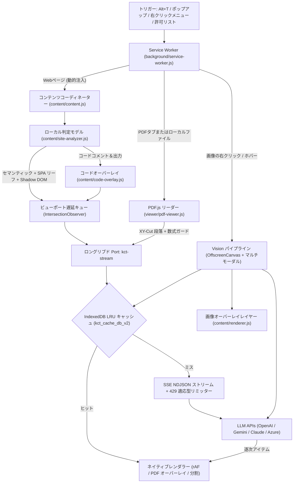
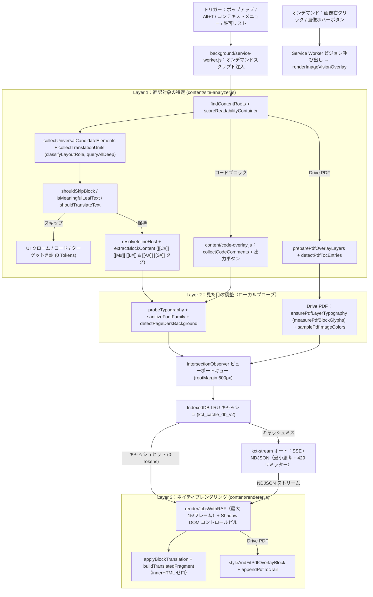

# NativeRead

[English](README.md) · [繁體中文](README.zh-TW.md) · [简体中文](README.zh-CN.md) · **日本語** · [한국어](README.ko.md) · [Español](README.es.md) · [Français](README.fr.md) · [Deutsch](README.de.md)

**NativeRead (v2.9.0)** は、元のページのタイポグラフィとレイアウトを保持したまま、Webページ、PDF、コードコメント、埋め込みインフォグラフィックを翻訳する Manifest V3 ブラウザ拡張機能・ネイティブ iOS/macOS Safari 拡張機能アプリ・Android ネイティブ APK・モバイル PWA です。デフォルトではサイレント（非稼働）で、自身の LLM API キーを使ってオンデマンドで動作し、読書のリズムを崩さずに段落単位でストリーミング翻訳を行います。

---

## 1. 製品概要とクイックスタート

### 主な機能

| 機能 | 仕組み | 読書体験 |
| --- | --- | --- |
| **デフォルトサイレントのWeb翻訳** | 静的な `content_scripts` はゼロ。オンデマンド（`Alt+T`、ポップアップボタン、右クリックメニュー、またはサイト単位の許可リスト `autoTranslateHosts`）で `chrome.scripting` により動的に注入されます。 | 翻訳しないサイトではオーバーヘッド、フローティング UI、API 使用量が一切発生しません。 |
| **内蔵 PDF.js リーダー** | ローカルの Apache-2.0 版 `PDF.js`（`vendor/pdfjs/`）を `viewer/pdf-viewer.html` にバンドル。リモート PDF、Google ドライブのリンク、ローカル `.pdf` のドラッグ＆ドロップに対応。 | **Overlay**、**Split**、**Original** モードを切り替え可能（`1` / `2` / `3`）。図、表、独立数式はそのまま保持されます。 |
| **Google ドライブ PDF ページ内オーバーレイ** | `.ndfHFb-c4YZDc-cYSp0e-DARUcf` ビューアレイヤーをその場で検出し、同列のテキストボックスを統合、目次のリーダー（点線）を再構築し、ページのラスター画像からネイティブのグリフメトリクスを計測します。 | タブを離れることなく、Google ドライブ内で複数ページの PDF を直接翻訳できます。 |
| **オンデマンド画像・インフォグラフィックオーバーレイ** | `>= 200x140` px の画像に対する右クリック（**NativeRead 翻譯圖片文字**）またはホバーピル（**譯圖**）による完全オンデマンド実行。ページ内の画像を自動スキャンすることはありません。 | 3D 図解やイラストを保持したまま、サンプリングした背景色・前景色を使ってテキストブロックをその場で置き換えます。 |
| **コードコメントとノートブック出力** | 静的な `<pre>` ブロック（Pygments、Prism、Highlight.js、GitHub `.pl-c`）には非破壊の CSS `attr()` スワップ、CodeMirror 6（`.cm-editor`）には読み取り専用オーバーレイ、Jupyter 出力にはクイック翻訳ボタンを提供します。 | コードは編集・実行可能なまま維持されます。エディタにフォーカスするか原文モードに切り替えるとオーバーレイは自動的に非表示になります。 |
| **モバイル＆クロスプラットフォーム** | スタンドアロンのモバイル PWA（`docs/`）、ユニバーサル Userscript（`docs/nativeread.user.js`）、Android 拡張機能 ZIP（`docs/nativeread-android-extension.zip`）、およびローカル QR コード `#nr_sync` 同期を提供。 | API キーを再入力することなく、iOS Safari や Android ブラウザで完全な翻訳ワークフローを利用できます。 |

### クイックスタート（デスクトップ拡張機能）

Chromium 119+（Chrome、Edge、Brave、または互換ブラウザ）が必要です。

1. リポジトリをクローンします：
   ```bash
   git clone https://github.com/Chih-Kai-Wang/native-read.git
   ```
2. `chrome://extensions/`（または `edge://extensions/`）を開き、**デベロッパー モード**を有効にします。
3. **パッケージ化されていない拡張機能を読み込む**をクリックし、クローンした `native-read` ディレクトリを選択します。
4. **NativeRead** ツールバーアイコン → **Options** をクリックし、モデルプロバイダーを選択して API キーを入力し、**Fetch model list** をクリックしてモデルを選択してから、**Test Connection** をクリックして保存します。
5. 任意の Web ページまたは PDF タブで **`Alt+T`**（macOS では **⌥ Option+T**；ポップアップに設定済みのショートカットが表示され、`chrome://extensions/shortcuts` でカスタマイズ可能）、ポップアップボタン、または右クリックメニューから翻訳を実行します。ポップアップまたはフローティングピルの `☆` / `★` をクリックすると、現在のドメインを自動翻訳の許可リストに追加・削除できます。

### 対応モデルプロバイダー

`shared/config.js`（`PROVIDER_PRESETS`）において、4 つのグループにまたがる 32 個のプリセットのデータ駆動型レジストリとして設定されています（オプション画面と PWA では `<optgroup>` で描画され、`scripts/build-mobile.js` が同じソースから `docs/providers.js` を生成します）。設定したエンドポイントから利用可能なモデルをライブで取得でき、ローカルエンドポイント（`localhost`、`127.0.0.1`、`0.0.0.0`）では API キーは不要で、その他の OpenAI 互換サービスも `custom` 経由で利用できます。

| グループ | プロバイダー ID | プロトコル | Base URL |
| --- | --- | --- | --- |
| ネイティブ | `gemini` | Gemini Native | `https://generativelanguage.googleapis.com/v1beta` |
| ネイティブ | `anthropic` | Anthropic Messages | `https://api.anthropic.com/v1` |
| 国際 | `openai` | OpenAI | `https://api.openai.com/v1` |
| 国際 | `azure` | OpenAI (api-key header) | `https://YOUR-RESOURCE.openai.azure.com/openai/v1` |
| 国際 | `openrouter` | OpenAI | `https://openrouter.ai/api/v1` |
| 国際 | `groq` | OpenAI | `https://api.groq.com/openai/v1` |
| 国際 | `mistral` | OpenAI | `https://api.mistral.ai/v1` |
| 国際 | `xai` | OpenAI | `https://api.x.ai/v1` |
| 国際 | `together` | OpenAI | `https://api.together.xyz/v1` |
| 国際 | `fireworks` | OpenAI | `https://api.fireworks.ai/inference/v1` |
| 国際 | `cerebras` | OpenAI | `https://api.cerebras.ai/v1` |
| 国際 | `deepinfra` | OpenAI | `https://api.deepinfra.com/v1/openai` |
| 国際 | `huggingface` | OpenAI | `https://router.huggingface.co/v1` |
| 国際 | `novita` | OpenAI | `https://api.novita.ai/openai` |
| 国際 | `deepseek` | OpenAI | `https://api.deepseek.com/v1` |
| 国際 | `qwen-intl` | OpenAI | `https://dashscope-intl.aliyuncs.com/compatible-mode/v1` |
| 国際 | `moonshot-intl` | OpenAI | `https://api.moonshot.ai/v1` |
| 国際 | `zai` | OpenAI | `https://api.z.ai/api/paas/v4` |
| 国際 | `minimax-intl` | OpenAI | `https://api.minimax.io/v1` |
| 国際 | `siliconflow-intl` | OpenAI | `https://api.siliconflow.com/v1` |
| 中国本土 | `qwen` | OpenAI | `https://dashscope.aliyuncs.com/compatible-mode/v1` |
| 中国本土 | `moonshot` | OpenAI | `https://api.moonshot.cn/v1` |
| 中国本土 | `zhipu` | OpenAI | `https://open.bigmodel.cn/api/paas/v4` |
| 中国本土 | `siliconflow` | OpenAI | `https://api.siliconflow.cn/v1` |
| 中国本土 | `volcengine` | OpenAI | `https://ark.cn-beijing.volces.com/api/v3` |
| 中国本土 | `qianfan` | OpenAI | `https://qianfan.baidubce.com/v2` |
| 中国本土 | `hunyuan` | OpenAI | `https://api.hunyuan.cloud.tencent.com/v1` |
| 中国本土 | `minimax` | OpenAI | `https://api.minimaxi.com/v1` |
| 中国本土 | `stepfun` | OpenAI | `https://api.stepfun.com/v1` |
| ローカル＆カスタム | `ollama` | OpenAI | `http://localhost:11434/v1` |
| ローカル＆カスタム | `lmstudio` | OpenAI | `http://localhost:1234/v1` |
| ローカル＆カスタム | `custom` | OpenAI | `http://localhost:11434/v1` |

- **モデル選択とライブ一覧**：`gemini` がデフォルトプロバイダーであり、`gemini`（`gemini-3.5-flash-lite`）、`anthropic`（`claude-opus-5-5`）、`openrouter`（`google/gemini-2.5-flash`）のみがデフォルトモデルを保持します。その他のすべてのプリセットは空の状態で開始するため、**Fetch model list**（`LIST_MODELS` は Gemini の `GET /v1beta/models`（`generateContent` 対応）、Anthropic の `GET /v1/models`（`after_id` ページネーション対応）、または OpenAI 互換の `GET {baseUrl}/models` を照会）からモデルを選択できます。現在のモデルが一覧にない場合は警告を表示し、空の場合は翻訳やテストの前にモデル選択を促し、400/404/410/422 のモデル未検出・非推奨エラー時には保存済み設定を上書きせずに再選択を案内します。
- **Anthropic Claude (`anthropic`)**：拡張機能、Userscript、PWA 全体でネイティブの Messages API（ストリーミング SSE、バッチ/単一翻訳、Test Connection、base64 画像ブロックによるオンデマンド画像翻訳）を使用し、推奨モデルとして `claude-sonnet-5-5` と `claude-haiku-5-5` に対応し、`stop_reason` をチェックして拒否された場合は明確なエラーとして表示します。
- **Azure OpenAI (`azure`)**：`*.openai.azure.com`、`*.services.ai.azure.com`、`*.cognitiveservices.azure.com` の各エンドポイントに対応しています。モデル欄にデプロイメント名を入力すると（ライブモデル一覧からは除外）、API キーは自動的に `api-key` ヘッダーで送信されます。
- **検証に関する注記**：`azure` のテンプレート URL とローカルの `ollama`／`lmstudio`／`custom` を除く、すべてのクラウド プリセット Base URL についてエンドポイントの疎通確認をライブで実施済みです。一方、Anthropic Claude および Azure OpenAI のリクエスト/レスポンスサポートはオフラインのフィクスチャテスト（エンドポイント、ヘッダー、リクエストボディ、レスポンス/ストリームのパース）で検証済みであり、ライブ API に対するテストはまだ実施されていません。
- **翻訳先言語**：`zh-TW`（デフォルト）、`zh-CN`、`ja`、`ko`、`es`、`fr`、`de`、`vi`、`pt`、およびカスタム言語プロンプト。
- **思考レベル（`thinkingEffort`）**：`fastest`（デフォルト）、`balanced`、または `deep`。Gemini 3.x/4.x は `thinkingLevel`（`MINIMAL` / `LOW` / `MEDIUM`）に、Gemini 2.5 Flash は `thinkingBudget`（`0` / `512` / `2048`）に、OpenAI `o1`/`o3`/`o4` は `reasoning_effort: "low"` に自動マッピングされます。DashScope `qwen3` は `fastest` モードで `enable_thinking: false` を設定しつつレスポンスから `thought` パートを除去し、Anthropic Claude は対応モデルにおいて `temperature`、`top_p`、`top_k`、thinking 設定を送信せずに `output_config.effort`（`low` / `medium` / `high`）へマッピングします。

### モバイル＆クロスプラットフォーム対応

- **モバイル PWA（`https://chih-kai-wang.github.io/native-read/`）**：iOS Safari および Android Chrome でホーム画面に追加可能。モバイル向け PDF.js リーダー（overlay / split / original、Google ドライブのリンク解決、15 秒の全ダウンロードタイムアウト、「新しいタブで PDF を開く」フォールバックボタン付き）、Web URL＆直接貼り付け記事翻訳、Claude を含む対応プロバイダーでのストリーミング翻訳、オフライン App Shell（`docs/sw.js`）、ローカル IndexedDB キャッシュを備えています。
- **ユニバーサル Userscript（`https://chih-kai-wang.github.io/native-read/nativeread.user.js`）**：iOS Safari（*Stay* または *Userscripts* 経由）および Android ブラウザ（*Tampermonkey*、*Lemur*、*Kiwi*、*Firefox*）で動作します。ドラッグ可能な Shadow DOM の `NR` エッジタブを注入し、厳格なページの CSP が `fetch` をブロックする場合は `GM_xmlhttpRequest` にフォールバックします。
- **Android 拡張機能 ZIP（`https://chih-kai-wang.github.io/native-read/nativeread-android-extension.zip`）**：Chromium ベースの Android ブラウザ（*Lemur*、*Kiwi*、*Quetta*、*Edge Android*）向けの完全な MV3 パッケージで、タッチ選択翻訳（`touchend` / `selectionchange`）に対応しています。
- **ローカル QR コード `#nr_sync` 同期**：デスクトップの Options ページで同期リンクと QR コードを生成し、モバイルでスキャンするとプロバイダー、API キー、モデル、各種設定が PWA、Userscript、または Android 拡張機能にインポートされ、URL フラグメントは即座に消去されます。

### アップデート

- **Userscript**：`@updateURL`（`docs/nativeread.meta.js`）、`@downloadURL`（`docs/nativeread.user.js`）、`@homepageURL`、`@supportURL` が含まれているため、Tampermonkey、Violentmonkey、Stay で自動更新できます。
- **モバイル PWA**：バージョン管理された Service Worker キャッシュ（`nativeread-pwa-v<version>`）を使用します。新しい Service Worker が開いているページの制御を取得すると更新バナーが表示され、リフレッシュすることで新しいバージョンが適用されます。
- **デスクトップ拡張機能（パッケージ化されていない形式）＆ Android 拡張機能 ZIP**：拡張機能のポップアップを開くと、GitHub Pages 上の `version.json` を確認し（最大 24 時間に 1 回、Options の `checkForUpdates` で切り替え可能）、新しいバージョンがある場合は GitHub README へリンクする `有新版本 vX（目前 vY）/ 查看更新` を表示します。これらのインストール形式はウェブストアで管理されていないため、更新には手動での再インストール（最新リポジトリを pull して再読み込み、または更新された Android ZIP の再インポート）が必要です。

---

## 2. 技術アーキテクチャ



### 2.1 ローカル・ゼロレイテンシ判定モデル

ページのセグメンテーション、フィルタリング、タイポグラフィの判定はすべて `content/site-analyzer.js` と `content/renderer.js` 内でローカルに実行され、追加の LLM 呼び出しは一切発生しません：

NativeRead は、サイトごとの分岐やアダプターを持たない単一の汎用 3 層ローカルパイプラインを実行し、翻訳対象の決定、ネイティブタイポグラフィへの適合、そして追加の LLM 呼び出しゼロでのシームレスなストリームレンダリングを実現します。



- **メインコンテンツの検出（`findContentRoots`、`scoreReadabilityContainer`）**：埋め込みの Jupyter/ノートブックセル（`LESSON_CELL_SELECTOR`）、Google ドライブ PDF ビューアページ（`.ndfHFb-c4YZDc-cYSp0e-DARUcf`）、およびセマンティックコンテナ（`article`、`main`、`[role="main"]`、`.markdown-body`、`.prose`、`#mw-content-text`）を優先します。コンテナは `textLen + pCount * 40` でスコアリングされ、`linkRatio > 0.55` でペナルティ、article/doc コンテナで `1.25x` のブーストを受け、テキストの `>= 65%` を保持している場合はよりタイトな内部コンテナに絞り込まれます。トップレベルの `#firstHeading` / `h1` 見出しは保持されます。
- **レイアウトモデルに基づくセグメンテーション（`collectUniversalCandidateElements`、`collectTranslationUnits`、`classifyLayoutRole`）**：セグメンテーションはタグ名から翻訳単位を推測しなくなりました。`collectTranslationUnits`（`collectUniversalCandidateElements` から呼び出されます）は CSS フォーマットモデルに従い、1 つのブロックコンテナ（1 つのインラインフォーマットコンテキスト）内のインフローのインラインコンテンツを単一の翻訳単位として扱います。
  - *レイアウトロール分類（`classifyLayoutRole`）*：`getComputedStyle`（スキャンごとに各要素で 1 回キャッシュ）から各要素を `BOX`（ブロックレベルまたは flex/grid アイテム）、`INLINE`（inline、inline-block など）、`CONTENTS`（`display: contents`、透過）、または `OUT`（非描画、`visibility: hidden`、視覚的に隠されたスクリーンリーダー用テキスト、絶対/固定配置またはフロートボックス、フォームコントロール、アイコンフォント）に分類します。非表示コンテンツ（`display: none`、視覚的非表示）は翻訳に送信されませんが、実際の本文を含むフロートや配置済みボックスは独自のコンテナとして走査されます。
  - *セル分離、混在ラン、アトミックなインラインコンテンツ*：テキストが横並びのセルに配置されたコンテナ（例：フォーラムの行：タイトル | 投稿者 | 投票数 | コメント数）が 1 つの文にマージされることはなく、各セルが独自の単位になります。ブロック子要素の横にテキストがあるコンテナはラン（run）に分割されます。単一のインライン要素であるランは 1 つの単位になりますが、ブロックの隣にある裸のテキストはページ所有のテキストノードをラップするのを避けるため翻訳されずに残されます（`getLastSegmentationStats` では `mixedSkipped` としてカウント）。アトミックなインラインコンテンツ（`code`、数式、引用）は、ディスプレイ数式が `display: block` を使用している場合でも段落を分割しません。
  - *レガシー参照*：以前の 2 パススキャンは比較用としてのみ `collectUniversalCandidateElementsLegacy` として残されています。
- **Shadow DOM 走査（`queryAllDeep`、`ensureShadowModeStyle`）**：コードエディタや UI ノード（`SHADOW_SKIP_SELECTOR`）をスキップしながら深さ 5 までオープンな `shadowRoot` ツリーを走査し、`:host-context(html.kct-mode-*)` ルールを注入して Shadow DOM 内でも置換 / 原文 / バイリンガル表示の切り替えが機能するようにします。
- **インライン構造と保護トークン（`extractBlockContent`、`buildTranslatedFragment`、`resolveInlineHost`、`validateTranslatedTokens`）**：原子トークン `[[C#]]`（インラインコード `code, kbd, var`）、`[[M#]]`（数式や引用 `.katex, .MathJax, mjx-container, math, .mwe-math-element, sup.reference`）、`[[L#]]`（識別子、URL、引用マーカーなどの翻訳不要な `<a href>` リンク）に加え、ペアトークン `[[A#]]…[[/A#]]`（翻訳可能なクリック可能リンク）と `[[S#]]…[[/S#]]`（インライン強調：bold/strong/italic/em/u/mark/s/small/sub/sup）を生成します。`buildTranslatedFragment` は原子トークンをディープクローン（`cloneNode(true)`）、ペアタグをシャロークローン（`cloneNode(false)`、`id` を除き `href`/`class` を保持）として `DocumentFragment` に復元します。ブロックのテキストが単一のインラインチェーン（例：`li > a > b`）内にある場合、`resolveInlineHost` がその内部へ降りてモデルに頼らず元のリンクや強調内に翻訳を描画します。描画前に `validateTranslatedTokens` がすべてのプレースホルダーが 1 回ずつ出現し、ペアタグが適切にネストされているかを検証します。一致しない場合、ブロックは `data-kct-structure-fallback="1"` で描画され、リンクを黙って失う代わりに翻訳と並んでクリック可能な原文を保持します。
- **スタイル保持と flex/grid ホスト（`[[S#]]`、`.kct-trans-wrap`、`resolveInlineHost`、`data-kct-flex-host`）**：親要素と見た目が異なるインライン要素（フォントサイズ、ウェイト、スタイル、ファミリー、色、装飾、インライン見出し、またはスクリーンリーダー専用ラベル）はすべてペアの `[[S#]]` タグとして保持されます。保持された各要素が元の位置で持っていたタイポグラフィは抽出時に記録され、サイトの CSS（例：`.titleline > a` のような子セレクタ）が `.kct-trans-wrap` 内で一致しなくなった場合にそのクローンへ再適用されます。さらに、`resolveInlineHost` は flex/grid コンテナの内部へは決して降りず、flex/grid ホストは翻訳全体を 1 つのレイアウトセル内に保持します（`data-kct-flex-host`）。 可視コンテンツが欠落したり統合されたりすることはありません。レンダリングされているが翻訳不可能なインラインコンテンツ（アイコン、アイコンフォント、`aria-hidden` の視覚要素、画像、CSS で描画された要素）およびブロックレベルまたはフロー外の子孫要素は、分割不可能な `[[C#]]` トークンとして元の位置に保持され（バイリンガルモードでは重複するメディアのコピーは非表示になります）、ライブコントロールやメディア（入力欄、ボタン、`video`、`canvas`、`iframe`、割り当てられた `slot`）が翻訳単位の一部になることはなく、非表示テキスト（`display: none`、`visibility: hidden`、スクリーンリーダー専用ラベル）が送信されることもなく、1 つの単位が別の単位を含むこともありません。
- **言語フィルタリング（`shouldTranslateText`）**：URL、メールアドレス、ファイルパス、Jupyter の `In[]`/`Out[]` プロンプト、単一トークンの ASCII コード識別子、および Unicode スクリプト比率を用いて翻訳先言語で既に書かれているテキストを除外します（`zh-TW`/`zh-CN` の場合、漢字比率 `>= 0.55` かつラテン単語 `< 6` の場合はスキップしますが、仮名比率 `>= 0.12` の日本語テキストは翻訳対象とします）。
- **フォント遺伝子ペアリング（`probeTypography`、`detectRenderedSerif`、`sanitizeFontFamily`、`content/content.css`）**：計算済み `fontFamily` から各ブロックを `serif`、`sans`、`mono` に分類し、サイトフォントが名前で認識できない場合（例：`sans-serif` フォールバックを宣言する `CMS` Computer Modern Web フォント）は、`detectRenderedSerif` がキャンバスに `"I"` を描画してセリフの有無を確認（ファミリーごとにキャッシュ）することでセリフ体サイトにセリフ体 CJK フォントを割り当てます。その後、汎用 CSS ファミリー（`serif`、`sans-serif`、`monospace`、`system-ui` など）を除去してサイト固有のラテンフォントを最大 5 つ `--kct-orig-font` に残し、対応する翻訳先言語のフォントスタック（`var(--kct-orig-font), var(--kct-font-serif|sans|mono)`）を付加します。`lineHeight / fontSize < 1.62` の高密度でクランプされていない本文ブロックには、選択的に `line-height: 1.72` のリフト（`data-kct-lh-lift="1"`）を適用します。

### 2.2 デュアル PDF ネイティブレイアウト・パイプライン

NativeRead は、ブラウザでの PDF レンダリング方式に合わせて 2 つの特化型 PDF パイプラインを備えています：

| ステージ | 内蔵 PDF.js リーダー (`viewer/pdf-viewer.js`) | Google ドライブページ内オーバーレイ (`site-analyzer.js` + `renderer.js`) |
| --- | --- | --- |
| **テキスト＆ジオメトリ取得元** | CSS ビューポート座標に変換された `pdfPage.getTextContent()`。回転テキスト（`\|angle\| > 0.25`）はスキップ。 | `.ndfHFb-c4YZDc-cYSp0e-DARUcf-Df1ZY-bN97Pc-haAclf` 内のパーセンテージ配置された非表示 `<p>` ノード。 |
| **段組み＆段落グループ化** | ベースライン行クラスタリング、幾何学的な上付き・下付き文字の吸収、連続ガターによる段分割、ハイフネーション解除、および再帰的 XY-Cut 読み順判定（Y-Cut → X-Cut → 内部 X バレー跨ぎ分割）。 | グループ横断の同列マージ（`leftDiff <= 3.6%`、`hRatio <= 0.36`）、ハイフネーション解除、および `nearestBelowTop` 安全高さクランプ。吸収された `<p>` ノードは `data-kct-pdf-merged="absorbed"` で非表示化。 |
| **数式＆目次処理** | 独立数式（`isDisplayedMathBlock`）をスキップし、インライン数式を `[[M#]]` で保護、漏れた LaTeX を Unicode に正規化（`cleanLatexMathInText`）。 | `detectPdfTocEntries` が `>= 3` 行の右揃え目次行（誤差 `1.2%` 以内）を検出し、タイトルのみを翻訳して CSS 点線リーダー（`.kct-pdf-toc-leader`）と等幅ページ番号を持つネイティブ flex 行を再構築。 |
| **タイポグラフィ＆ウェイト計測** | `styles` と `commonObjs` から PDF フォントメタデータ（`isSerif`、`isBold`、`isItalic`、`isMono`、`isMathFont`）を読み取り。 | `ensurePdfLayerTypography` がページの `` ラスターから直接 x-height インクバンド（ラテン `0.53` / CJK `0.88`）とストローク比率（中央値の `>= 1.3x` = 太字）を計測し、近似サイズ（`1.08x` 許容）を共通の中央値にクラスタリング。 |
| **色＆衝突保護** | ページごとに 1 回の `ctx.getImageData` で周囲の中央値 `bg` + WCAG コントラスト `fg` をサンプリング。`refineMaxHeightWithCanvasInk` が各段落の下部をスキャンして図や罫線との重なりを回避し、コンパクトな図表ラベルを検出。 | `samplePdfImageColors` が各ページ ``（`img.currentSrc \|\| img.src` にバインド）から周囲の中央値 `bg` とコントラスト調整済み `fg` をサンプリングし、`2px` の box-shadow ハローと `:hover` 展開を適用。 |
| **表示モード** | **Overlay**、**Split**（キャンバス + 翻訳カード）、**Original**、およびクリック比較ポップオーバー。 | **Replace**、**Original**、**Bilingual**（ホバーでバイリンガルカードに展開するコンパクトなページ内オーバーレイ）。 |

### 2.3 オンデマンド・マルチモーダル画像オーバーレイ・パイプライン

1. **明示的なユーザートリガー**：`>= 200x140` px のコンテンツ画像（nav/header/footer および Google ドライブ PDF ページラスターを除く）に対して、ユーザーが画像を右クリック（**NativeRead 翻譯圖片文字**）またはホバーピル（**譯圖**）をクリックしたときのみ起動します。
2. **バックグラウンド取得＆ダウンスケーリング（`background/service-worker.js`）**：`prepareImagePayloadForVision` は Service Worker から `http(s):` 画像をダウンロードする（ページ Canvas の CORS 汚染を回避；上限 16 MB、タイムアウト 20 秒、マジックバイトによる MIME スニッフィング）か、ローカル/blob 画像の `data:` URL を受け取ります。`createImageBitmap` + `OffscreenCanvas` を使用して `~480px` のアルファ保持サンプルバッファを作成し、`1600px` または `4 MB` を超える画像を再エンコードします。
3. **構造化 Vision 推論、インク補正＆色サンプリング**：`callVisionImageLLM` は単一のマルチモーダルリクエスト（Gemini `inlineData`、OpenAI `image_url`、または Anthropic Messages base64 `image` ブロック；タイムアウト 60 秒、より信頼性の高いボックスを得るため常に `balanced` 以上の思考レベルを使用）を送信し、0–1000 座標の `{"blocks":[{"box_2d":[ymin,xmin,ymax,xmax],"text":"...","role":"title|badge|body"}]}` を取得します。`refineImageBoxToInk` は途切れたグリフの端をカバーするため各ボックスの辺を最大 `~0.6 ×` 1 行分だけ拡張し、文字間隔のみを橋渡しして実線の枠線やイラストの端で停止します。`sampleImageBoxColors` は各ボックスの周囲最頻値 `bg` と WCAG チェック済みの内部 `fg` を計算し、CJK 文字間の不要なスペースや改行を除去して、SHA-256 ダイジェストと正規化 URL の両方をキーとするバージョン付き `img:v4:` キーで IndexedDB にキャッシュします。
4. **その場オーバーレイレンダリング（`content/renderer.js`）**：`renderImageVisionOverlay` は `` を `.kct-img-overlay-host` でラップし、`.kct-img-overlay-layer` を正確な画像サイズに合わせ、同じロール（`title` / `badge` / `body`）のラベル間でフォントサイズを統一しながら適応型フォント縮小（`fitVisionOverlayBlock`）で各ブロックを配置し、ユーザーがオンデマンドで **原圖 / 顯示譯圖** を切り替えられるようにします。

### 2.4 ストリーミング、ビューポート遅延読み込み、レート制限＆LRU キャッシュ

- **SSE / NDJSON ストリーミング＆耐障害フォールバック**：コンテンツスクリプトと PDF ビューアはロングリブドな `kct-stream` ポート経由で接続します。Service Worker は Gemini（`:streamGenerateContent?alt=sse`）、OpenAI（`stream: true`）、または Anthropic Messages の SSE NDJSON 行（`{"i":0,"t":"..."}`）をストリーミングし、`createIncrementalJsonScanner` で逐次パースします。欠落アイテムやストリーム破損時は、再帰的二分探索（`translateItemsWithFallback`、最大深さ 3）を伴うバッチ JSON（`TRANSLATE_BATCH`）にフォールバックします。
- **rAF マイクロバッチ処理＆ビューポート遅延読み込み**：ストリーミングされた Web 翻訳は、`renderJobsWithRAF` を通じてアニメーションフレームあたり最大 `15` アイテムのスライスでフラッシュされます（対応環境ではスライス間に `scheduler.yield()` を実行）。画面外のブロックは `IntersectionObserver`（Web は `rootMargin: 600px 0px`、PDF.js は `500px 0px`）で遅延され、ビューポート優先で最大 `3` つの並列バッチワーカー（`batchSize: 20`、`maxBatchChars: 5500`）にキューイングされます。
- **フレーム横断 429 適応型レートリミッター**：`background/service-worker.js` はフレーム全体でグローバル並列数上限 `3` を強制します。HTTP `429` が発生すると `Retry-After` / `retryDelay` を解析し、90 秒間の適応型ペーシングウィンドウ（並列数 `1`、リクエスト間隔 `4.3s`）とグローバルクールダウンをトリガーし、日次/ゼロクォータ枯渇（`QUOTA_EXCEEDED`）と一時的な RPM 制限（`RATE_LIMITED`）を分離して扱います。
- **IndexedDB LRU キャッシュ（`shared/cache-db.js`）**：`kct_cache_db_v2`（ストア `entries`、`ts` インデックス）に最大 `20,000` エントリを保存します。キーは `protocol:model:thinkingEffort:targetLang:customLang:glossaryHash` です。キャッシュヒット時はデバウンス付きで `ts` を更新（閾値 `60s`、デバウンス `250ms`）し、容量超過時のエビクションで最も古いレコード（LRU）が削除されるようにします。

### 2.5 プロジェクト構成

```text
native-read/
├── manifest.json                 # MV3 マニフェスト、バージョンの単一情報源、権限、Alt+T コマンド
├── shared/
│   ├── config.js                 # Schema v5 設定、32 プロバイダーレジストリ（PROVIDER_PRESETS）、思考設定、URL/PDF ヘルパー
│   ├── cache-db.js               # IndexedDB kct_cache_db_v2 20,000 エントリ LRU キャッシュ
│   └── pdf-layout.mjs            # 純粋な PDF 幾何レイアウト、数式・LaTeX 保護、Computer Modern セリフ検出およびエコー防止モジュール
├── background/
│   └── service-worker.js         # 動的インジェクター、SSE/NDJSON ストリーマー、429 リミッター、Vision エンジン、#nr_sync ガード
├── content/
│   ├── site-analyzer.js          # ローカル判定モデル (Readability, 2パス SPA, Shadow DOM, Drive PDF マージ/目次)
│   ├── code-overlay.js           # 静的 <pre> コメント置換、CodeMirror 6 オーバーレイ、Jupyter 出力翻訳
│   ├── renderer.js               # 安全な DOM レンダラー、フォント遺伝子ペアリング、Drive PDF ラスター計測、画像オーバーレイ
│   ├── content.js                # ビューポート遅延キュー、kct-stream クライアント、Shadow DOM ピル/選択/画像 UI
│   └── content.css               # 置換/原文/バイリンガルモード、フォントスタック、Drive PDF ＆画像オーバーレイスタイル
├── viewer/                       # 内蔵 PDF.js リーダー (pdf-viewer.html / .css / .js)
├── popup/                        # 拡張機能ポップアップ操作、許可リスト切り替え、更新通知、PDF リーダー起動
├── options/                      # 設定ページ、プロバイダー/モデル設定、用語集、ローカル QR 同期、キャッシュ管理
├── icons/                        # 拡張機能アイコン (16 / 48 / 128 px)
├── scripts/
│   └── build-mobile.js           # バージョン刻印、Userscript / meta.js / version.json / Android ZIP / PDF.js・アイコン生成
├── docs/                         # GitHub Pages モバイル PWA（index.html、app.js、app.css、sw.js、生成された providers.js およびバンドル）
├── tests/                        # オフライン回帰テストフィクスチャ（リンク/強調保持用の tests/fixtures/inline-structure/ を含む）
├── LICENSE                       # MIT ライセンス
└── README*.md                    # 多言語の製品、アーキテクチャ、セキュリティドキュメント
```

---

## 3. プライバシー＆セキュリティアーキテクチャ

| 領域 | 実装内容 |
| --- | --- |
| **ローカルストレージ** | 拡張機能の設定と API キーは `chrome.storage.local`（`kct_settings_v1`）のみに保存されます。PWA 設定は `localStorage`、Userscript 設定は `GM_getValue`/`GM_setValue`（フォールバックは `localStorage`）に保存されます。翻訳キャッシュは IndexedDB（`kct_cache_db_v2`）にローカル保存され、いつでも消去可能です。 |
| **ネットワークエンドポイント** | 拡張機能と Userscript の通信は、選択された `api.anthropic.com` や Azure OpenAI ホストを含め、設定された LLM エンドポイントへ直接送信されます。API キーは HTTP ヘッダー（`x-goog-api-key`、`Authorization: Bearer`、Anthropic 用の `x-api-key` + `anthropic-version: 2026-10-21` + `anthropic-dangerous-direct-browser-access: true`、または Azure 用の `api-key`）のみに配置され、エラーメッセージからは除去されます（`redactApiKey`）。リモート PDF およびオンデマンド画像は、Service Worker によって元の URL から直接取得されます。 |
| **アップデート確認** | 拡張機能のポップアップが開かれたとき（かつ `checkForUpdates` が有効な場合、デフォルトはオン）、最大 24 時間に 1 回 `https://chih-kai-wang.github.io/native-read/version.json` を取得します（`chrome.storage.local` の `nr_update_check_v1` にキャッシュ、タイムアウト 5 秒、`credentials: 'omit'`、追加権限なし、バックグラウンドタイマーなし）。JSON ペイロードは厳密に検証され、URL として使用されることはありません。更新リンクは GitHub README にハードコードされています。Options で `checkForUpdates` のチェックを外すと完全に無効化できます。 |
| **モデル一覧** | Options で **Fetch model list** をクリックすると、設定されたプロバイダーへ直接 `LIST_MODELS`（拡張機能専用、`isExtensionSender`）を送信し（`GET /v1beta/models`、`GET /v1/models`、または `GET {baseUrl}/models`、タイムアウト 10 秒、Azure は対象外）、返されたモデル ID のみ（API キーは含めず、最大 20 エンドポイント）を `chrome.storage.local` の `nr_model_list_v1` にキャッシュします。 |
| **`#nr_sync` フラグメント処理** | 同期ペイロードは URL の `#` フラグメント（`?query` ではない）のみに格納されるため、ブラウザが HTTP リクエストで送信することはありません。`background/service-worker.js` は拡張機能オリジンまたは `https://chih-kai-wang.github.io/native-read` からの `#nr_sync` のみを受け入れ、明示的な `apiKey` が含まれない限りエンドポイントの変更（`baseUrl` / `protocol` / `providerId`）を拒否し、`http:`/`https:` スキームを検証した上で、即座に `history.replaceState` でフラグメントを消去します。 |
| **ゼロ `innerHTML` DOM 安全性** | すべての翻訳文字列、ポップオーバー、オーバーレイは `document.createTextNode` と `.textContent` を介して書き込まれます。原子プレースホルダー（`[[C#]]`、`[[M#]]`、`[[L#]]`）は既存の DOM ノードのクローン作成のみを行い、ペアタグ（`[[A#]]`、`[[S#]]`）は既存要素のシャロークローン（`cloneNode(false)`）のみを再構築し、`validateTranslatedTokens` 構造ガードが不一致時に原文を可視のまま保持するためリンクが失われることはありません。 |
| **MV3 CSP＆PDF.js 強化** | PDF.js は `viewer/pdf-viewer.js` と `docs/app.js` の両方で `isEvalSupported: false` を設定してローカルにバンドルされています。特権 Service Worker アクション（`ENSURE_AND_COMMAND`、`TEST_CONNECTION`、`LIST_MODELS`、`OPEN_PDF_VIEWER`、`GET_SW_DEBUG`、`CLEAR_CACHE`）は `isExtensionSender(sender)` を強制します。 |
| **UI＆QR 分離** | フローティングピル、選択ポップオーバー、画像ホバートリガー、Userscript コントロールは Shadow DOM（`all: initial`）内に分離されています。同期用 QR コードは外部の QR サービスを呼び出すことなく Options ページ内でローカル生成されます。 |

> **モバイル PWA（`docs/app.js`）に関する注記**：PDF URL について、NativeRead は Google ドライブのリンクを解決し、直接ブラウザフェッチのみを使用するため（15 秒の全ダウンロードタイムアウト、`api.allorigins.win` リレーなし、「新しいタブで PDF を開く」フォールバックボタンおよびローカルファイル案内付き）、プライベートな PDF の URL やバイトデータがサードパーティのリレーに送信されることはありません。PWA のオプション機能である **Web URL** タブでは、クロスオリジンの公開記事抽出（`fetchReadableArticleFromUrl`）に現在 `r.jina.ai`（フォールバックとして `api.allorigins.win`）を使用しています。モバイルでサードパーティリレーを一切使用したくない場合は、Web タブに記事テキストを直接貼り付けるか、Userscript または Android 拡張機能をご利用ください。

---

## 開発

モバイル配布用アーティファクトをビルドし、すべての JavaScript ファイルに対して構文チェックを実行します：

```bash
node scripts/build-mobile.js
for f in shared/*.js background/*.js content/*.js popup/*.js options/*.js viewer/*.js scripts/*.js docs/app.js docs/sw.js docs/nativeread.user.js; do node --check "$f" || exit 1; done
```

`manifest.json` の `"version"` が単一の信頼できる情報源（`MAJOR.MINOR.PATCH`）です。`node scripts/build-mobile.js` を実行するとバージョンが検証され、Userscript の `@version`、`docs/sw.js` の `CACHE_NAME`（`nativeread-pwa-v<version>`）、および `docs/index.html` の PWA バッジに刻印されます。

`docs/nativeread.user.js`、`docs/nativeread.meta.js`、`docs/version.json`、`docs/nativeread-android-extension.zip`、`docs/vendor/pdfjs/`、`docs/icons/`、および `docs/.nojekyll` は `scripts/build-mobile.js` によって生成されます。`shared/`、`content/`、`viewer/`、`docs/app.js` 配下のソースモジュールを編集した後、ビルドスクリプトを再実行してください。

**リリースフロー（メンテナー向け）**：`manifest.json` の `"version"` を更新 → `node scripts/build-mobile.js` を実行 → コミット＆プッシュすることで、GitHub Pages から更新された PWA、Userscript、メタデータ、`version.json`、および Android ZIP が配信されます。

**回帰コーパス（`tests/corpus/`）**：`capture.sh` は ego-browser を通じて実際のページをスナップショットし（`document.styleSheets` から DOM と CSS をシリアライズし、すべての単語を同じ長さの疑似単語にスクランブルし、リンク/画像を置換します。スナップショットは git 管理対象外です）、`run.sh [git-rev]` はすべてのスナップショットと手書きの `fixtures/edge-cases.html` を 1:1 の疑似翻訳機でレンダリングし、ページごとにセグメンター非依存の不変条件（マージされたセル、翻訳内の非インラインボックス、失われたリンク、変更されたタイポグラフィ（`styleLost`）、フォールバック、満たされなかった `data-expect` の期待値、水平オーバーフロー、単位数、カバレッジ）を報告します。v2.5.0 の Kaggle バグを再現し、v2.6.0 では 8 サイト（Kaggle、Wikipedia、colah、MDN、Hacker News、Stack Overflow、GitHub、arXiv）でクリーンな結果を示します。

---

## ロードマップ / 未対応の機能

- **ブラウザウェブストア**：Chrome ウェブストアおよび Edge アドオンには未公開です。現在デスクトップでのインストールには、ストアの自動更新がない **パッケージ化されていない拡張機能を読み込む** が必要です。
- **クラウド PDF リンク解決**：Dropbox、OneDrive、Box の PDF リンク変換にはまだ対応していません（Google ドライブのリンクには対応済み）。
- **その他のメディア＆フォーマット**：動画字幕の翻訳、スキャンされた PDF の OCR、EPUB や Office ドキュメントには対応していません。
- **UI のローカライズ**：拡張機能および PWA のインターフェース文字列は現在、繁体字中国語のみとなっています。
- **その他のデスクトップブラウザ**：デスクトップ版 Firefox および Safari は公式にはサポートされていません。

---

## ライセンス

[MIT License](LICENSE) の下で公開されています。バンドルされている PDF.js（`vendor/pdfjs/` および `docs/vendor/pdfjs/`）は Apache-2.0 License の下でライセンスされています（[docs/vendor/pdfjs/LICENSE](docs/vendor/pdfjs/LICENSE) を参照）。