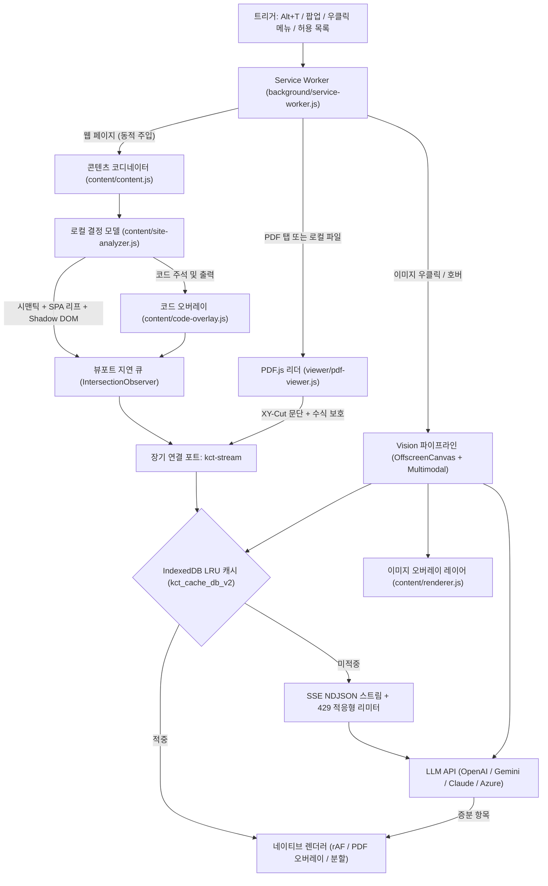
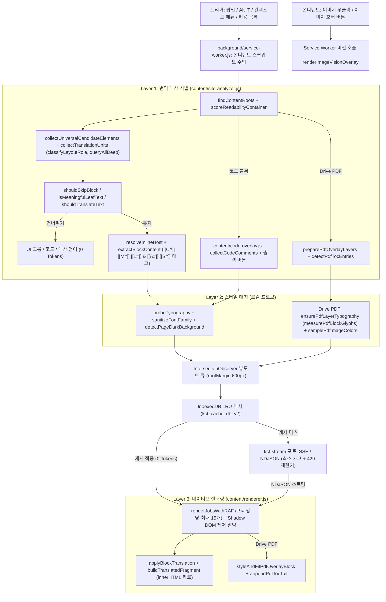

# NativeRead

[English](README.md) · [繁體中文](README.zh-TW.md) · [简体中文](README.zh-CN.md) · [日本語](README.ja.md) · **한국어** · [Español](README.es.md) · [Français](README.fr.md) · [Deutsch](README.de.md)

**NativeRead (v2.8.5)**는 웹 페이지, PDF, 코드 주석, 내장 인포그래픽을 원본 페이지의 타이포그래피와 레이아웃을 유지한 채 번역하는 Manifest V3 브라우저 확장 프로그램이자 모바일 PWA입니다. 기본적으로는 아무 동작도 하지 않으며, 사용자의 LLM API 키를 이용해 필요할 때만 실행되고 읽기 흐름을 방해하지 않도록 문단 단위로 스트리밍 번역합니다.

---

## 1. 제품 개요 및 빠른 시작

### 주요 기능

| 기능 | 동작 방식 | 읽기 경험 |
| --- | --- | --- |
| **기본 비활성(Silent-by-Default) 웹 번역** | 정적 `content_scripts` 없이 필요할 때만 `chrome.scripting`으로 동적 주입(`Alt+T`, 팝업 버튼, 우클릭 메뉴 또는 사이트별 허용 목록 `autoTranslateHosts`). | 번역하지 않는 사이트에서는 오버헤드, 플로팅 UI, API 사용량이 모두 0입니다. |
| **내장 PDF.js 리더** | `viewer/pdf-viewer.html` 내부에 로컬 Apache-2.0 `PDF.js`(`vendor/pdfjs/`)를 번들링하며 원격 PDF, Google Drive 링크, 로컬 `.pdf` 드래그 앤 드롭을 지원합니다. | **오버레이(Overlay)**, **분할(Split)**, **원본(Original)** 모드 전환(`1` / `2` / `3`); 그림, 표, 수식 블록은 손상 없이 유지됩니다. |
| **Google Drive PDF 페이지 내 오버레이** | `.ndfHFb-c4YZDc-cYSp0e-DARUcf` 뷰어 레이어를 제자리에서 감지하고 동일 열 텍스트 상자를 병합하며 목차 점선 리더를 재구성하고 페이지 래스터에서 네이티브 글리프 메트릭을 측정합니다. | 탭을 벗어나지 않고 Google Drive 내부에서 다중 페이지 Drive PDF를 바로 번역합니다. |
| **온디맨드 이미지 및 인포그래픽 오버레이** | `>= 200x140` px 이미지에서 우클릭(**NativeRead 翻譯圖片文字**) 또는 호버 필(**譯圖**)을 통해서만 온디맨드로 실행되며 페이지 이미지를 자동 스캔하지 않습니다. | 샘플링한 배경/전경 색상을 사용해 텍스트 블록을 제자리에서 교체하며 3D 다이어그램과 일러스트는 보존합니다. |
| **코드 주석 및 노트북 출력** | 정적 `<pre>` 블록(Pygments, Prism, Highlight.js, GitHub `.pl-c`)을 위한 비파괴 CSS `attr()` 스왑, CodeMirror 6(`.cm-editor`)용 읽기 전용 오버레이, Jupyter 출력용 빠른 번역 버튼을 제공합니다. | 코드는 편집 가능하고 실행 가능한 상태로 유지되며, 에디터에 포커스하거나 원본 모드로 전환하면 오버레이가 자동으로 숨겨집니다. |
| **모바일 및 크로스 플랫폼** | 독립형 모바일 PWA(`docs/`), 범용 유저스크립트(`docs/nativeread.user.js`), Android 확장 ZIP(`docs/nativeread-android-extension.zip`), 로컬 QR 코드 `#nr_sync` 동기화를 제공합니다. | iOS Safari와 Android 브라우저에서 API 키를 다시 입력하지 않고도 전체 번역 워크플로를 사용할 수 있습니다. |

### 빠른 시작 (데스크톱 확장 프로그램)

Chromium 119 이상(Chrome, Edge, Brave 또는 호환 브라우저)이 필요합니다.

1. 저장소를 클론합니다:
   ```bash
   git clone https://github.com/Chih-Kai-Wang/native-read.git
   ```
2. `chrome://extensions/`(또는 `edge://extensions/`)를 열고 **개발자 모드**를 활성화합니다.
3. **압축해제된 확장 프로그램을 로드합니다**를 클릭하고 클론한 `native-read` 디렉터리를 선택합니다.
4. **NativeRead** 툴바 아이콘 → **Options**를 클릭하고 모델 제공자를 선택한 다음 API 키를 입력하고 **Fetch model list**를 클릭하여 모델을 고른 뒤 **Test Connection**을 클릭하고 저장합니다.
5. 아무 웹 페이지나 PDF 탭에서 **`Alt+T`**(macOS에서는 **⌥ Option+T**; 팝업에 설정된 단축키가 표시되며 `chrome://extensions/shortcuts`에서 사용자 지정 가능), 팝업 버튼 또는 우클릭 메뉴로 번역을 실행합니다. 팝업이나 플로팅 필에서 `☆` / `★`를 클릭하면 현재 도메인을 자동 번역 허용 목록에 추가하거나 제거할 수 있습니다.

### 지원 모델 제공자

`shared/config.js`(`PROVIDER_PRESETS`)에 4개 그룹에 걸친 32개 프리셋의 데이터 기반 레지스트리로 구성되어 있습니다(옵션 페이지와 PWA에서는 `<optgroup>`으로 렌더링되며, `scripts/build-mobile.js`가 동일한 소스에서 `docs/providers.js`를 생성합니다). 사용자는 구성된 엔드포인트에서 사용 가능한 모델을 실시간으로 가져올 수 있으며, 로컬 엔드포인트(`localhost`, `127.0.0.1`, `0.0.0.0`)는 API 키가 필요하지 않고, 다른 모든 OpenAI 호환 서비스는 `custom`을 통해 사용할 수 있습니다.

| 그룹 | 제공자 ID | 프로토콜 | Base URL |
| --- | --- | --- | --- |
| 네이티브 | `gemini` | Gemini Native | `https://generativelanguage.googleapis.com/v1beta` |
| 네이티브 | `anthropic` | Anthropic Messages | `https://api.anthropic.com/v1` |
| 국제 | `openai` | OpenAI | `https://api.openai.com/v1` |
| 국제 | `azure` | OpenAI (api-key header) | `https://YOUR-RESOURCE.openai.azure.com/openai/v1` |
| 국제 | `openrouter` | OpenAI | `https://openrouter.ai/api/v1` |
| 국제 | `groq` | OpenAI | `https://api.groq.com/openai/v1` |
| 국제 | `mistral` | OpenAI | `https://api.mistral.ai/v1` |
| 국제 | `xai` | OpenAI | `https://api.x.ai/v1` |
| 국제 | `together` | OpenAI | `https://api.together.xyz/v1` |
| 국제 | `fireworks` | OpenAI | `https://api.fireworks.ai/inference/v1` |
| 국제 | `cerebras` | OpenAI | `https://api.cerebras.ai/v1` |
| 국제 | `deepinfra` | OpenAI | `https://api.deepinfra.com/v1/openai` |
| 국제 | `huggingface` | OpenAI | `https://router.huggingface.co/v1` |
| 국제 | `novita` | OpenAI | `https://api.novita.ai/openai` |
| 국제 | `deepseek` | OpenAI | `https://api.deepseek.com/v1` |
| 국제 | `qwen-intl` | OpenAI | `https://dashscope-intl.aliyuncs.com/compatible-mode/v1` |
| 국제 | `moonshot-intl` | OpenAI | `https://api.moonshot.ai/v1` |
| 국제 | `zai` | OpenAI | `https://api.z.ai/api/paas/v4` |
| 국제 | `minimax-intl` | OpenAI | `https://api.minimax.io/v1` |
| 국제 | `siliconflow-intl` | OpenAI | `https://api.siliconflow.com/v1` |
| 중국 본토 | `qwen` | OpenAI | `https://dashscope.aliyuncs.com/compatible-mode/v1` |
| 중국 본토 | `moonshot` | OpenAI | `https://api.moonshot.cn/v1` |
| 중국 본토 | `zhipu` | OpenAI | `https://open.bigmodel.cn/api/paas/v4` |
| 중국 본토 | `siliconflow` | OpenAI | `https://api.siliconflow.cn/v1` |
| 중국 본토 | `volcengine` | OpenAI | `https://ark.cn-beijing.volces.com/api/v3` |
| 중국 본토 | `qianfan` | OpenAI | `https://qianfan.baidubce.com/v2` |
| 중국 본토 | `hunyuan` | OpenAI | `https://api.hunyuan.cloud.tencent.com/v1` |
| 중국 본토 | `minimax` | OpenAI | `https://api.minimaxi.com/v1` |
| 중국 본토 | `stepfun` | OpenAI | `https://api.stepfun.com/v1` |
| 로컬 및 사용자 지정 | `ollama` | OpenAI | `http://localhost:11434/v1` |
| 로컬 및 사용자 지정 | `lmstudio` | OpenAI | `http://localhost:1234/v1` |
| 로컬 및 사용자 지정 | `custom` | OpenAI | `http://localhost:11434/v1` |

- **모델 선택 및 실시간 목록**: `gemini`가 기본 제공자이며, `gemini`(`gemini-3.5-flash-lite`), `anthropic`(`claude-opus-5-5`), `openrouter`(`google/gemini-2.5-flash`)만 기본 모델을 유지합니다. 나머지 모든 프리셋은 비어 있는 상태로 시작하므로 **Fetch model list**(`LIST_MODELS`는 `generateContent`가 포함된 Gemini `GET /v1beta/models`, `after_id` 페이지네이션이 포함된 Anthropic `GET /v1/models`, 또는 OpenAI 호환 `GET {baseUrl}/models`를 조회)를 통해 선택할 수 있습니다. 현재 모델이 목록에 없으면 경고를 표시하고, 비어 있을 때는 번역이나 테스트 전에 모델 선택을 안내하며, 400/404/410/422 모델 미발견 또는 지원 중단 오류 시 저장된 설정을 덮어쓰지 않고 다시 선택하도록 안내합니다.
- **Anthropic Claude (`anthropic`)**: 확장 프로그램, 유저스크립트, PWA 전반에서 네이티브 Messages API(스트리밍 SSE, 배치/단일 번역, 연결 테스트, base64 이미지 블록을 통한 온디맨드 이미지 번역)를 사용하며 추천 모델로 `claude-sonnet-5-5` 및 `claude-haiku-5-5`를 제공하고, `stop_reason`을 확인하여 거절 응답이 명확한 오류로 표시되도록 합니다.
- **Azure OpenAI (`azure`)**: `*.openai.azure.com`, `*.services.ai.azure.com`, `*.cognitiveservices.azure.com` 엔드포인트를 지원합니다. 모델 필드에 배포 이름을 입력하면(실시간 모델 목록에서 제외됨) API 키가 자동으로 `api-key` 헤더에 포함되어 전송됩니다.
- **검증 참고**: `azure` 템플릿 URL과 로컬 `ollama` / `lmstudio` / `custom` 엔드포인트를 제외한 모든 클라우드 프리셋 Base URL은 엔드포인트 가용성에 대해 라이브 프로브를 완료했으며, Anthropic Claude 및 Azure OpenAI 요청/응답 지원은 오프라인 픽스처 테스트(엔드포인트, 헤더, 요청 본문, 응답/스트림 파싱)로 검증되었으나 실제 라이브 API에 대한 테스트는 아직 수행되지 않았습니다.
- **대상 언어**: `zh-TW`(기본값), `zh-CN`, `ja`, `ko`, `es`, `fr`, `de`, `vi`, `pt` 및 사용자 지정 언어 프롬프트.
- **사고 수준 (`thinkingEffort`)**: `fastest`(기본값), `balanced`, 또는 `deep`. Gemini 3.x/4.x는 `thinkingLevel`(`MINIMAL` / `LOW` / `MEDIUM`)로, Gemini 2.5 Flash는 `thinkingBudget`(`0` / `512` / `2048`)로, OpenAI `o1`/`o3`/`o4`는 `reasoning_effort: "low"`로 자동 매핑됩니다. DashScope `qwen3`은 `fastest` 모드에서 `enable_thinking: false`로 설정하고 응답의 `thought` 파트를 제거하며, Anthropic Claude는 이를 지원하는 모델에서 `temperature`, `top_p`, `top_k` 또는 thinking config를 보내지 않고 `output_config.effort`(`low` / `medium` / `high`)로 매핑합니다.

### 모바일 및 크로스 플랫폼 지원

- **모바일 PWA (`https://chih-kai-wang.github.io/native-read/`)**: iOS Safari 및 Android Chrome의 홈 화면에 설치할 수 있습니다. 모바일 PDF.js 리더(오버레이 / 분할 / 원본, Google Drive 링크 해석, 15 s 전체 다운로드 타임아웃, "새 탭에서 PDF 열기" 폴백 버튼 포함), 웹 URL 및 직접 붙여넣기 문서 번역기, Claude를 포함한 지원 제공자 스트리밍 번역, 오프라인 앱 셸(`docs/sw.js`), 로컬 IndexedDB 캐싱을 포함합니다.
- **범용 유저스크립트 (`https://chih-kai-wang.github.io/native-read/nativeread.user.js`)**: iOS Safari(*Stay* 또는 *Userscripts* 경유) 및 Android 브라우저(*Tampermonkey*, *Lemur*, *Kiwi*, *Firefox*)에서 실행됩니다. 드래그 가능한 Shadow DOM `NR` 가장자리 탭을 주입하며 엄격한 페이지 CSP가 `fetch`를 차단할 경우 `GM_xmlhttpRequest`로 폴백합니다.
- **Android 확장 ZIP (`https://chih-kai-wang.github.io/native-read/nativeread-android-extension.zip`)**: Chromium 기반 Android 브라우저(*Lemur*, *Kiwi*, *Quetta*, *Edge Android*)용 전체 MV3 패키지로 터치 선택 번역(`touchend` / `selectionchange`)을 지원합니다.
- **로컬 QR 코드 `#nr_sync` 동기화**: 데스크톱 옵션 페이지에서 동기화 링크와 QR 코드를 생성합니다. 모바일에서 스캔하면 제공자, API 키, 모델, 환경설정이 PWA, 유저스크립트 또는 Android 확장 프로그램으로 가져와지며 URL 프래그먼트는 즉시 삭제됩니다.

### 업데이트

- **유저스크립트**: `@updateURL`(`docs/nativeread.meta.js`), `@downloadURL`(`docs/nativeread.user.js`), `@homepageURL`, `@supportURL`이 포함되어 있어 Tampermonkey, Violentmonkey, Stay가 자동으로 업데이트할 수 있습니다.
- **모바일 PWA**: 버전이 지정된 Service Worker 캐시(`nativeread-pwa-v<version>`)를 사용합니다. 새 Service Worker가 열린 페이지를 제어하게 되면 업데이트 배너가 나타나며 새로고침하면 새 버전이 적용됩니다.
- **데스크톱 확장 프로그램(압축해제) 및 Android 확장 ZIP**: 팝업을 열면 GitHub Pages의 `version.json`을 확인합니다(24시간당 최대 1회, 옵션의 `checkForUpdates`로 전환 가능). 새 버전이 있으면 GitHub README로 연결되는 `有新版本 vX（目前 vY）/ 查看更新`를 표시합니다. 이러한 설치는 웹 스토어에서 관리되지 않으므로 업데이트 시에는 수동 재설치(최신 저장소를 pull하여 다시 로드하거나 업데이트된 Android ZIP을 다시 가져오기)가 필요합니다.

---

## 2. 기술 아키텍처



### 2.1 로컬 무지연(Zero-Latency) 결정 모델

모든 페이지 분할, 필터링, 타이포그래피 결정은 추가 LLM 호출 없이 `content/site-analyzer.js`와 `content/renderer.js`에서 로컬로 실행됩니다:

NativeRead는 사이트별 분기나 어댑터 없이 단일 범용 3계층 로컬 파이프라인을 실행하여 번역 대상을 결정하고, 네이티브 타이포그래피에 맞추며, 추가 LLM 호출 없이 스트림을 매끄럽게 렌더링합니다.



- **본문 감지 (`findContentRoots`, `scoreReadabilityContainer`)**: 내장 Jupyter/노트북 셀(`LESSON_CELL_SELECTOR`), Google Drive PDF 뷰어 페이지(`.ndfHFb-c4YZDc-cYSp0e-DARUcf`), 시맨틱 컨테이너(`article`, `main`, `[role="main"]`, `.markdown-body`, `.prose`, `#mw-content-text`)를 우선합니다. 컨테이너는 `textLen + pCount * 40`으로 점수를 매기고 `linkRatio > 0.55`일 때 감점하며 article/doc 컨테이너에는 `1.25x` 가중치를 부여하고, 텍스트의 `>= 65%`를 유지하는 더 좁은 내부 컨테이너로 정제합니다. 최상위 `#firstHeading` / `h1` 제목은 보존됩니다.
- **레이아웃 모델 기반 분할 (`collectUniversalCandidateElements`, `collectTranslationUnits`, `classifyLayoutRole`)**: 분할은 더 이상 태그 이름에서 번역 단위를 추측하지 않습니다. `collectUniversalCandidateElements`가 호출하는 `collectTranslationUnits`는 CSS 서식 모델을 따라 하나의 블록 컨테이너(하나의 인라인 서식 컨텍스트) 내 인플로우(in-flow) 인라인 콘텐츠를 단일 번역 단위로 취급합니다.
  - *레이아웃 역할 분류 (`classifyLayoutRole`)*: `getComputedStyle`(스캔당 요소별로 한 번 캐시됨)을 기반으로 각 요소를 `BOX`(블록 레벨 또는 flex/grid 아이템), `INLINE`(inline, inline-block 등), `CONTENTS`(`display: contents`, 투명), 또는 `OUT`(렌더링되지 않음, `visibility: hidden`, 시각적으로 숨겨진 스크린 리더 텍스트, 절대/고정 위치 또는 플로트 박스, 폼 컨트롤, 아이콘 폰트)으로 분류합니다. 숨겨진 콘텐츠(`display: none`, 시각적 숨김)는 번역 대상으로 전송되지 않으며, 실제 본문이 포함된 플로트 및 위치 지정 박스는 자체 컨테이너로 순회됩니다.
  - *셀 격리, 혼합 런(run) 및 원자적 인라인 콘텐츠*: 텍스트가 나란히 배치된 셀에 있는 컨테이너(예: 포럼 행: 제목 | 작성자 | 투표수 | 댓글 수)는 절대 하나의 문장으로 병합되지 않으며 각 셀이 독립적인 단위가 됩니다. 블록 자식 옆에 텍스트가 있는 컨테이너는 런(run)으로 분할됩니다. 단일 인라인 요소인 런은 하나의 단위가 되는 반면, 블록 옆의 맨 텍스트는 페이지 소유의 텍스트 노드를 감싸지 않고 번역하지 않은 채 남겨집니다(`getLastSegmentationStats`에서 `mixedSkipped`로 집계). 원자적 인라인 콘텐츠(`code`, 수식, 인용)는 디스플레이 수식이 `display: block`을 사용하더라도 단락을 분할하지 않습니다.
  - *레거시 참조*: 이전의 2패스 스캔은 비교용으로만 `collectUniversalCandidateElementsLegacy`로 유지됩니다.
- **Shadow DOM 순회 (`queryAllDeep`, `ensureShadowModeStyle`)**: 코드 에디터와 UI 노드(`SHADOW_SKIP_SELECTOR`)를 건너뛰면서 최대 깊이 5까지 열린 `shadowRoot` 트리를 순회하고, Shadow DOM 내부에서도 교체 / 원본 / 이중 언어 전환이 작동하도록 `:host-context(html.kct-mode-*)` 규칙을 주입합니다.
- **인라인 구조 및 보호 토큰 (`extractBlockContent`, `buildTranslatedFragment`, `resolveInlineHost`, `validateTranslatedTokens`)**: 원자적 토큰 `[[C#]]`(인라인 코드 `code, kbd, var`), `[[M#]]`(수식 및 인용 `.katex, .MathJax, mjx-container, math, .mwe-math-element, sup.reference`), `[[L#]]`(식별자, URL, 인용 마커 등 번역 불필요한 `<a href>` 링크)와 함께 쌍으로 된 `[[A#]]…[[/A#]]`(번역 가능한 클릭 가능 링크) 및 `[[S#]]…[[/S#]]`(인라인 강조: bold/strong/italic/em/u/mark/s/small/sub/sup)를 생성합니다. `buildTranslatedFragment`는 원자적 토큰을 깊은 복제(`cloneNode(true)`)로, 쌍 태그를 얕은 복제(`cloneNode(false)`, `id`는 제거하고 `href`/`class` 유지)로 `DocumentFragment`에 복원합니다. 블록의 텍스트가 단일 인라인 체인(예: `li > a > b`) 내부에 있을 때 `resolveInlineHost`가 그 안으로 내려가 모델에 의존하지 않고 원본 링크나 강조 내부에 번역을 렌더링합니다. 렌더링 전에 `validateTranslatedTokens`가 모든 플레이스홀더가 한 번씩 나타나고 쌍 태그가 균형 있게 중첩되었는지 검증하며, 그렇지 않으면 블록이 `data-kct-structure-fallback="1"`로 렌더링되어 링크를 조용히 누락하는 대신 번역과 함께 클릭 가능한 원문을 유지합니다.
- **스타일 보존 및 flex/grid 호스트 (`[[S#]]`, `.kct-trans-wrap`, `resolveInlineHost`, `data-kct-flex-host`)**: 부모와 외형이 다른 모든 인라인 요소(글꼴 크기, 굵기, 스타일 또는 패밀리, 색상, 장식, 인라인 제목 또는 스크린 리더 전용 레이블)는 쌍으로 된 `[[S#]]` 태그로 유지됩니다. 유지된 각 요소가 원래 위치에서 가졌던 타이포그래피는 추출 시 기록되며, 사이트의 CSS(예: `.titleline > a`와 같은 자식 선택자)가 `.kct-trans-wrap` 내부에서 더 이상 일치하지 않을 경우 복제본에 다시 적용됩니다. 또한 `resolveInlineHost`는 flex/grid 컨테이너 내부로 내려가지 않으며, flex/grid 호스트는 전체 번역을 하나의 레이아웃 셀 내에 유지합니다(`data-kct-flex-host`). 보이는 내용은 절대 누락되거나 병합되지 않습니다. 렌더링되었지만 번역할 수 없는 인라인 콘텐츠(아이콘, 아이콘 폰트, `aria-hidden` 시각 요소, 이미지, CSS로 그린 요소)와 블록 수준 또는 플로우 외부의 하위 요소는 원자적 `[[C#]]` 토큰으로 제자리에 유지되며(이중 언어 모드에서는 중복된 미디어 사본이 숨겨짐), 라이브 컨트롤과 미디어(입력 필드, 버튼, `video`, `canvas`, `iframe`, 할당된 `slot`)는 절대 번역 단위의 일부가 되지 않고, 숨겨진 텍스트(`display: none`, `visibility: hidden`, 스크린 리더 전용 레이블)는 절대 전송되지 않으며, 하나의 단위가 다른 단위를 포함하는 일도 없습니다.
- **언어 필터링 (`shouldTranslateText`)**: URL, 이메일, 파일 경로, Jupyter `In[]`/`Out[]` 프롬프트, 단일 토큰 ASCII 코드 식별자를 걸러내며, 유니코드 스크립트 비율을 사용해 이미 대상 언어로 작성된 텍스트를 제외합니다(`zh-TW`/`zh-CN`의 경우 라틴 단어 `< 6`개이면서 한자 비율 `>= 0.55`이면 건너뛰되, 가나 비율 `>= 0.12`인 일본어 텍스트는 계속 번역합니다).
- **폰트-진(Font-gene) 페어링 (`probeTypography`, `detectRenderedSerif`, `sanitizeFontFamily`, `content/content.css`)**: 계산된 `fontFamily`로부터 각 블록을 `serif`, `sans`, `mono`로 분류하며, 사이트 폰트가 이름으로 인식되지 않는 경우(예: `sans-serif` 폴백을 선언하는 `CMS` Computer Modern 웹폰트) `detectRenderedSerif`가 캔버스에 `"I"`를 그려 세리프 여부를 확인(패밀리별 캐시)하여 세리프 사이트에 세리프 CJK 폰트를 적용합니다. 그런 다음 일반 CSS 포괄 패밀리(`serif`, `sans-serif`, `monospace`, `system-ui` 등)를 제거하여 최대 5개의 사이트 고유 라틴 폰트를 `--kct-orig-font`에 남긴 뒤, 일치하는 대상 언어 스택(`var(--kct-orig-font), var(--kct-font-serif|sans|mono)`)을 뒤에 붙입니다. `lineHeight / fontSize < 1.62`인 밀집된 비고정 산문 블록에는 선택적으로 `line-height: 1.72` 상승(`data-kct-lh-lift="1"`)을 적용합니다.

### 2.2 듀얼 PDF 네이티브 레이아웃 파이프라인

NativeRead는 브라우저에서 PDF가 렌더링되는 방식에 맞춘 두 가지 특화된 PDF 파이프라인을 유지합니다:

| 단계 | 내장 PDF.js 리더 (`viewer/pdf-viewer.js`) | Google Drive 페이지 내 오버레이 (`site-analyzer.js` + `renderer.js`) |
| --- | --- | --- |
| **텍스트 및 기하학 소스** | CSS 뷰포트 좌표로 변환된 `pdfPage.getTextContent()`; 회전된 텍스트(`\|angle\| > 0.25`)는 건너뜁니다. | `.ndfHFb-c4YZDc-cYSp0e-DARUcf-Df1ZY-bN97Pc-haAclf` 내부의 백분율 위치 지정 숨겨진 `<p>` 노드. |
| **열 및 문단 그룹화** | 베이스라인 행 클러스터링, 기하학적 위첨자/아래첨자 흡수, 연속 거터 열 분할, 하이픈 제거, 재귀적 XY-Cut 읽기 순서(Y-Cut → X-Cut → 내부 X-밸리 걸침 분할). | 교차 그룹 동일 열 병합(`leftDiff <= 3.6%`, `hRatio <= 0.36`), 하이픈 제거, `nearestBelowTop` 안전 높이 클램핑; 흡수된 `<p>` 노드는 `data-kct-pdf-merged="absorbed"`로 숨김. |
| **수식 및 목차 처리** | 독립 수식 블록(`isDisplayedMathBlock`) 건너뛰기, `[[M#]]`로 인라인 수식 보호, 유출된 LaTeX를 유니코드로 정규화(`cleanLatexMathInText`). | `detectPdfTocEntries`가 오른쪽 정렬된 목차 행(`1.2%` 이내) `>= 3`개를 찾아 제목만 번역하고 CSS 점선 리더(`.kct-pdf-toc-leader`)와 표 형식 페이지 번호가 있는 네이티브 flex 행으로 재구성. |
| **타이포그래피 및 굵기 크기 조정** | `styles` 및 `commonObjs`에서 PDF 폰트 메타데이터(`isSerif`, `isBold`, `isItalic`, `isMono`, `isMathFont`)를 읽습니다. | `ensurePdfLayerTypography`가 페이지 `` 래스터에서 직접 x-height 잉크 밴드(라틴 `0.53` / CJK `0.88`)와 획 비율(중앙값 `>= 1.3x` = 굵게)을 측정하고 유사한 크기(`1.08x` 허용 오차)를 공통 중앙값으로 클러스터링합니다. |
| **색상 및 충돌 보호** | 페이지당 단일 `ctx.getImageData`로 둘레 중앙값 `bg` + WCAG 대비 `fg`를 샘플링하며 `refineMaxHeightWithCanvasInk`가 각 문단 아래를 스캔해 그림/선과 겹치지 않게 하고 컴팩트한 다이어그램 레이블을 감지합니다. | `samplePdfImageColors`가 각 페이지 ``(`img.currentSrc \|\| img.src`에 바인딩)에서 둘레 중앙값 `bg`와 대비 조정된 `fg`를 샘플링하고 `2px` box-shadow 헤일로 및 `:hover` 확장을 적용합니다. |
| **표시 모드** | **오버레이(Overlay)**, **분할(Split)**(캔버스 + 번역 카드), **원본(Original)** 및 클릭 비교 팝오버. | **교체(Replace)**, **원본(Original)**, **이중 언어(Bilingual)**(호버 시 이중 언어 카드로 확장되는 컴팩트한 제자리 오버레이). |

### 2.3 온디맨드 멀티모달 이미지 오버레이 파이프라인

1. **명시적 사용자 트리거**: 사용자가 `>= 200x140` px 콘텐츠 이미지(nav/header/footer 및 Google Drive PDF 페이지 래스터 제외)에서 우클릭(**NativeRead 翻譯圖片文字**)하거나 호버 필(**譯圖**)을 클릭할 때만 활성화됩니다.
2. **백그라운드 가져오기 및 다운스케일링 (`background/service-worker.js`)**: `prepareImagePayloadForVision`은 Service Worker에서 `http(s):` 이미지를 다운로드하거나(페이지 Canvas CORS 오염 방지; 16 MB 상한, 20 s 타임아웃, 매직 바이트 MIME 스니핑) 로컬/블롭 이미지용 `data:` URL을 수락합니다. `createImageBitmap` + `OffscreenCanvas`를 사용하여 알파를 보존하는 `~480px` 샘플 버퍼를 만들고 `1600px` 또는 `4 MB`를 초과하는 이미지를 다시 인코딩합니다.
3. **구조화된 Vision 추론, 잉크 정제 및 색상 샘플링**: `callVisionImageLLM`은 단일 멀티모달 요청(Gemini `inlineData`, OpenAI `image_url`, 또는 Anthropic Messages base64 `image` 블록; 60 s 타임아웃, 더 신뢰할 수 있는 박스를 위해 항상 최소 `balanced` 사고 수준 사용)을 전송하여 0–1000 좌표의 `{"blocks":[{"box_2d":[ymin,xmin,ymax,xmax],"text":"...","role":"title|badge|body"}]}`를 반환받습니다. `refineImageBoxToInk`는 잘린 글리프 가장자리를 덮기 위해 각 박스를 면당 최대 `~0.6 ×` 1줄 높이만큼 확장하면서 자간만 연결하고 실선 테두리나 일러스트 가장자리에서 멈춥니다. `sampleImageBoxColors`는 각 박스에 대해 최빈값 둘레 `bg`와 WCAG 검사된 내부 `fg`를 계산하고, CJK 문자 사이의 불필요한 공백/줄바꿈을 제거한 뒤 SHA-256 다이제스트와 정규화된 URL 모두를 기준으로 버전이 지정된 `img:v4:` 키 아래 IndexedDB에 결과를 캐싱합니다.
4. **제자리 오버레이 렌더링 (`content/renderer.js`)**: `renderImageVisionOverlay`는 ``를 `.kct-img-overlay-host`로 감싸고 `.kct-img-overlay-layer`를 정확한 이미지 크기에 맞추며, 동일한 역할(`title` / `badge` / `body`)의 레이블 간 폰트 크기를 통일하면서 적응형 폰트 축소(`fitVisionOverlayBlock`)로 각 블록을 배치하고 사용자가 필요에 따라 **原圖 / 顯示譯圖**를 전환할 수 있게 합니다.

### 2.4 스트리밍, 뷰포트 지연 로딩, 속도 제한 및 LRU 캐시

- **SSE / NDJSON 스트리밍 및 복원력 있는 폴백**: 콘텐츠 스크립트와 PDF 뷰어는 장기 연결 `kct-stream` 포트를 통해 연결됩니다. Service Worker는 Gemini(`:streamGenerateContent?alt=sse`), OpenAI(`stream: true`) 또는 Anthropic Messages SSE NDJSON 라인(`{"i":0,"t":"..."}`)을 스트리밍하며 `createIncrementalJsonScanner`를 통해 증분 파싱합니다. 누락된 항목이나 끊어진 스트림은 재귀적 이분법(`translateItemsWithFallback`, 최대 깊이 3)을 사용하는 배치 JSON(`TRANSLATE_BATCH`)으로 폴백합니다.
- **rAF 마이크로 배칭 및 뷰포트 지연 로딩**: 스트리밍된 웹 번역은 애니메이션 프레임당 최대 `15`개 항목의 슬라이스로 `renderJobsWithRAF`를 통해 플러시됩니다(지원되는 경우 슬라이스 간 `scheduler.yield()`). 화면 밖 블록은 `IntersectionObserver`(웹용 `rootMargin: 600px 0px`, PDF.js용 `500px 0px`)를 통해 지연되며 최대 `3`개의 동시 배치 워커(`batchSize: 20`, `maxBatchChars: 5500`)로 뷰포트 우선 대기열에 들어갑니다.
- **프레임 간 429 적응형 속도 제한기**: `background/service-worker.js`는 프레임 전체에서 전역 동시성 상한 `3`을 적용합니다. HTTP `429` 발생 시 `Retry-After` / `retryDelay`를 파싱하여 90 s 적응형 페이싱 창(동시성 `1`, 요청 간 간격 `4.3s`)과 전역 쿨다운을 트리거하고, 일일/제로 할당량 소진(`QUOTA_EXCEEDED`)을 일시적 RPM 제한(`RATE_LIMITED`)과 분리합니다.
- **IndexedDB LRU 캐시 (`shared/cache-db.js`)**: `kct_cache_db_v2`(`entries` 스토어, `ts`로 인덱싱)에 최대 `20,000`개 항목을 저장하며 키는 `protocol:model:thinkingEffort:targetLang:customLang:glossaryHash`입니다. 캐시 적중 시 `ts`를 디바운스 갱신(`60s` 임계값, `250ms` 디바운스)하므로 오버플로 축출 시 가장 오래전에 사용된 레코드가 제거됩니다.

### 2.5 프로젝트 구조

```text
native-read/
├── manifest.json                 # MV3 매니페스트, 버전 단일 진실 공급원, 권한, Alt+T 명령
├── shared/
│   ├── config.js                 # Schema v5 설정, 32개 제공자 레지스트리(PROVIDER_PRESETS), 사고 설정, URL/PDF 도우미
│   ├── cache-db.js               # IndexedDB kct_cache_db_v2 20,000개 항목 LRU 캐시
│   └── pdf-layout.mjs            # 순수 PDF 기하 레이아웃, 수식/LaTeX 보호, Computer Modern 세리프 감지 및 에코 방지 모듈
├── background/
│   └── service-worker.js         # 동적 인젝터, SSE/NDJSON 스트리머, 429 리미터, Vision 엔진, #nr_sync 가드
├── content/
│   ├── site-analyzer.js          # 로컬 결정 모델 (Readability, 2패스 SPA, Shadow DOM, Drive PDF 병합/목차)
│   ├── code-overlay.js           # 정적 <pre> 주석 스왑, CodeMirror 6 오버레이, Jupyter 출력 번역기
│   ├── renderer.js               # 안전한 DOM 렌더러, 폰트-진 페어링, Drive PDF 래스터 메트릭, 이미지 오버레이
│   ├── content.js                # 뷰포트 지연 큐, kct-stream 클라이언트, Shadow DOM 필/선택/이미지 UI
│   └── content.css               # 교체/원본/이중 언어 모드, 폰트 스택, Drive PDF 및 이미지 오버레이 스타일
├── viewer/                       # 내장 PDF.js 리더 (pdf-viewer.html / .css / .js)
├── popup/                        # 확장 프로그램 팝업 컨트롤, 허용 목록 전환, 업데이트 알림, PDF 리더 실행기
├── options/                      # 설정 페이지, 제공자/모델 구성, 용어집, 로컬 QR 동기화, 캐시 제어
├── icons/                        # 확장 프로그램 아이콘 (16 / 48 / 128 px)
├── scripts/
│   └── build-mobile.js           # 버전 스탬핑; 유저스크립트, meta.js, version.json, Android ZIP, PDF.js/아이콘 생성
├── docs/                         # GitHub Pages 모바일 PWA(index.html, app.js, app.css, sw.js, 생성된 providers.js 및 번들)
├── tests/                        # 오프라인 회귀 테스트 픽스처(링크/강조 보존용 tests/fixtures/inline-structure/ 포함)
├── LICENSE                       # MIT 라이선스
└── README*.md                    # 다국어 제품, 아키텍처 및 보안 문서
```

---

## 3. 개인정보 보호 및 보안 아키텍처

| 영역 | 구현 |
| --- | --- |
| **로컬 저장소** | 확장 프로그램 설정과 API 키는 `chrome.storage.local`(`kct_settings_v1`)에만 저장됩니다. PWA 설정은 `localStorage`에, 유저스크립트 설정은 `GM_getValue`/`GM_setValue`(`localStorage` 폴백)에 저장됩니다. 번역 캐시는 IndexedDB(`kct_cache_db_v2`)에 로컬로 저장되며 언제든지 삭제할 수 있습니다. |
| **네트워크 엔드포인트** | 확장 프로그램과 유저스크립트 트래픽은 선택한 경우 `api.anthropic.com` 또는 Azure OpenAI 호스트를 포함해 사용자가 구성한 LLM 엔드포인트로 직접 전송됩니다. API 키는 엄격하게 HTTP 헤더(`x-goog-api-key`, `Authorization: Bearer`, Anthropic용 `x-api-key` + `anthropic-version: 2026-10-21` + `anthropic-dangerous-direct-browser-access: true`, 또는 Azure용 `api-key`)에만 배치되며 오류 메시지에서는 마스킹됩니다(`redactApiKey`). 원격 PDF와 온디맨드 이미지는 Service Worker가 원본 URL에서 직접 가져옵니다. |
| **업데이트 확인** | 확장 프로그램 팝업을 열면(`checkForUpdates`가 활성화된 경우, 기본값 켜짐) 24시간당 최대 1회 `https://chih-kai-wang.github.io/native-read/version.json`을 가져옵니다(`nr_update_check_v1` 아래 `chrome.storage.local`에 캐시, 5 s 타임아웃, `credentials: 'omit'`, 추가 권한 없음, 백그라운드 타이머 없음). JSON 페이로드는 엄격하게 검증되며 URL로 사용되지 않습니다. 업데이트 링크는 GitHub README로 하드코딩되어 있습니다. 완전히 비활성화하려면 옵션에서 `checkForUpdates`를 선택 해제하세요. |
| **모델 목록** | Options에서 **Fetch model list**를 클릭하면 구성된 제공자로 직접 `LIST_MODELS`(확장 프로그램 전용, `isExtensionSender`)를 전송하고(`GET /v1beta/models`, `GET /v1/models` 또는 `GET {baseUrl}/models`, 10초 타임아웃, Azure 제외), 반환된 모델 ID만(API 키는 절대 저장하지 않으며 최대 20개 엔드포인트) `chrome.storage.local`의 `nr_model_list_v1`에 캐시합니다. |
| **`#nr_sync` 프래그먼트 처리** | 동기화 페이로드는 브라우저가 HTTP 요청으로 전송하지 않는 URL `#` 프래그먼트에만 존재합니다(`?query`에는 절대 포함되지 않음). `background/service-worker.js`는 확장 프로그램 출처 또는 `https://chih-kai-wang.github.io/native-read`에서의 `#nr_sync`만 수락하고, 명시적인 `apiKey`가 포함되지 않은 경우 엔드포인트 변경(`baseUrl` / `protocol` / `providerId`)을 거부하며, `http:`/`https:` 스킴을 검증하고 `history.replaceState`로 프래그먼트를 즉시 지웁니다. |
| **Zero-`innerHTML` DOM 안전성** | 모든 번역된 문자열, 팝오버, 오버레이는 `document.createTextNode`와 `.textContent`를 통해 작성됩니다. 원자적 플레이스홀더(`[[C#]]`, `[[M#]]`, `[[L#]]`)는 복제된 기존 DOM 노드만 복원하고, 쌍 태그(`[[A#]]`, `[[S#]]`)는 기존 요소의 얕은 복제(`cloneNode(false)`)만 재구성하며, `validateTranslatedTokens` 구조 가드가 불일치 시 원문을 표시된 상태로 유지하므로 링크가 절대 누락되지 않습니다. |
| **MV3 CSP 및 PDF.js 강화** | PDF.js는 `viewer/pdf-viewer.js`와 `docs/app.js` 모두에서 `isEvalSupported: false`로 로컬 번들링됩니다. 권한이 있는 Service Worker 작업(`ENSURE_AND_COMMAND`, `TEST_CONNECTION`, `LIST_MODELS`, `OPEN_PDF_VIEWER`, `GET_SW_DEBUG`, `CLEAR_CACHE`)은 `isExtensionSender(sender)`를 강제합니다. |
| **UI 및 QR 격리** | 플로팅 필, 선택 팝오버, 이미지 호버 트리거, 유저스크립트 컨트롤은 Shadow DOM(`all: initial`) 내부에 격리됩니다. 동기화 QR 코드는 외부 QR 서비스를 호출하지 않고 옵션 페이지에서 로컬로 생성됩니다. |

> **모바일 PWA(`docs/app.js`) 관련 참고 사항**: PDF URL의 경우 NativeRead는 Google Drive 링크를 해석하고 직접 브라우저 fetch만 사용하므로(15 s 전체 다운로드 타임아웃, `api.allorigins.win` 릴레이 없음, "새 탭에서 PDF 열기" 폴백 버튼 및 로컬 파일 안내 제공) 비공개 PDF URL/바이트가 타사 릴레이로 전송되지 않습니다. PWA의 선택적 **Web URL** 탭에서 교차 출처 공개 문서 추출(`fetchReadableArticleFromUrl`)은 현재 `r.jina.ai`(`api.allorigins.win` 폴백 포함)를 사용합니다. 모바일에서 타사 릴레이를 전혀 사용하지 않으려면 Web 탭에 문서 텍스트를 직접 붙여넣거나 유저스크립트 / Android 확장 프로그램을 사용하세요.

---

## 개발

모바일 배포 아티팩트를 빌드하고 모든 JavaScript 파일에 대해 구문 검사를 실행합니다:

```bash
node scripts/build-mobile.js
for f in shared/*.js background/*.js content/*.js popup/*.js options/*.js viewer/*.js scripts/*.js docs/app.js docs/sw.js docs/nativeread.user.js; do node --check "$f" || exit 1; done
```

`manifest.json`의 `"version"`이 단일 진실 공급원(`MAJOR.MINOR.PATCH`)입니다. `node scripts/build-mobile.js`를 실행하면 버전을 검증하고 유저스크립트 `@version`, `docs/sw.js` `CACHE_NAME`(`nativeread-pwa-v<version>`), `docs/index.html`의 PWA 배지에 스탬핑합니다.

`docs/nativeread.user.js`, `docs/nativeread.meta.js`, `docs/version.json`, `docs/nativeread-android-extension.zip`, `docs/vendor/pdfjs/`, `docs/icons/`, `docs/.nojekyll`은 `scripts/build-mobile.js`에 의해 생성됩니다. `shared/`, `content/`, `viewer/`, `docs/app.js` 아래의 소스 모듈을 편집한 다음 빌드 스크립트를 다시 실행하세요.

**릴리스 흐름(메인테이너)**: `manifest.json`에서 `"version"` 올리기 → `node scripts/build-mobile.js` 실행 → GitHub Pages가 업데이트된 PWA, 유저스크립트, 메타데이터, `version.json`, Android ZIP을 제공하도록 커밋 및 푸시.

**회귀 코퍼스 (`tests/corpus/`)**: `capture.sh`는 ego-browser를 통해 실제 페이지를 스냅샷하고(`document.styleSheets`에서 DOM과 CSS를 직렬화하고, 모든 단어를 같은 길이의 유사 단어로 스크램블하며, 링크/이미지를 교체함; 스냅샷은 git-ignored), `run.sh [git-rev]`는 모든 스냅샷과 직접 작성한 `fixtures/edge-cases.html`을 1:1 가짜 번역기로 렌더링하여 페이지별로 분할기와 무관한 불변 조건(병합된 셀, 번역 내부의 비인라인 박스, 유실된 링크, 변경된 타이포그래피(`styleLost`), 폴백, 충족되지 않은 `data-expect` 기대치, 가로 오버플로, 단위 수, 커버리지)을 보고합니다. 이는 v2.5.0의 Kaggle 버그를 재현하며 v2.6.0에서는 8개 사이트(Kaggle, Wikipedia, colah, MDN, Hacker News, Stack Overflow, GitHub, arXiv)에서 모두 정상 통과합니다.

---

## 로드맵 / 아직 지원되지 않는 기능

- **브라우저 웹 스토어**: 아직 Chrome Web Store 또는 Edge Add-ons에 게시되지 않았습니다. 현재 데스크톱 설치는 스토어 자동 업데이트 없이 **압축해제된 확장 프로그램을 로드합니다**가 필요합니다.
- **클라우드 PDF 링크 리졸버**: Dropbox, OneDrive, Box PDF 링크는 아직 변환되지 않습니다(Google Drive 링크는 지원됨).
- **추가 미디어 및 형식**: 비디오 자막 번역 없음, 스캔된 PDF용 OCR 없음, EPUB 또는 Office 문서 미지원.
- **UI 현지화**: 확장 프로그램 및 PWA 인터페이스 문자열은 현재 번체 중국어만 지원합니다.
- **기타 데스크톱 브라우저**: 데스크톱 Firefox 및 Safari는 공식적으로 지원되지 않습니다.

---

## 라이선스

[MIT License](LICENSE)에 따라 배포됩니다. 번들된 PDF.js(`vendor/pdfjs/` 및 `docs/vendor/pdfjs/`)는 Apache-2.0 라이선스에 따라 배포됩니다([docs/vendor/pdfjs/LICENSE](docs/vendor/pdfjs/LICENSE) 참조).