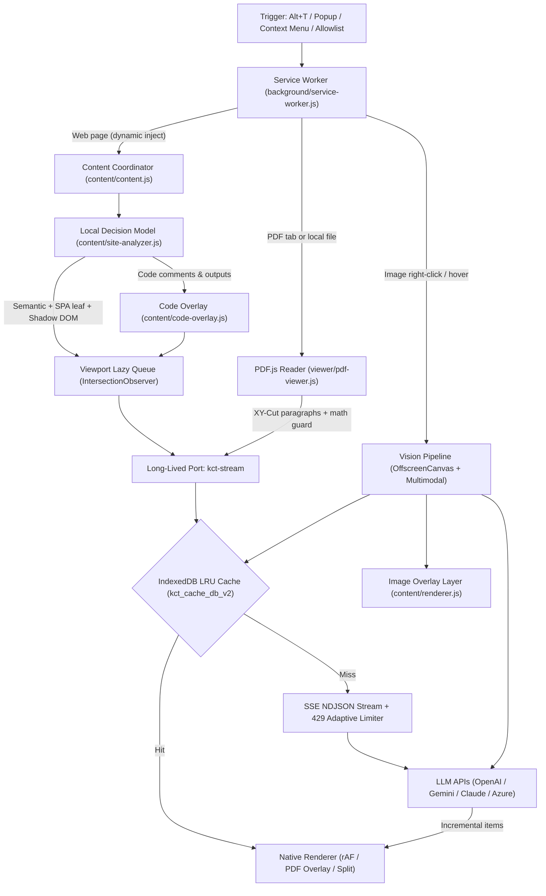
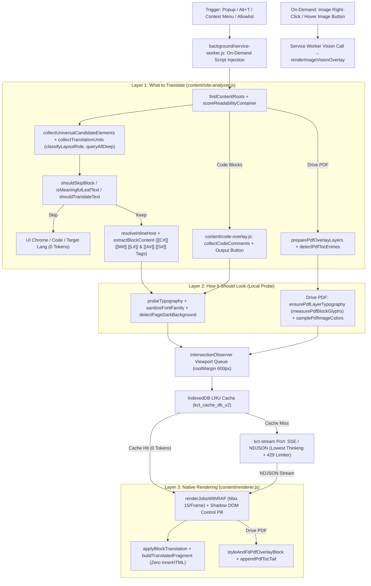

# NativeRead

**English** · [繁體中文](README.zh-TW.md) · [简体中文](README.zh-CN.md) · [日本語](README.ja.md) · [한국어](README.ko.md) · [Español](README.es.md) · [Français](README.fr.md) · [Deutsch](README.de.md)

**NativeRead (v2.6.1)** is a Manifest V3 browser extension and mobile PWA that translates web pages, PDFs, code comments, and embedded infographics while preserving the original page typography and layout. It stays silent by default, runs on demand with your own LLM API key, and streams translations paragraph by paragraph without breaking reading rhythm.

---

## 1. Product Overview & Quick Start

### Key Capabilities

| Feature | How It Works | Reading Experience |
| --- | --- | --- |
| **Silent-by-Default Web Translation** | Zero static `content_scripts`; dynamically injects via `chrome.scripting` on demand (`Alt+T`, popup button, context menu, or per-site allowlist `autoTranslateHosts`). | Zero overhead, zero floating UI, and zero API usage on sites you do not translate. |
| **Built-in PDF.js Reader** | Bundles local Apache-2.0 `PDF.js` (`vendor/pdfjs/`) inside `viewer/pdf-viewer.html`; supports remote PDFs, Google Drive links, and local `.pdf` drag-and-drop. | Switch between **Overlay**, **Split**, and **Original** modes (`1` / `2` / `3`); figures, tables, and displayed equations remain intact. |
| **Google Drive PDF In-Page Overlay** | Detects `.ndfHFb-c4YZDc-cYSp0e-DARUcf` viewer layers in place, merges same-column text boxes, rebuilds TOC dot leaders, and measures native glyph metrics from page rasters. | Translates multi-page Drive PDFs directly inside Google Drive without leaving the tab. |
| **On-Demand Image & Infographic Overlay** | Strictly on demand via right-click (**NativeRead Translate Image Text**) or hover pill (**譯圖**) on images `>= 200x140` px; never auto-scans page images. | Replaces text blocks in place using sampled background/foreground colors while preserving 3D diagrams and illustrations. |
| **Code Comments & Notebook Outputs** | Non-destructive CSS `attr()` swap for static `<pre>` blocks (Pygments, Prism, Highlight.js, GitHub `.pl-c`), read-only overlay for CodeMirror 6 (`.cm-editor`), and quick-translate buttons on Jupyter outputs. | Code stays editable and runnable; overlays hide automatically when you focus an editor or switch to original mode. |
| **Mobile & Cross-Platform** | Ships a standalone mobile PWA (`docs/`), a universal Userscript (`docs/nativeread.user.js`), an Android extension ZIP (`docs/nativeread-android-extension.zip`), and local QR-code `#nr_sync` sync. | Full translation workflow on iOS Safari and Android browsers without re-typing API keys. |

### Quick Start (Desktop Extension)

Requires Chromium 119+ (Chrome, Edge, Brave, or compatible browsers).

1. Clone the repository:
   ```bash
   git clone https://github.com/Chih-Kai-Wang/native-read.git
   ```
2. Open `chrome://extensions/` (or `edge://extensions/`) and enable **Developer mode**.
3. Click **Load unpacked** and select the cloned `native-read` directory.
4. Click the **NativeRead** toolbar icon → **Options**, choose a model provider, enter your API key, click **Fetch model list** and pick a model, then click **Test Connection** and save.
5. Trigger translation on any web page or PDF tab with **`Alt+T`** (**⌥ Option+T** on macOS; the popup shows your configured shortcut, customizable at `chrome://extensions/shortcuts`), the popup button, or the right-click menu. Click `☆` / `★` in the popup or floating pill to add/remove the current domain from your auto-translate allowlist.

### Supported Model Providers

Configured in `shared/config.js` (`PROVIDER_PRESETS`) as a data-driven registry of 32 presets across four groups (rendered with `<optgroup>` in Options and the PWA, where `scripts/build-mobile.js` generates `docs/providers.js` from the same source). Users can fetch available models live from the configured endpoint, local endpoints (`localhost`, `127.0.0.1`, `0.0.0.0`) do not require an API key, and any other OpenAI-compatible service works via `custom`.

| Group | Provider ID | Protocol | Base URL |
| --- | --- | --- | --- |
| Native | `gemini` | Gemini Native | `https://generativelanguage.googleapis.com/v1beta` |
| Native | `anthropic` | Anthropic Messages | `https://api.anthropic.com/v1` |
| International | `openai` | OpenAI | `https://api.openai.com/v1` |
| International | `azure` | OpenAI (api-key header) | `https://YOUR-RESOURCE.openai.azure.com/openai/v1` |
| International | `openrouter` | OpenAI | `https://openrouter.ai/api/v1` |
| International | `groq` | OpenAI | `https://api.groq.com/openai/v1` |
| International | `mistral` | OpenAI | `https://api.mistral.ai/v1` |
| International | `xai` | OpenAI | `https://api.x.ai/v1` |
| International | `together` | OpenAI | `https://api.together.xyz/v1` |
| International | `fireworks` | OpenAI | `https://api.fireworks.ai/inference/v1` |
| International | `cerebras` | OpenAI | `https://api.cerebras.ai/v1` |
| International | `deepinfra` | OpenAI | `https://api.deepinfra.com/v1/openai` |
| International | `huggingface` | OpenAI | `https://router.huggingface.co/v1` |
| International | `novita` | OpenAI | `https://api.novita.ai/openai` |
| International | `deepseek` | OpenAI | `https://api.deepseek.com/v1` |
| International | `qwen-intl` | OpenAI | `https://dashscope-intl.aliyuncs.com/compatible-mode/v1` |
| International | `moonshot-intl` | OpenAI | `https://api.moonshot.ai/v1` |
| International | `zai` | OpenAI | `https://api.z.ai/api/paas/v4` |
| International | `minimax-intl` | OpenAI | `https://api.minimax.io/v1` |
| International | `siliconflow-intl` | OpenAI | `https://api.siliconflow.com/v1` |
| Mainland China | `qwen` | OpenAI | `https://dashscope.aliyuncs.com/compatible-mode/v1` |
| Mainland China | `moonshot` | OpenAI | `https://api.moonshot.cn/v1` |
| Mainland China | `zhipu` | OpenAI | `https://open.bigmodel.cn/api/paas/v4` |
| Mainland China | `siliconflow` | OpenAI | `https://api.siliconflow.cn/v1` |
| Mainland China | `volcengine` | OpenAI | `https://ark.cn-beijing.volces.com/api/v3` |
| Mainland China | `qianfan` | OpenAI | `https://qianfan.baidubce.com/v2` |
| Mainland China | `hunyuan` | OpenAI | `https://api.hunyuan.cloud.tencent.com/v1` |
| Mainland China | `minimax` | OpenAI | `https://api.minimaxi.com/v1` |
| Mainland China | `stepfun` | OpenAI | `https://api.stepfun.com/v1` |
| Local & custom | `ollama` | OpenAI | `http://localhost:11434/v1` |
| Local & custom | `lmstudio` | OpenAI | `http://localhost:1234/v1` |
| Local & custom | `custom` | OpenAI | `http://localhost:11434/v1` |

- **Model selection & live list**: `gemini` is the default provider and only `gemini` (`gemini-3.5-flash-lite`), `anthropic` (`claude-opus-5-5`), and `openrouter` (`google/gemini-2.5-flash`) keep a default model; all other presets start empty so you can pick via **Fetch model list** (`LIST_MODELS` queries Gemini `GET /v1beta/models` with `generateContent`, Anthropic `GET /v1/models` with `after_id` pagination, or OpenAI-compatible `GET {baseUrl}/models`), warning if the current model is unlisted, prompting to choose a model before translating or testing when empty, and hinting to re-pick on 400/404/410/422 model-not-found or deprecated errors without rewriting saved settings.
- **Anthropic Claude (`anthropic`)**: Uses the native Messages API across the extension, Userscript, and PWA (streaming SSE, batch/single translation, Test Connection, and on-demand image translation via base64 image blocks), with suggested models `claude-sonnet-5-5` and `claude-haiku-5-5`, and checks `stop_reason` so refusals surface as clear errors.
- **Azure OpenAI (`azure`)**: Supports `*.openai.azure.com`, `*.services.ai.azure.com`, and `*.cognitiveservices.azure.com` endpoints; enter your deployment name in the model field (excluded from the live model list), and the API key is automatically sent in the `api-key` header.
- **Verification note**: Every hosted preset Base URL (all except the `azure` placeholder and the local `ollama` / `lmstudio` / `custom` endpoints) was probed live for endpoint availability, while Anthropic Claude and Azure OpenAI request/response support were verified with offline fixture tests (endpoint, headers, request body, and response/stream parsing) and have not yet been tested against the live APIs.
- **Target languages**: `zh-TW` (default), `zh-CN`, `ja`, `ko`, `es`, `fr`, `de`, `vi`, `pt`, plus custom language prompts.
- **Thinking effort (`thinkingEffort`)**: `fastest` (default), `balanced`, or `deep`. Automatically maps Gemini 3.x/4.x to `thinkingLevel` (`MINIMAL` / `LOW` / `MEDIUM`), Gemini 2.5 Flash to `thinkingBudget` (`0` / `512` / `2048`), OpenAI `o1`/`o3`/`o4` to `reasoning_effort: "low"`, DashScope `qwen3` to `enable_thinking: false` in `fastest` mode while stripping `thought` parts from responses, and Anthropic Claude to `output_config.effort` (`low` / `medium` / `high`) on models that support it without sending `temperature`, `top_p`, `top_k`, or a thinking config.

### Mobile & Cross-Platform Support

- **Mobile PWA (`https://chih-kai-wang.github.io/native-read/`)**: Installable to the Home Screen on iOS Safari and Android Chrome. Includes a mobile PDF.js reader (overlay / split / original, with Google Drive link resolution, a 15 s full-download timeout, and an "open PDF in a new tab" fallback button), a Web URL & direct-paste article translator, streaming translation across supported providers including Claude, an offline App Shell (`docs/sw.js`), and local IndexedDB caching.
- **Universal Userscript (`https://chih-kai-wang.github.io/native-read/nativeread.user.js`)**: Runs in iOS Safari (via *Stay* or *Userscripts*) and Android browsers (*Tampermonkey*, *Lemur*, *Kiwi*, *Firefox*). Injects a draggable Shadow DOM `NR` edge tab and falls back to `GM_xmlhttpRequest` when strict page CSPs block `fetch`.
- **Android Extension ZIP (`https://chih-kai-wang.github.io/native-read/nativeread-android-extension.zip`)**: Full MV3 package for Chromium-based Android browsers (*Lemur*, *Kiwi*, *Quetta*, *Edge Android*) with touch selection translation (`touchend` / `selectionchange`).
- **Local QR-Code `#nr_sync` Sync**: Generate a sync link and QR code in the desktop Options page; scanning it on mobile imports your provider, API key, model, and preferences into the PWA, Userscript, or Android extension and immediately wipes the URL fragment.

### Updates

- **Userscript**: Includes `@updateURL` (`docs/nativeread.meta.js`), `@downloadURL` (`docs/nativeread.user.js`), `@homepageURL`, and `@supportURL` so Tampermonkey, Violentmonkey, and Stay can update automatically.
- **Mobile PWA**: Uses a versioned Service Worker cache (`nativeread-pwa-v<version>`). When a new Service Worker takes control of an open page, an update banner appears and refreshing applies the new version.
- **Desktop Extension (Unpacked) & Android Extension ZIP**: When opened, the extension popup checks `version.json` on GitHub Pages (at most once per 24 hours; toggleable via `checkForUpdates` in Options) and displays `有新版本 vX（目前 vY）/ 查看更新` linking to the GitHub README when a newer version is available. Because these installs are not managed by a web store, updating still requires manual reinstall (pulling the latest repo and reloading, or re-importing the updated Android ZIP).

---

## 2. Technical Architecture



### 2.1 Local Zero-Latency Decision Model

All page segmentation, filtering, and typography decisions run locally in `content/site-analyzer.js` and `content/renderer.js` with zero extra LLM calls:

NativeRead runs a single universal three-layer local pipeline—with no per-site branches or adapters—to decide what to translate, match native typography, and render streams seamlessly with zero extra LLM calls.



- **Main-content detection (`findContentRoots`, `scoreReadabilityContainer`)**: Prioritizes embedded Jupyter/notebook cells (`LESSON_CELL_SELECTOR`), Google Drive PDF viewer pages (`.ndfHFb-c4YZDc-cYSp0e-DARUcf`), and semantic containers (`article`, `main`, `[role="main"]`, `.markdown-body`, `.prose`, `#mw-content-text`). Containers are scored by `textLen + pCount * 40`, penalized when `linkRatio > 0.55`, boosted `1.25x` for article/doc containers, and refined to tighter inner containers when they retain `>= 65%` of text. Top-level `#firstHeading` / `h1` headings are preserved.
- **Layout-model segmentation (`collectUniversalCandidateElements`, `collectTranslationUnits`, `classifyLayoutRole`)**: Segmentation no longer guesses translation units from tag names; `collectTranslationUnits` (called by `collectUniversalCandidateElements`) follows the CSS formatting model, treating the in-flow inline content of one block container (one inline formatting context) as a single translation unit.
  - *Layout role classification (`classifyLayoutRole`)*: Classifies each element from `getComputedStyle` (cached once per element per scan) as `BOX` (block-level or flex/grid item), `INLINE` (inline, inline-block…), `CONTENTS` (`display: contents`, transparent), or `OUT` (not rendered, `visibility: hidden`, visually hidden screen-reader text, absolutely/fixed-positioned or floated boxes, form controls, icon fonts). Hidden content (`display: none`, visually hidden) is not sent for translation, while floats and positioned boxes with real prose are walked as their own containers.
  - *Cell isolation, mixed runs & atomic inline content*: Containers whose text sits in side-by-side cells (e.g. a forum row: title | author | votes | comment count) are never merged into one sentence—each cell becomes its own unit. Containers with text beside a block child are split into runs: a run that is a single inline element becomes a unit, whereas bare text next to a block is left untranslated rather than wrapping page-owned text nodes (counted as `mixedSkipped` in `getLastSegmentationStats`). Atomic inline content (`code`, formulas, citations) never splits a paragraph, even when a displayed formula uses `display: block`.
  - *Legacy reference*: The previous two-pass scan is kept as `collectUniversalCandidateElementsLegacy` only for comparison.
- **Shadow DOM traversal (`queryAllDeep`, `ensureShadowModeStyle`)**: Traverses open `shadowRoot` trees up to depth 5 while skipping code editors and UI nodes (`SHADOW_SKIP_SELECTOR`), and injects `:host-context(html.kct-mode-*)` rules so Replace / Original / Bilingual switching works inside Shadow DOM.
- **Inline structure & protection tokens (`extractBlockContent`, `buildTranslatedFragment`, `resolveInlineHost`, `validateTranslatedTokens`)**: Emits atomic `[[C#]]` (inline code `code, kbd, var`), `[[M#]]` (math/citations `.katex, .MathJax, mjx-container, math, .mwe-math-element, sup.reference`), and `[[L#]]` (non-translatable `<a href>` links such as identifiers, URLs, or citation markers), plus paired `[[A#]]…[[/A#]]` (translatable clickable links) and `[[S#]]…[[/S#]]` (inline emphasis: bold/strong/italic/em/u/mark/s/small/sub/sup); `buildTranslatedFragment` restores atomic tokens as deep clones (`cloneNode(true)`) and paired tags as shallow clones (`cloneNode(false)`, keeping `href`/`class` with `id` stripped) into a `DocumentFragment`. When a block's text lives inside a single inline chain (e.g. `li > a > b`), `resolveInlineHost` descends into it so the translation renders inside the original link or emphasis without relying on the model. Before rendering, `validateTranslatedTokens` verifies that every placeholder appears once with balanced, properly nested paired tags; otherwise the block renders with `data-kct-structure-fallback="1"`, keeping the clickable original visible alongside the translation instead of silently dropping links.
- **Style preservation & flex/grid hosts (`[[S#]]`, `.kct-trans-wrap`, `resolveInlineHost`, `data-kct-flex-host`)**: Any inline element that looks different from its parent (font size, weight, style, or family, colour, decoration, an inline heading, or a screen-reader-only label) is kept as a paired `[[S#]]` tag. The typography each kept element had in its original position is recorded at extraction and re-applied to its clone if the site's CSS (e.g. child selectors like `.titleline > a`) no longer matches inside `.kct-trans-wrap`. In addition, `resolveInlineHost` never descends into flex/grid containers, and a flex/grid host keeps the whole translation in one layout cell (`data-kct-flex-host`). Nothing visible is ever dropped or merged: rendered but untranslatable inline content (icons, icon fonts, `aria-hidden` visuals, images, CSS-drawn elements) and block-level or out-of-flow descendants are kept in place as atomic `[[C#]]` tokens (bilingual mode hides the duplicate media copies), live controls and media (inputs, buttons, `video`, `canvas`, `iframe`, assigned `slot`s) never become part of a translation unit, hidden text (`display: none`, `visibility: hidden`, screen-reader-only labels) is never sent, and a unit never contains another unit.
- **Language filtering (`shouldTranslateText`)**: Filters out URLs, emails, file paths, Jupyter `In[]`/`Out[]` prompts, single-token ASCII code identifiers, and text already written in the target language using Unicode script ratios (for `zh-TW`/`zh-CN`, skips Han ratio `>= 0.55` with `< 6` Latin words while still translating Japanese text with Kana ratio `>= 0.12`).
- **Font-gene pairing (`probeTypography`, `detectRenderedSerif`, `sanitizeFontFamily`, `content/content.css`)**: Classifies each block as `serif`, `sans`, or `mono` from computed `fontFamily`—and when a site font is not recognised by name (e.g. the `CMS` Computer Modern webfont declaring a `sans-serif` fallback), `detectRenderedSerif` draws `"I"` on a canvas to check for serifs (cached per family) so serif sites get serif CJK fonts—then strips generic CSS catch-all families (`serif`, `sans-serif`, `monospace`, `system-ui`, etc.) so up to 5 site-specific Latin fonts remain in `--kct-orig-font`, and appends the matching target-language stack (`var(--kct-orig-font), var(--kct-font-serif|sans|mono)`). Dense unclamped prose blocks with `lineHeight / fontSize < 1.62` receive a selective `line-height: 1.72` lift (`data-kct-lh-lift="1"`).

### 2.2 Dual PDF Native-Layout Pipelines

NativeRead maintains two specialized PDF pipelines tailored to how PDFs are rendered in the browser:

| Stage | Built-in PDF.js Reader (`viewer/pdf-viewer.js`) | Google Drive In-Page Overlay (`site-analyzer.js` + `renderer.js`) |
| --- | --- | --- |
| **Text & Geometry Source** | `pdfPage.getTextContent()` transformed to CSS viewport coordinates; skips rotated text (`\|angle\| > 0.25`). | Percentage-positioned hidden `<p>` nodes inside `.ndfHFb-c4YZDc-cYSp0e-DARUcf-Df1ZY-bN97Pc-haAclf`. |
| **Column & Paragraph Grouping** | Baseline row clustering, geometric superscript/subscript absorption, contiguous gutter column splitting, de-hyphenation, and recursive XY-Cut reading order (Y-Cut → X-Cut → interior X-valley straddler split). | Cross-group same-column merging (`leftDiff <= 3.6%`, `hRatio <= 0.36`), de-hyphenation, and `nearestBelowTop` safe-height clamping; absorbed `<p>` nodes hidden via `data-kct-pdf-merged="absorbed"`. |
| **Math & TOC Handling** | Skips displayed equations (`isDisplayedMathBlock`), protects inline math with `[[M#]]`, and normalizes leaked LaTeX to Unicode (`cleanLatexMathInText`). | `detectPdfTocEntries` finds `>= 3` right-aligned TOC rows (within `1.2%`), translates only titles, and rebuilds native flex rows with CSS dotted leaders (`.kct-pdf-toc-leader`) and tabular page numbers. |
| **Typography & Weight Sizing** | Reads PDF font metadata (`isSerif`, `isBold`, `isItalic`, `isMono`, `isMathFont`) from `styles` and `commonObjs`. | `ensurePdfLayerTypography` measures x-height ink bands (`0.53` Latin / `0.88` CJK) and stroke ratios (`>= 1.3x` median = bold) directly from page `` rasters, clustering near-equal sizes (`1.08x` tolerance) to a shared median. |
| **Color & Collision Protection** | Single `ctx.getImageData` per page samples perimeter median `bg` + WCAG contrast `fg`; `refineMaxHeightWithCanvasInk` scans below each paragraph to avoid overlapping figures/rules and detects compact diagram labels. | `samplePdfImageColors` samples perimeter median `bg` and contrast-adjusted `fg` from each page `` (bound to `img.currentSrc \|\| img.src`), with `2px` box-shadow halo and `:hover` expansion. |
| **Display Modes** | **Overlay**, **Split** (canvas + translated cards), **Original**, plus click-to-compare popover. | **Replace**, **Original**, and **Bilingual** (compact in-place overlay that expands into a bilingual card on hover). |

### 2.3 On-Demand Multimodal Image Overlay Pipeline

1. **Explicit user trigger**: Activated only when the user right-clicks an image (**NativeRead 翻譯圖片文字**) or clicks the hover pill (**譯圖**) on content images `>= 200x140` px (excluding nav/header/footer and Google Drive PDF page rasters).
2. **Background fetch & downscaling (`background/service-worker.js`)**: `prepareImagePayloadForVision` downloads `http(s):` images from the Service Worker (avoiding page Canvas CORS taint; 16 MB cap, 20 s timeout, magic-byte MIME sniffing) or accepts `data:` URLs for local/blob images. Using `createImageBitmap` + `OffscreenCanvas`, it creates a `~480px` alpha-preserving sample buffer and re-encodes images exceeding `1600px` or `4 MB`.
3. **Structured Vision inference, ink refinement & color sampling**: `callVisionImageLLM` sends a single multimodal request (Gemini `inlineData`, OpenAI `image_url`, or Anthropic Messages base64 `image` block; 60 s timeout, always using at least the `balanced` thinking level for more reliable boxes) returning `{"blocks":[{"box_2d":[ymin,xmin,ymax,xmax],"text":"...","role":"title|badge|body"}]}` in 0–1000 coordinates. `refineImageBoxToInk` expands each box per side by at most `~0.6 ×` one line height to cover cut-off glyph edges while bridging only letter spacing and stopping at solid borders or illustration edges. `sampleImageBoxColors` computes modal perimeter `bg` and WCAG-checked interior `fg` for each box, strips stray spaces/newlines between CJK characters, and caches the result in IndexedDB under versioned `img:v4:` keys by both SHA-256 digest and normalized URL.
4. **In-place overlay rendering (`content/renderer.js`)**: `renderImageVisionOverlay` wraps the `` in `.kct-img-overlay-host`, aligns `.kct-img-overlay-layer` to exact image dimensions, places each block with adaptive font shrinking (`fitVisionOverlayBlock`) while unifying font size across labels of the same role (`title` / `badge` / `body`), and lets users toggle **原圖 / 顯示譯圖** on demand.

### 2.4 Streaming, Viewport Lazy Loading, Rate Limiting & LRU Cache

- **SSE / NDJSON streaming & resilient fallback**: Content scripts and the PDF viewer connect over a long-lived `kct-stream` port. The Service Worker streams Gemini (`:streamGenerateContent?alt=sse`), OpenAI (`stream: true`), or Anthropic Messages SSE NDJSON lines (`{"i":0,"t":"..."}`), parsed incrementally via `createIncrementalJsonScanner`. Missing items or broken streams fall back to batch JSON (`TRANSLATE_BATCH`) with recursive bisection (`translateItemsWithFallback`, up to depth 3).
- **rAF micro-batching & viewport lazy loading**: Streamed web translations flush through `renderJobsWithRAF` in slices of up to `15` items per animation frame (`scheduler.yield()` between slices when supported). Off-screen blocks are deferred via `IntersectionObserver` (`rootMargin: 600px 0px` for web; `500px 0px` for PDF.js), queued viewport-first with up to `3` concurrent batch workers (`batchSize: 20`, `maxBatchChars: 5500`).
- **Cross-frame 429 adaptive rate limiter**: `background/service-worker.js` enforces a global concurrency cap of `3` across frames. On HTTP `429`, it parses `Retry-After` / `retryDelay`, triggers a 90 s adaptive pacing window (concurrency `1`, `4.3s` inter-request gap) plus global cooldown, and separates daily/zero quota exhaustion (`QUOTA_EXCEEDED`) from temporary RPM limits (`RATE_LIMITED`).
- **IndexedDB LRU cache (`shared/cache-db.js`)**: Stores up to `20,000` entries in `kct_cache_db_v2` (store `entries`, indexed by `ts`), keyed by `protocol:model:thinkingEffort:targetLang:customLang:glossaryHash`. Cache hits debounce-touch `ts` (`60s` threshold, `250ms` debounce) so overflow eviction removes least-recently-used records.

### 2.5 Project Structure

```text
native-read/
├── manifest.json                 # MV3 manifest, version source of truth, permissions, Alt+T command
├── shared/
│   ├── config.js                 # Schema v5 settings, 32-provider registry (PROVIDER_PRESETS), thinking config, URL/PDF helpers
│   ├── cache-db.js               # IndexedDB kct_cache_db_v2 20,000-entry LRU cache
│   └── pdf-layout.mjs            # Pure PDF geometry, equation/LaTeX math guard, Computer Modern serif detection & anti-echo helpers
├── background/
│   └── service-worker.js         # Dynamic injector, SSE/NDJSON streamer, 429 limiter, Vision engine, #nr_sync guard
├── content/
│   ├── site-analyzer.js          # Local decision model (Readability, 2-pass SPA, Shadow DOM, Drive PDF merge/TOC)
│   ├── code-overlay.js           # Static <pre> comment swap, CodeMirror 6 overlay, Jupyter output translator
│   ├── renderer.js               # Safe DOM renderer, font-gene pairing, Drive PDF raster metrics, image overlays
│   ├── content.js                # Viewport lazy queue, kct-stream client, Shadow DOM pill/selection/image UI
│   └── content.css               # Replace/Original/Bilingual modes, font stacks, Drive PDF & image overlay styles
├── viewer/                       # Built-in PDF.js reader (pdf-viewer.html / .css / .js)
├── popup/                        # Extension popup controls, allowlist toggle, update notice, PDF reader launcher
├── options/                      # Settings page, provider/model config, glossary, local QR sync, cache controls
├── icons/                        # Extension icons (16 / 48 / 128 px)
├── scripts/
│   └── build-mobile.js           # Stamps version; generates Userscript, meta.js, version.json, Android ZIP, PDF.js/icons
├── docs/                         # GitHub Pages mobile PWA (index.html, app.js, app.css, sw.js, generated providers.js & bundles)
├── tests/                        # Offline regression fixtures (including tests/fixtures/inline-structure/ for link/emphasis preservation)
├── LICENSE                       # MIT License
└── README*.md                    # Multilingual product, architecture, and security documentation
```

---

## 3. Privacy & Security Architecture

| Area | Implementation |
| --- | --- |
| **Local Storage** | Extension settings and API keys live only in `chrome.storage.local` (`kct_settings_v1`); PWA settings live in `localStorage`; Userscript settings live in `GM_getValue`/`GM_setValue` (`localStorage` fallback). Translation caches live locally in IndexedDB (`kct_cache_db_v2`) and can be cleared anytime. |
| **Network Endpoints** | Extension and Userscript traffic goes directly to your configured LLM endpoint—including `api.anthropic.com` or Azure OpenAI hosts when selected—with API keys placed strictly in HTTP headers (`x-goog-api-key`, `Authorization: Bearer`, `x-api-key` + `anthropic-version: 2026-10-21` + `anthropic-dangerous-direct-browser-access: true` for Anthropic, or `api-key` for Azure) and redacted from error messages (`redactApiKey`). Remote PDFs and on-demand images are fetched directly from their source URLs by the Service Worker. |
| **Update Check** | When the extension popup is opened (and `checkForUpdates` is enabled, default on), it fetches `https://chih-kai-wang.github.io/native-read/version.json` at most once per 24 hours (cached in `chrome.storage.local` under `nr_update_check_v1`, 5 s timeout, `credentials: 'omit'`, no extra permissions, no background timers). The JSON payload is strictly validated and never used as a URL; the update link is hard-coded to the GitHub README. Uncheck `checkForUpdates` in Options to disable it completely. |
| **Model List** | Clicking **Fetch model list** in Options sends `LIST_MODELS` (extension-only, `isExtensionSender`) directly to the configured provider (`GET /v1beta/models`, `GET /v1/models`, or `GET {baseUrl}/models`; 10 s timeout, Azure excluded) and caches returned model IDs only (never the API key, max 20 endpoints) in `chrome.storage.local` under `nr_model_list_v1`. |
| **`#nr_sync` Fragment Handling** | Sync payloads live exclusively in the URL `#` fragment (never `?query`), which browsers do not transmit in HTTP requests. `background/service-worker.js` accepts `#nr_sync` only from the extension origin or `https://chih-kai-wang.github.io/native-read`, rejects endpoint mutations (`baseUrl` / `protocol` / `providerId`) unless an explicit `apiKey` is included, validates `http:`/`https:` schemes, and immediately clears the fragment with `history.replaceState`. |
| **Zero-`innerHTML` DOM Safety** | All translated strings, popovers, and overlays are written via `document.createTextNode` and `.textContent`. Atomic placeholders (`[[C#]]`, `[[M#]]`, `[[L#]]`) restore only cloned pre-existing DOM nodes, paired tags (`[[A#]]`, `[[S#]]`) rebuild only shallow clones (`cloneNode(false)`) of pre-existing elements, and the `validateTranslatedTokens` structure guard keeps the original visible on mismatch so a link is never dropped. |
| **MV3 CSP & PDF.js Hardening** | PDF.js is bundled locally with `isEvalSupported: false` in both `viewer/pdf-viewer.js` and `docs/app.js`. Privileged Service Worker actions (`ENSURE_AND_COMMAND`, `TEST_CONNECTION`, `LIST_MODELS`, `OPEN_PDF_VIEWER`, `GET_SW_DEBUG`, `CLEAR_CACHE`) enforce `isExtensionSender(sender)`. |
| **UI & QR Isolation** | Floating pills, selection popovers, image hover triggers, and Userscript controls are isolated inside Shadow DOM (`all: initial`). Sync QR codes are generated locally in the Options page without calling external QR services. |

> **Note on the Mobile PWA (`docs/app.js`)**: For PDF URLs, NativeRead resolves Google Drive links and uses direct browser fetch only (15 s full-download timeout, no `api.allorigins.win` relay, plus an "open PDF in a new tab" fallback button and local-file guidance) so private PDF URLs/bytes are never sent to a third-party relay. In the PWA's optional **Web URL** tab, cross-origin public article extraction (`fetchReadableArticleFromUrl`) currently uses `r.jina.ai` (with an `api.allorigins.win` fallback); if you require zero third-party relays on mobile, paste article text directly in the Web tab or use the Userscript / Android extension instead.

---

## Development

Build mobile distribution artifacts and run syntax checks across all JavaScript files:

```bash
node scripts/build-mobile.js
for f in shared/*.js shared/*.mjs background/*.js content/*.js popup/*.js options/*.js viewer/*.js scripts/*.js docs/app.js docs/sw.js docs/pdf-layout.mjs docs/nativeread.user.js; do node --check "$f" || exit 1; done
```

`manifest.json` `"version"` is the single source of truth (`MAJOR.MINOR.PATCH`). Running `node scripts/build-mobile.js` validates the version and stamps it into the Userscript `@version`, `docs/sw.js` `CACHE_NAME` (`nativeread-pwa-v<version>`), and the PWA badge in `docs/index.html`.

`docs/nativeread.user.js`, `docs/nativeread.meta.js`, `docs/version.json`, `docs/pdf-layout.mjs`, `docs/nativeread-android-extension.zip`, `docs/vendor/pdfjs/`, `docs/icons/`, and `docs/.nojekyll` are generated by `scripts/build-mobile.js`—edit the source modules under `shared/`, `content/`, `viewer/`, and `docs/app.js`, then re-run the build script.

**Release flow (maintainers)**: bump `"version"` in `manifest.json` → run `node scripts/build-mobile.js` → commit and push so GitHub Pages serves the updated PWA, Userscript, metadata, `version.json`, and Android ZIP.

**Regression corpus (`tests/corpus/`)**: `capture.sh` snapshots real pages through ego-browser (serializing DOM and CSS from `document.styleSheets`, scrambling every word to a same-length pseudo-word, and replacing links/images; snapshots are git-ignored), while `run.sh [git-rev]` renders every snapshot plus the hand-written `fixtures/edge-cases.html` with a 1:1 fake translator and reports, per page, segmenter-independent invariants: merged cells, non-inline boxes inside translations, lost links, changed typography (`styleLost`), fallbacks, unmet `data-expect` expectations, horizontal overflow, unit count, and coverage. It reproduces the v2.5.0 Kaggle bug and is clean on 8 sites (Kaggle, Wikipedia, colah, MDN, Hacker News, Stack Overflow, GitHub, arXiv) with v2.6.0.

---

## Roadmap / Not yet supported

- **Browser web stores**: Not yet published on the Chrome Web Store or Edge Add-ons; desktop installation currently requires **Load unpacked** without store auto-updates.
- **Cloud PDF link resolvers**: Dropbox, OneDrive, and Box PDF links are not converted yet (Google Drive links are supported).
- **Additional media & formats**: No video subtitle translation, no OCR for scanned PDFs, and no EPUB or Office document support.
- **UI localization**: Extension and PWA interface strings are currently Traditional Chinese only.
- **Other desktop browsers**: Desktop Firefox and Safari are not officially supported.

---

## License

Released under the [MIT License](LICENSE). Bundled PDF.js (`vendor/pdfjs/` and `docs/vendor/pdfjs/`) is licensed under the Apache-2.0 License (see [docs/vendor/pdfjs/LICENSE](docs/vendor/pdfjs/LICENSE)).
