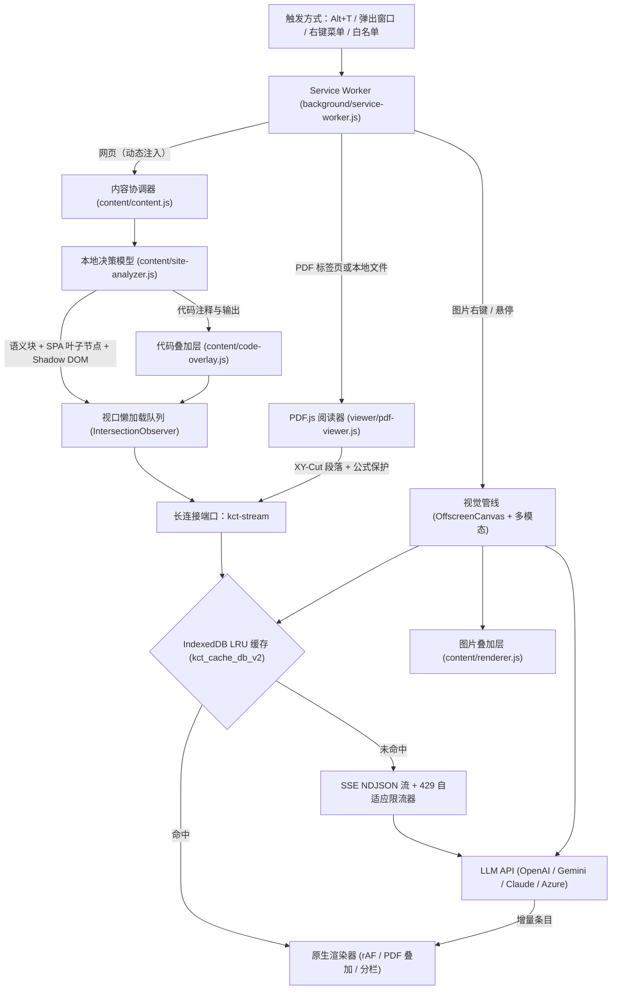
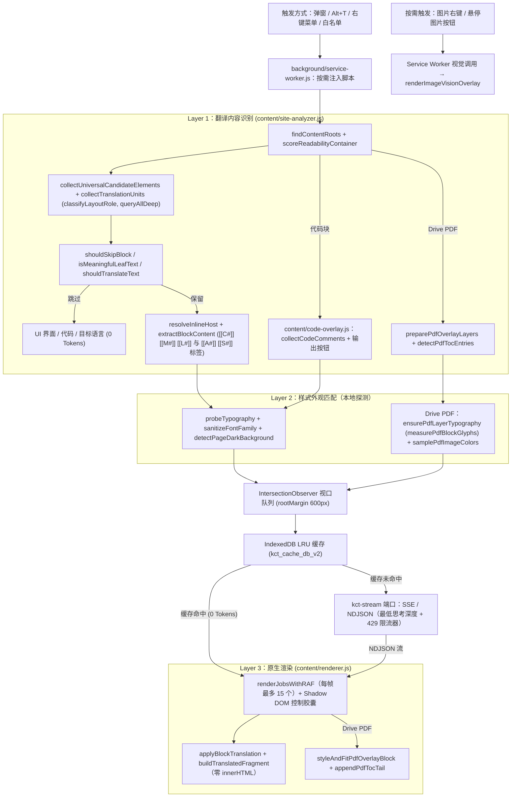

# NativeRead

[English](README.md) · [繁體中文](README.zh-TW.md) · **简体中文** · [日本語](README.ja.md) · [한국어](README.ko.md) · [Español](README.es.md) · [Français](README.fr.md) · [Deutsch](README.de.md)

**NativeRead (v2.9.0)** 是一款整合 Manifest V3 浏览器扩展程序、iOS/macOS 原生 App 与 Safari 扩展、Android 原生 APK 及移动端 PWA 的翻译工具，可在保留原始页面排版与布局的前提下，翻译网页、PDF、代码注释及嵌入式信息图。它默认保持静默，仅在需要时使用你自己的 LLM API 密钥按需运行，并逐段流式输出译文，不打断阅读节奏。

---

## 1. 产品概览与快速开始

### 核心功能

| 功能 | 实现原理 | 阅读体验 |
| --- | --- | --- |
| **默认静默的网页翻译** | 零静态 `content_scripts`；仅在需要时通过 `chrome.scripting` 动态注入（`Alt+T`、弹出窗口按钮、右键菜单或站点白名单 `autoTranslateHosts`）。 | 在无需翻译的网站上实现零开销、零悬浮 UI、零 API 消耗。 |
| **内置 PDF.js 阅读器** | 在 `viewer/pdf-viewer.html` 中内置本地 Apache-2.0 协议的 `PDF.js`（`vendor/pdfjs/`）；支持远程 PDF、Google Drive 链接以及本地 `.pdf` 拖拽打开。 | 可在 **Overlay**、**Split** 和 **Original** 模式间切换（`1` / `2` / `3`）；插图、表格与独立公式保持完整。 |
| **Google Drive PDF 页内叠加** | 原位识别 `.ndfHFb-c4YZDc-cYSp0e-DARUcf` 浏览层，合并同栏文本框、重建目录点线引导符，并从页面光栅图像中测量原生字形度量。 | 无需离开当前标签页，即可直接在 Google Drive 内翻译多页 PDF。 |
| **按需图片与信息图叠加翻译** | 严格按需触发：对 `>= 200x140` px 的图片通过右键菜单（**NativeRead 翻譯圖片文字**）或悬停胶囊按钮（**譯圖**）启用；从不自动扫描页面图片。 | 采样背景色与前景色后原位替换文本块，同时保留 3D 图表与插画。 |
| **代码注释与 Notebook 输出** | 对静态 `<pre>` 代码块（Pygments、Prism、Highlight.js、GitHub `.pl-c`）采用非破坏性 CSS `attr()` 替换；为 CodeMirror 6（`.cm-editor`）提供只读叠加层；为 Jupyter 输出提供快捷翻译按钮。 | 代码保持可编辑、可运行；聚焦编辑器或切换回原文模式时叠加层自动隐藏。 |
| **移动端与跨平台支持** | 提供独立移动端 PWA（`docs/`）、通用用户脚本（`docs/nativeread.user.js`）、Android 扩展程序 ZIP 包（`docs/nativeread-android-extension.zip`）以及本地 QR 二维码 `#nr_sync` 同步。 | 在 iOS Safari 与 Android 浏览器上无需重复输入 API 密钥即可获得完整翻译体验。 |

### 快速开始（桌面端扩展程序）

需要 Chromium 119+（Chrome、Edge、Brave 或其他兼容浏览器）。

1. 克隆仓库：
   ```bash
   git clone https://github.com/Chih-Kai-Wang/native-read.git
   ```
2. 打开 `chrome://extensions/`（或 `edge://extensions/`）并开启 **Developer mode**（开发者模式）。
3. 点击 **Load unpacked**（加载已解压的扩展程序），选择克隆下来的 `native-read` 目录。
4. 点击 **NativeRead** 工具栏图标 → **Options**，选择模型提供商并输入 API 密钥，点击 **Fetch model list** 选择模型，然后点击 **Test Connection** 并保存。
5. 在任意网页或 PDF 标签页中按下 **`Alt+T`**（macOS 上为 **⌥ Option+T**；弹出窗口会显示您配置的快捷键，可在 `chrome://extensions/shortcuts` 自定义）、点击弹出窗口按钮或使用右键菜单即可触发翻译。点击弹出窗口或悬浮胶囊上的 `☆` / `★`，可将当前域名加入或移出自动翻译白名单。

### 支持的模型提供商

在 `shared/config.js`（`PROVIDER_PRESETS`）中配置为包含四大分组、共 32 个预设的数据驱动注册表（在选项页面和 PWA 中通过 `<optgroup>` 渲染，其中 `scripts/build-mobile.js` 会从同一数据源生成 `docs/providers.js`）。用户可从已配置的端点实时获取可用模型，本地端点（`localhost`、`127.0.0.1`、`0.0.0.0`）无需 API 密钥，任何其他 OpenAI 兼容服务均可通过 `custom` 使用。

| 分组 | 提供商 ID | 协议 | Base URL |
| --- | --- | --- | --- |
| 原生 | `gemini` | Gemini Native | `https://generativelanguage.googleapis.com/v1beta` |
| 原生 | `anthropic` | Anthropic Messages | `https://api.anthropic.com/v1` |
| 国际 | `openai` | OpenAI | `https://api.openai.com/v1` |
| 国际 | `azure` | OpenAI (api-key header) | `https://YOUR-RESOURCE.openai.azure.com/openai/v1` |
| 国际 | `openrouter` | OpenAI | `https://openrouter.ai/api/v1` |
| 国际 | `groq` | OpenAI | `https://api.groq.com/openai/v1` |
| 国际 | `mistral` | OpenAI | `https://api.mistral.ai/v1` |
| 国际 | `xai` | OpenAI | `https://api.x.ai/v1` |
| 国际 | `together` | OpenAI | `https://api.together.xyz/v1` |
| 国际 | `fireworks` | OpenAI | `https://api.fireworks.ai/inference/v1` |
| 国际 | `cerebras` | OpenAI | `https://api.cerebras.ai/v1` |
| 国际 | `deepinfra` | OpenAI | `https://api.deepinfra.com/v1/openai` |
| 国际 | `huggingface` | OpenAI | `https://router.huggingface.co/v1` |
| 国际 | `novita` | OpenAI | `https://api.novita.ai/openai` |
| 国际 | `deepseek` | OpenAI | `https://api.deepseek.com/v1` |
| 国际 | `qwen-intl` | OpenAI | `https://dashscope-intl.aliyuncs.com/compatible-mode/v1` |
| 国际 | `moonshot-intl` | OpenAI | `https://api.moonshot.ai/v1` |
| 国际 | `zai` | OpenAI | `https://api.z.ai/api/paas/v4` |
| 国际 | `minimax-intl` | OpenAI | `https://api.minimax.io/v1` |
| 国际 | `siliconflow-intl` | OpenAI | `https://api.siliconflow.com/v1` |
| 中国大陆 | `qwen` | OpenAI | `https://dashscope.aliyuncs.com/compatible-mode/v1` |
| 中国大陆 | `moonshot` | OpenAI | `https://api.moonshot.cn/v1` |
| 中国大陆 | `zhipu` | OpenAI | `https://open.bigmodel.cn/api/paas/v4` |
| 中国大陆 | `siliconflow` | OpenAI | `https://api.siliconflow.cn/v1` |
| 中国大陆 | `volcengine` | OpenAI | `https://ark.cn-beijing.volces.com/api/v3` |
| 中国大陆 | `qianfan` | OpenAI | `https://qianfan.baidubce.com/v2` |
| 中国大陆 | `hunyuan` | OpenAI | `https://api.hunyuan.cloud.tencent.com/v1` |
| 中国大陆 | `minimax` | OpenAI | `https://api.minimaxi.com/v1` |
| 中国大陆 | `stepfun` | OpenAI | `https://api.stepfun.com/v1` |
| 本地与自定义 | `ollama` | OpenAI | `http://localhost:11434/v1` |
| 本地与自定义 | `lmstudio` | OpenAI | `http://localhost:1234/v1` |
| 本地与自定义 | `custom` | OpenAI | `http://localhost:11434/v1` |

- **模型选择与实时列表**：`gemini` 为默认提供商，且仅 `gemini`（`gemini-3.5-flash-lite`）、`anthropic`（`claude-opus-5-5`）和 `openrouter`（`google/gemini-2.5-flash`）保留默认模型；其余所有预设默认留空，以便你通过 **Fetch model list** 获取并选择模型（`LIST_MODELS` 会查询 Gemini `GET /v1beta/models` 中支持 `generateContent` 的模型、Anthropic `GET /v1/models` 及其 `after_id` 分页，或 OpenAI 兼容的 `GET {baseUrl}/models`）。若当前模型不在列表中会发出警告；模型为空时在翻译或测试前会提示选择模型；遇到 400/404/410/422 模型未找到或已弃用错误时，会提示重新选择而不会覆盖已保存的设置。
- **Anthropic Claude (`anthropic`)**：在扩展程序、用户脚本和 PWA 中均使用原生 Messages API（支持 SSE 流式传输、批量/单条翻译、Test Connection 以及通过 base64 image 块进行按需图片翻译），推荐模型为 `claude-sonnet-5-5` 和 `claude-haiku-5-5`，并会检查 `stop_reason` 以便将拒答情况转化为清晰的错误提示。
- **Azure OpenAI (`azure`)**：支持 `*.openai.azure.com`、`*.services.ai.azure.com` 和 `*.cognitiveservices.azure.com` 端点；在模型字段填写你的部署名称（不参与实时模型列表获取），API 密钥会自动通过 `api-key` 请求头发送。
- **验证说明**：除 `azure` 模板网址与本地 `ollama`／`lmstudio`／`custom` 端点外，每个云端预设的 Base URL 均已进行在线端点可用性探测；而 Anthropic Claude 和 Azure OpenAI 的请求/响应支持已通过离线夹具测试（端点、请求头、请求体以及响应/流解析），尚未针对线上真实 API 进行测试。
- **目标语言**：`zh-TW`（默认）、`zh-CN`、`ja`、`ko`、`es`、`fr`、`de`、`vi`、`pt`，以及自定义语言提示词。
- **思考深度 (`thinkingEffort`)**：`fastest`（默认）、`balanced` 或 `deep`。会自动将 Gemini 3.x/4.x 映射为 `thinkingLevel`（`MINIMAL` / `LOW` / `MEDIUM`），将 Gemini 2.5 Flash 映射为 `thinkingBudget`（`0` / `512` / `2048`），将 OpenAI `o1`/`o3`/`o4` 映射为 `reasoning_effort: "low"`，在 `fastest` 模式下为 DashScope `qwen3` 设置 `enable_thinking: false` 并从响应中剥离 `thought` 部分，以及在支持的 Anthropic Claude 模型上设置 `output_config.effort`（`low` / `medium` / `high`），且不发送 `temperature`、`top_p`、`top_k` 或 thinking 配置。

### 移动端与跨平台支持

- **移动端 PWA (`https://chih-kai-wang.github.io/native-read/`)**：可添加到 iOS Safari 和 Android Chrome 的主屏幕。内置移动端 PDF.js 阅读器（overlay / split / original 模式，支持 Google Drive 链接解析、15 s 完整下载超时以及“在新标签页中打开 PDF”的回退按钮）、Web URL 与直接粘贴文章翻译器、支持包括 Claude 在内的各提供商流式翻译、离线 App Shell（`docs/sw.js`）以及本地 IndexedDB 缓存。
- **通用用户脚本 (`https://chih-kai-wang.github.io/native-read/nativeread.user.js`)**：可在 iOS Safari（通过 *Stay* 或 *Userscripts*）以及 Android 浏览器（*Tampermonkey*、*Lemur*、*Kiwi*、*Firefox*）中运行。注入可拖拽的 Shadow DOM `NR` 侧边标签，并在页面严格 CSP 拦截 `fetch` 时回退到 `GM_xmlhttpRequest`。
- **Android 扩展程序 ZIP (`https://chih-kai-wang.github.io/native-read/nativeread-android-extension.zip`)**：适用于基于 Chromium 的 Android 浏览器（*Lemur*、*Kiwi*、*Quetta*、*Edge Android*）的完整 MV3 扩展包，支持触控划词翻译（`touchend` / `selectionchange`）。
- **本地二维码 `#nr_sync` 同步**：在桌面端 Options 页面生成同步链接与二维码；在移动端扫描后即可将提供商、API 密钥、模型及偏好设置导入 PWA、用户脚本或 Android 扩展程序，并立即清除 URL 片段。

### 更新机制

- **用户脚本**：包含 `@updateURL`（`docs/nativeread.meta.js`）、`@downloadURL`（`docs/nativeread.user.js`）、`@homepageURL` 和 `@supportURL`，因此 Tampermonkey、Violentmonkey 和 Stay 可自动更新。
- **移动端 PWA**：使用带版本号的 Service Worker 缓存（`nativeread-pwa-v<version>`）。当新版 Service Worker 接管已打开的页面时，会显示更新横幅，刷新即可应用新版本。
- **桌面端扩展程序（未打包）与 Android 扩展程序 ZIP**：打开扩展程序弹出窗口时，会检查 GitHub Pages 上的 `version.json`（每 24 小时最多一次；可在 Options 中通过 `checkForUpdates` 开关），当有新版本时显示 `有新版本 vX（目前 vY）/ 查看更新` 并链接至 GitHub README。由于此类安装方式不受应用商店托管，更新仍需手动重新安装（拉取最新仓库并重新加载，或重新导入更新后的 Android ZIP）。

---

## 2. 技术架构



### 2.1 本地零延迟决策模型

所有页面分段、过滤与排版决策均在 `content/site-analyzer.js` 和 `content/renderer.js` 中本地完成，不产生任何额外的 LLM 调用：

NativeRead 运行一套通用的三层本地流水线——无需针对特定网站编写分支或适配器——即可决定翻译内容、匹配原生排版，并在不产生额外 LLM 调用的情况下流畅渲染流式结果。



- **正文区域识别 (`findContentRoots`, `scoreReadabilityContainer`)**：优先识别嵌入式 Jupyter/notebook 单元格（`LESSON_CELL_SELECTOR`）、Google Drive PDF 浏览页（`.ndfHFb-c4YZDc-cYSp0e-DARUcf`）以及语义容器（`article`、`main`、`[role="main"]`、`.markdown-body`、`.prose`、`#mw-content-text`）。容器按 `textLen + pCount * 40` 计分，当 `linkRatio > 0.55` 时扣分，文章/文档容器获得 `1.25x` 加成；若更紧凑的内层容器保留了 `>= 65%` 的文本，则进一步细化到内层容器。顶层 `#firstHeading` / `h1` 标题会被保留。
- **基于布局模型的分段 (`collectUniversalCandidateElements`, `collectTranslationUnits`, `classifyLayoutRole`)**：分段不再根据标签名猜测翻译单元；`collectTranslationUnits`（由 `collectUniversalCandidateElements` 调用）遵循 CSS 格式化模型，将单个块级容器（一个行内格式化上下文）内的常规流（in-flow）行内内容视为一个翻译单元。
  - *布局角色分类 (`classifyLayoutRole`)*：根据 `getComputedStyle`（每次扫描对每个元素缓存一次）将元素分类为 `BOX`（块级或 flex/grid 项）、`INLINE`（inline、inline-block 等）、`CONTENTS`（`display: contents`，透明）或 `OUT`（未渲染、`visibility: hidden`、视觉隐藏的屏幕阅读器文本、绝对/固定定位或浮动盒、表单控件、图标字体）。隐藏内容（`display: none`、视觉隐藏）不会发送翻译，而包含真实正文的浮动盒和定位盒会作为各自独立的容器进行遍历。
  - *单元格隔离、混合片段与原子行内内容*：文本位于并排单元格中的容器（例如论坛列表行：标题 | 作者 | 投票数 | 评论数）绝不会被合并为同一句话——每个单元格都会成为独立的单元。同时包含文本和块级子元素的容器会被拆分为多个片段（run）：单个行内元素构成的片段会成为一个单元，而紧邻块级元素的裸文本则保留不译，以避免包裹页面自身的文本节点（在 `getLastSegmentationStats` 中计为 `mixedSkipped`）。原子行内内容（`code`、公式、引用）绝不会拆分段落，即使独立成行的公式使用了 `display: block`。
  - *旧版参考*：此前的两遍式扫描仅作为 `collectUniversalCandidateElementsLegacy` 保留用于对比。
- **Shadow DOM 遍历 (`queryAllDeep`, `ensureShadowModeStyle`)**：遍历深度最多 5 层的开放 `shadowRoot` 树，跳过代码编辑器与 UI 节点（`SHADOW_SKIP_SELECTOR`），并注入 `:host-context(html.kct-mode-*)` 规则，使替换 / 原文 / 双语切换在 Shadow DOM 内部同样生效。
- **行内结构与保护占位符 (`extractBlockContent`, `buildTranslatedFragment`, `resolveInlineHost`, `validateTranslatedTokens`)**：生成原子占位符 `[[C#]]`（行内代码 `code, kbd, var`）、`[[M#]]`（数学公式与引用 `.katex, .MathJax, mjx-container, math, .mwe-math-element, sup.reference`）与 `[[L#]]`（无需翻译的 `<a href>` 链接，如标识符、URL 或引用标记），以及成对标签 `[[A#]]…[[/A#]]`（可翻译的可点击链接）和 `[[S#]]…[[/S#]]`（行内强调：bold/strong/italic/em/u/mark/s/small/sub/sup）；`buildTranslatedFragment` 将原子占位符以深克隆（`cloneNode(true)`）、成对标签以浅克隆（`cloneNode(false)`，保留 `href`/`class` 并剥离 `id`）还原到 `DocumentFragment` 中。当块的文本位于单一内联链（如 `li > a > b`）中时，`resolveInlineHost` 会向下定位到该节点，使译文直接渲染在原始链接或强调元素内，而无需依赖模型。渲染前，`validateTranslatedTokens` 会验证每个占位符是否仅出现一次且成对标签嵌套平衡；否则该块将以 `data-kct-structure-fallback="1"` 渲染，在译文旁保留可点击的原文，避免静默丢失链接。
- **样式保留与 flex/grid 宿主 (`[[S#]]`, `.kct-trans-wrap`, `resolveInlineHost`, `data-kct-flex-host`)**：任何与父元素外观不同的行内元素（字号、字重、字体样式或字体族、颜色、装饰线、行内标题或仅限屏幕阅读器的标签）都会作为成对的 `[[S#]]` 标签保留。提取时会记录每个保留元素在原始位置的排版样式，如果网站 CSS（例如 `.titleline > a` 等子代选择器）在 `.kct-trans-wrap` 内部不再匹配，则会将其重新应用到克隆节点上。此外，`resolveInlineHost` 绝不会向下进入 flex/grid 容器，且 flex/grid 宿主会将整段译文保留在同一个布局单元格内（`data-kct-flex-host`）。 任何可见内容都不会被丢弃或合并：已渲染但不可翻译的行内内容（图标、图标字体、`aria-hidden` 视觉元素、图片、CSS 绘制的元素）以及块级或脱离文档流的后代元素会以不可分割的 `[[C#]]` 令牌形式保留在原位（双语模式会隐藏重复的媒体副本），实时控件与媒体（输入框、按钮、`video`、`canvas`、`iframe`、已分配的 `slot`）绝不会成为翻译单元的一部分，隐藏文本（`display: none`、`visibility: hidden`、仅限屏幕阅读器的标签）绝不会被发送，且一个单元绝不会包含另一个单元。
- **语言过滤 (`shouldTranslateText`)**：过滤掉 URL、邮箱、文件路径、Jupyter `In[]`/`Out[]` 提示符、单 token 的 ASCII 代码标识符，以及基于 Unicode 脚本比例判断已为目标语言的文本（对于 `zh-TW`/`zh-CN`，当汉字比例 `>= 0.55` 且拉丁词数 `< 6` 时跳过，但仍会翻译假名比例 `>= 0.12` 的日语文本）。
- **字体基因配对 (`probeTypography`, `detectRenderedSerif`, `sanitizeFontFamily`, `content/content.css`)**：根据计算后的 `fontFamily` 将每个块归类为 `serif`、`sans` 或 `mono`——当站点字体无法通过名称识别时（例如声明了 `sans-serif` 回退的 `CMS` Computer Modern 网页字体），`detectRenderedSerif` 会在画布上绘制 `"I"` 以检测衬线（按字体族缓存），从而让衬线站点匹配衬线 CJK 字体——随后剥离通用 CSS 兜底字体族（`serif`、`sans-serif`、`monospace`、`system-ui` 等），在 `--kct-orig-font` 中保留最多 5 个站点原生拉丁字体，并追加对应的目标语言字体栈（`var(--kct-orig-font), var(--kct-font-serif|sans|mono)`）。对于未截断且 `lineHeight / fontSize < 1.62` 的密集正文块，选择性地将行高提升至 `line-height: 1.72`（`data-kct-lh-lift="1"`）。

### 2.2 双 PDF 原生排版管线

NativeRead 针对 PDF 在浏览器中的两种渲染方式，维护了两条专用管线：

| 阶段 | 内置 PDF.js 阅读器 (`viewer/pdf-viewer.js`) | Google Drive 页内叠加 (`site-analyzer.js` + `renderer.js`) |
| --- | --- | --- |
| **文本与几何来源** | `pdfPage.getTextContent()` 转换至 CSS 视口坐标；跳过旋转文本（`\|angle\| > 0.25`）。 | `.ndfHFb-c4YZDc-cYSp0e-DARUcf-Df1ZY-bN97Pc-haAclf` 内按百分比定位的隐藏 `<p>` 节点。 |
| **分栏与段落分组** | 基线行聚类、几何上下标吸收、连续栏间沟槽分割、连字符合并，以及递归 XY-Cut 阅读顺序（Y-Cut → X-Cut → 跨栏 X 谷分割）。 | 跨组同栏合并（`leftDiff <= 3.6%`，`hRatio <= 0.36`）、连字符合并以及 `nearestBelowTop` 安全高度限制；被吸收的 `<p>` 节点通过 `data-kct-pdf-merged="absorbed"` 隐藏。 |
| **公式与目录处理** | 跳过独立公式块（`isDisplayedMathBlock`），使用 `[[M#]]` 保护行内公式，并将泄漏的 LaTeX 规范化为 Unicode（`cleanLatexMathInText`）。 | `detectPdfTocEntries` 识别 `>= 3` 行右对齐目录项（误差 `1.2%` 以内），仅翻译标题，并使用 CSS 点线引导符（`.kct-pdf-toc-leader`）与等宽页码重建原生 flex 行。 |
| **字体与字重测量** | 从 `styles` 和 `commonObjs` 读取 PDF 字体元数据（`isSerif`、`isBold`、`isItalic`、`isMono`、`isMathFont`）。 | `ensurePdfLayerTypography` 直接从页面 `` 光栅图像测量 x-height 墨迹带（拉丁 `0.53` / 中日韩 `0.88`）与笔画比例（`>= 1.3x` 中位数判定为粗体），并将相近字号（`1.08x` 容差）聚类至共享中位数。 |
| **颜色与防遮挡保护** | 每页单次 `ctx.getImageData` 采样周边中位数 `bg` 与符合 WCAG 对比度的 `fg`；`refineMaxHeightWithCanvasInk` 向下扫描避免覆盖插图/分割线，并识别紧凑图表标注。 | `samplePdfImageColors` 从每页 ``（绑定至 `img.currentSrc \|\| img.src`）采样周边中位数 `bg` 与对比度调整后的 `fg`，辅以 `2px` 阴影光晕及 `:hover` 展开。 |
| **显示模式** | **Overlay**、**Split**（画布 + 译文卡片）、**Original**，以及点击对照弹窗。 | **Replace**、**Original** 和 **Bilingual**（紧凑原位叠加，悬停时展开为双语卡片）。 |

### 2.3 按需多模态图片叠加管线

1. **显式用户触发**：仅当用户右键点击图片（**NativeRead 翻譯圖片文字**）或点击 `>= 200x140` px 内容图片上的悬停胶囊按钮（**譯圖**）时激活（排除导航/页眉/页脚及 Google Drive PDF 页面光栅图）。
2. **后台抓取与降采样 (`background/service-worker.js`)**：`prepareImagePayloadForVision` 从 Service Worker 下载 `http(s):` 图片（避免页面 Canvas CORS 污染；上限 16 MB，超时 20 s，支持魔数 MIME 嗅探），或接受本地/blob 图片的 `data:` URL。通过 `createImageBitmap` + `OffscreenCanvas` 生成保留透明通道的 `~480px` 采样缓冲区，并对超过 `1600px` 或 `4 MB` 的图片进行重编码。
3. **结构化视觉推理、墨迹微调与颜色采样**：`callVisionImageLLM` 发送单次多模态请求（Gemini `inlineData`、OpenAI `image_url` 或 Anthropic Messages base64 `image` 块；60 s 超时，始终至少使用 `balanced` 思考深度以获得更可靠的坐标框），返回 0–1000 坐标系下的 `{"blocks":[{"box_2d":[ymin,xmin,ymax,xmax],"text":"...","role":"title|badge|body"}]}`。`refineImageBoxToInk` 将每个框的四边最多扩展约 `~0.6 ×` 单行高度，以覆盖被裁切的字形边缘，同时仅桥接字间距并在实线边框或插画边缘处停止。`sampleImageBoxColors` 为每个框计算周边众数 `bg` 与经 WCAG 校验的内部 `fg`，去除中日韩字符间多余的空格/换行，并按 SHA-256 摘要和规范化 URL 以带版本的 `img:v4:` 键缓存至 IndexedDB。
4. **原位叠加渲染 (`content/renderer.js`)**：`renderImageVisionOverlay` 将 `` 包裹在 `.kct-img-overlay-host` 中，使 `.kct-img-overlay-layer` 精确对齐图片尺寸，通过自适应字号缩放（`fitVisionOverlayBlock`）放置每个文本块，同时统一相同角色（`title` / `badge` / `body`）标签的字号，并支持用户随时切换 **原圖 / 顯示譯圖**。

### 2.4 流式传输、视口懒加载、限流与 LRU 缓存

- **SSE / NDJSON 流式传输与弹性回退**：内容脚本与 PDF 阅读器通过长连接端口 `kct-stream` 通信。Service Worker 流式传输 Gemini（`:streamGenerateContent?alt=sse`）、OpenAI（`stream: true`）或 Anthropic Messages 的 SSE NDJSON 行（`{"i":0,"t":"..."}`），并通过 `createIncrementalJsonScanner` 增量解析。若出现条目缺失或流中断，则回退至批量 JSON（`TRANSLATE_BATCH`）并配合递归二分（`translateItemsWithFallback`，最多 3 层）。
- **rAF 微批处理与视口懒加载**：流式返回的网页译文通过 `renderJobsWithRAF` 按每动画帧最多 `15` 条的切片刷新（支持时在切片间调用 `scheduler.yield()`）。视口外的内容块通过 `IntersectionObserver` 延迟处理（网页 `rootMargin: 600px 0px`；PDF.js `500px 0px`），按视口优先顺序排队，最多 `3` 个并发批处理工作线程（`batchSize: 20`，`maxBatchChars: 5500`）。
- **跨框架 429 自适应限流器**：`background/service-worker.js` 在所有框架间强制执行全局并发上限 `3`。遇到 HTTP `429` 时，解析 `Retry-After` / `retryDelay`，触发 90 s 自适应节奏窗口（并发降为 `1`，请求间隔 `4.3s`）及全局冷却，并将每日/零配额耗尽（`QUOTA_EXCEEDED`）与临时 RPM 限制（`RATE_LIMITED`）区分开来。
- **IndexedDB LRU 缓存 (`shared/cache-db.js`)**：在 `kct_cache_db_v2`（对象存储 `entries`，按 `ts` 索引）中最多存储 `20,000` 条记录，键由 `protocol:model:thinkingEffort:targetLang:customLang:glossaryHash` 构成。缓存命中时会防抖更新 `ts`（`60s` 阈值，`250ms` 防抖），以便在容量溢出时淘汰最近最少使用的记录。

### 2.5 项目结构

```text
native-read/
├── manifest.json                 # MV3 清单、版本号唯一来源、权限、Alt+T 快捷键
├── shared/
│   ├── config.js                 # Schema v5 设置、32 个提供商注册表（PROVIDER_PRESETS）、思考配置、URL/PDF 辅助函数
│   ├── cache-db.js               # IndexedDB kct_cache_db_v2 20,000 条目 LRU 缓存
│   └── pdf-layout.mjs            # 纯 PDF 几何布局、公式/LaTeX 数学保护、Computer Modern 衬线检测与防回音模块
├── background/
│   └── service-worker.js         # 动态注入器、SSE/NDJSON 流式器、429 限流器、视觉引擎、#nr_sync 校验
├── content/
│   ├── site-analyzer.js          # 本地决策模型（Readability、两遍式 SPA、Shadow DOM、Drive PDF 合并/目录）
│   ├── code-overlay.js           # 静态 <pre> 注释替换、CodeMirror 6 叠加层、Jupyter 输出翻译器
│   ├── renderer.js               # 安全 DOM 渲染器、字体基因配对、Drive PDF 光栅度量、图片叠加层
│   ├── content.js                # 视口懒加载队列、kct-stream 客户端、Shadow DOM 胶囊/划词/图片 UI
│   └── content.css               # 替换/原文/双语模式、字体栈、Drive PDF 与图片叠加样式
├── viewer/                       # 内置 PDF.js 阅读器（pdf-viewer.html / .css / .js）
├── popup/                        # 扩展程序弹出控制面板、白名单开关、更新提示、PDF 阅读器入口
├── options/                      # 设置页面、提供商/模型配置、术语表、本地二维码同步、缓存控制
├── icons/                        # 扩展程序图标（16 / 48 / 128 px）
├── scripts/
│   └── build-mobile.js           # 写入版本号；生成用户脚本、meta.js、version.json、Android ZIP、PDF.js/图标
├── docs/                         # GitHub Pages 移动端 PWA（index.html、app.js、app.css、sw.js、生成的 providers.js 与构建包）
├── tests/                        # 离线回归测试夹具（包含用于链接/强调保留的 tests/fixtures/inline-structure/）
├── LICENSE                       # MIT 协议
└── README*.md                    # 多语言产品、架构与安全文档
```

---

## 3. 隐私与安全架构

| 领域 | 实现方式 |
| --- | --- |
| **本地存储** | 扩展程序设置与 API 密钥仅存储在 `chrome.storage.local`（`kct_settings_v1`）；PWA 设置存储在 `localStorage`；用户脚本设置存储在 `GM_getValue`/`GM_setValue`（回退至 `localStorage`）。翻译缓存本地保存在 IndexedDB（`kct_cache_db_v2`）中，可随时清除。 |
| **网络端点** | 扩展程序与用户脚本的流量直接发送至你配置的 LLM 端点——包括所选的 `api.anthropic.com` 或 Azure OpenAI 主机——API 密钥严格置于 HTTP 请求头中（`x-goog-api-key`、`Authorization: Bearer`、Anthropic 的 `x-api-key` + `anthropic-version: 2026-10-21` + `anthropic-dangerous-direct-browser-access: true`，或 Azure 的 `api-key`），并在错误消息中脱敏（`redactApiKey`）。远程 PDF 与按需图片均由 Service Worker 直接从其源 URL 获取。 |
| **更新检查** | 打开扩展程序弹出窗口时（且 `checkForUpdates` 已开启，默认开启），最多每 24 小时获取一次 `https://chih-kai-wang.github.io/native-read/version.json`（缓存在 `chrome.storage.local` 的 `nr_update_check_v1` 下，5 s 超时，`credentials: 'omit'`，无额外权限，无后台定时器）。JSON 载荷经过严格校验且绝不用作 URL；更新链接硬编码指向 GitHub README。在 Options 中取消勾选 `checkForUpdates` 即可完全关闭。 |
| **模型列表** | 在 Options 中点击 **Fetch model list** 会直接向所配置的提供商发送 `LIST_MODELS` 请求（仅限扩展程序，`isExtensionSender`；请求 `GET /v1beta/models`、`GET /v1/models` 或 `GET {baseUrl}/models`，超时 10 秒，Azure 除外），并将返回的模型 ID（绝不包含 API 密钥，最多缓存 20 个端点）缓存在 `chrome.storage.local` 的 `nr_model_list_v1` 中。 |
| **`#nr_sync` 片段处理** | 同步载荷仅存在于 URL 的 `#` 片段中（绝不使用 `?query`），浏览器不会在 HTTP 请求中传输该片段。`background/service-worker.js` 仅接受来自扩展程序源或 `https://chih-kai-wang.github.io/native-read` 的 `#nr_sync`，除非包含显式 `apiKey`，否则拒绝端点变更（`baseUrl` / `protocol` / `providerId`），校验 `http:`/`https:` 协议，并立即通过 `history.replaceState` 清除该片段。 |
| **零 `innerHTML` DOM 安全** | 所有译文字符串、弹窗和叠加层均通过 `document.createTextNode` 和 `.textContent` 写入。原子占位符（`[[C#]]`、`[[M#]]`、`[[L#]]`）仅还原克隆自原有 DOM 的节点，成对标签（`[[A#]]`、`[[S#]]`）仅重建原有元素的浅克隆（`cloneNode(false)`），且 `validateTranslatedTokens` 结构守卫会在不匹配时保留原文可见，确保链接永不丢失。 |
| **MV3 CSP 与 PDF.js 加固** | `viewer/pdf-viewer.js` 与 `docs/app.js` 均使用本地打包的 PDF.js，并设置 `isEvalSupported: false`。特权 Service Worker 操作（`ENSURE_AND_COMMAND`、`TEST_CONNECTION`、`LIST_MODELS`、`OPEN_PDF_VIEWER`、`GET_SW_DEBUG`、`CLEAR_CACHE`）强制校验 `isExtensionSender(sender)`。 |
| **UI 与二维码隔离** | 悬浮胶囊、划词弹窗、图片悬停触发器以及用户脚本控件均隔离在 Shadow DOM（`all: initial`）中。同步二维码在 Options 页面本地生成，不调用任何外部二维码服务。 |

> **关于移动端 PWA (`docs/app.js`) 的说明**：对于 PDF URL，NativeRead 会解析 Google Drive 链接并仅使用浏览器直接获取（15 s 完整下载超时，不使用 `api.allorigins.win` 中继，并提供“在新标签页中打开 PDF”回退按钮及本地文件引导），确保私有 PDF URL/字节绝不会发送至第三方中继。在 PWA 可选的 **Web URL** 标签页中，跨源公开文章提取（`fetchReadableArticleFromUrl`）目前使用 `r.jina.ai`（并带有 `api.allorigins.win` 回退）；若你在移动端要求零第三方中继，请直接在 Web 标签页粘贴文章正文，或改用用户脚本 / Android 扩展程序。

---

## 开发指南

构建移动端分发产物并对所有 JavaScript 文件执行语法检查：

```bash
node scripts/build-mobile.js
for f in shared/*.js background/*.js content/*.js popup/*.js options/*.js viewer/*.js scripts/*.js docs/app.js docs/sw.js docs/nativeread.user.js; do node --check "$f" || exit 1; done
```

`manifest.json` 中的 `"version"` 是版本号的唯一来源（`MAJOR.MINOR.PATCH`）。运行 `node scripts/build-mobile.js` 会校验版本号，并将其写入用户脚本的 `@version`、`docs/sw.js` 的 `CACHE_NAME`（`nativeread-pwa-v<version>`）以及 `docs/index.html` 中的 PWA 徽章。

`docs/nativeread.user.js`、`docs/nativeread.meta.js`、`docs/version.json`、`docs/nativeread-android-extension.zip`、`docs/vendor/pdfjs/`、`docs/icons/` 以及 `docs/.nojekyll` 均由 `scripts/build-mobile.js` 生成——请编辑 `shared/`、`content/`、`viewer/` 和 `docs/app.js` 下的源码模块，然后重新运行构建脚本。

**发布流程（维护者）**：更新 `manifest.json` 中的 `"version"` → 运行 `node scripts/build-mobile.js` → 提交并推送，以便 GitHub Pages 提供更新后的 PWA、用户脚本、元数据、`version.json` 和 Android ZIP。

**回归语料库 (`tests/corpus/`)**：`capture.sh` 通过 ego-browser 对真实页面进行快照（从 `document.styleSheets` 序列化 DOM 和 CSS，将每个单词打乱为等长的伪词，并替换链接/图片；快照已加入 git 忽略），而 `run.sh [git-rev]` 则使用 1:1 伪翻译器渲染每个快照以及手写的 `fixtures/edge-cases.html`，并按页面报告与分段器无关的不变量：合并的单元格、译文内的非行内盒、丢失的链接、变化的排版（`styleLost`）、回退（fallback）、未满足的 `data-expect` 预期、水平溢出、单元数量和覆盖率。它能够复现 v2.5.0 的 Kaggle 错误，并在 v2.6.0 下于 8 个站点（Kaggle、Wikipedia、colah、MDN、Hacker News、Stack Overflow、GitHub、arXiv）上全部通过。

---

## 路线图 / 暂不支持

- **浏览器应用商店**：尚未上架 Chrome Web Store 或 Edge Add-ons；桌面端安装目前需要通过 **Load unpacked**，暂无商店自动更新。
- **云端 PDF 链接解析**：暂不支持转换 Dropbox、OneDrive 和 Box 的 PDF 链接（已支持 Google Drive 链接）。
- **其他媒体与格式**：暂不支持视频字幕翻译、扫描版 PDF 的 OCR，以及 EPUB 或 Office 文档。
- **界面本地化**：扩展程序与 PWA 界面文案目前仅提供繁体中文。
- **其他桌面浏览器**：暂未正式支持桌面端 Firefox 和 Safari。

---

## 许可证

基于 [MIT License](LICENSE) 发布。内置的 PDF.js（`vendor/pdfjs/` 与 `docs/vendor/pdfjs/`）基于 Apache-2.0 许可证发布（详见 [docs/vendor/pdfjs/LICENSE](docs/vendor/pdfjs/LICENSE)）。