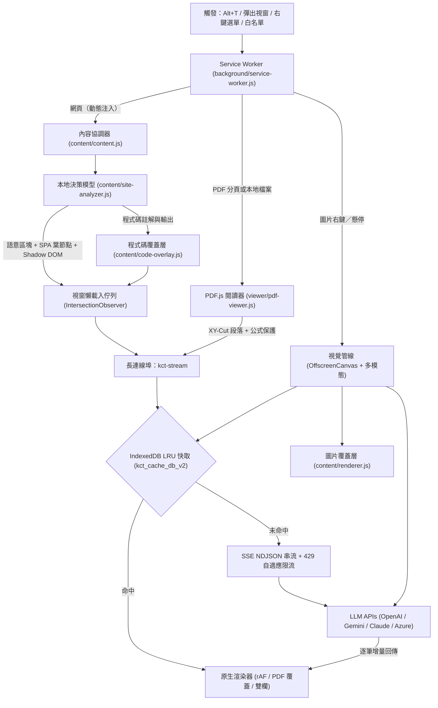
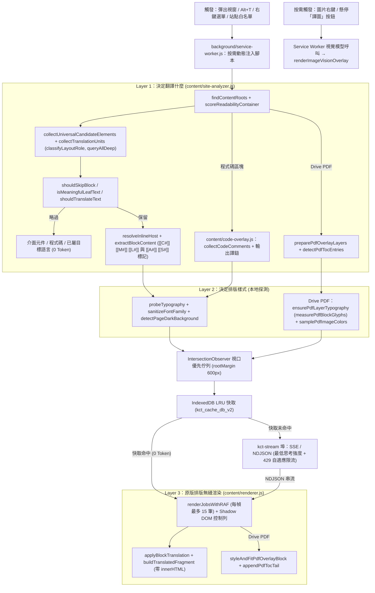

# NativeRead

[English](README.md) · **繁體中文** · [简体中文](README.zh-CN.md) · [日本語](README.ja.md) · [한국어](README.ko.md) · [Español](README.es.md) · [Français](README.fr.md) · [Deutsch](README.de.md)

**NativeRead（v2.6.1）** 是一款 Manifest V3 瀏覽器擴充功能與行動版 PWA，可翻譯網頁、PDF、程式碼註解與嵌入式資訊圖表，同時完整保留原始頁面字體與排版。它預設保持靜默，僅在使用者主動觸發時透過自備的 LLM API 金鑰運作，並逐段串流輸出譯文，不中斷閱讀節奏。

---

## 1. 產品總覽與快速開始

### 核心能力

| 功能 | 運作方式 | 閱讀體驗 |
| --- | --- | --- |
| **預設靜默的網頁翻譯** | 不註冊靜態 `content_scripts`；僅在需要時透過 `chrome.scripting` 動態注入（`Alt+T`、彈出視窗按鈕、右鍵選單或網站白名單 `autoTranslateHosts`）。 | 未翻譯的網站零額外開銷、零浮動 UI、零 API 消耗。 |
| **內建 PDF.js 閱讀器** | 於 `viewer/pdf-viewer.html` 內建本地 Apache-2.0 `PDF.js`（`vendor/pdfjs/`）；支援遠端 PDF、Google Drive 連結與本地 `.pdf` 拖放開啟。 | 可自由切換 **Overlay（覆蓋）**、**Split（雙欄對照）** 與 **Original（原文）** 模式（`1` / `2` / `3`）；圖表、表格與獨立公式完整保留。 |
| **Google Drive PDF 頁內覆蓋** | 直接偵測 `.ndfHFb-c4YZDc-cYSp0e-DARUcf` 檢視層，合併同欄文字框、重建目錄導引點線，並從頁面點陣圖量測原生字形尺寸。 | 不必離開分頁，即可在 Google Drive 內直接翻譯多頁 PDF。 |
| **按需圖片與資訊圖表覆蓋** | 嚴格採按需觸發，僅於右鍵點選（**NativeRead 翻譯圖片文字**）或懸停標籤（**譯圖**）且圖片尺寸 `>= 200x140` px 時執行；絕不自動掃描頁面圖片。 | 取樣背景與前景色原地替換文字區塊，同時保留 3D 圖解與插畫。 |
| **程式碼註解與 Notebook 輸出** | 靜態 `<pre>` 區塊採非破壞性 CSS `attr()` 替換（支援 Pygments、Prism、Highlight.js、GitHub `.pl-c`），CodeMirror 6（`.cm-editor`）採唯讀覆蓋層，並為 Jupyter 輸出提供快速翻譯按鈕。 | 程式碼仍可編輯與執行；聚焦編輯器或切回原文模式時覆蓋層會自動隱藏。 |
| **行動裝置與跨平台** | 隨附獨立行動版 PWA（`docs/`）、通用 Userscript（`docs/nativeread.user.js`）、Android 擴充功能 ZIP（`docs/nativeread-android-extension.zip`）與本地 QR Code `#nr_sync` 同步。 | 在 iOS Safari 與 Android 瀏覽器上享受完整翻譯流程，無須重複輸入 API 金鑰。 |

### 快速開始（桌面版擴充功能）

需使用 Chromium 119 以上版本（Chrome、Edge、Brave 或相容瀏覽器）。

1. 複製專案儲存庫：
   ```bash
   git clone https://github.com/Chih-Kai-Wang/native-read.git
   ```
2. 開啟 `chrome://extensions/`（或 `edge://extensions/`）並啟用 **開發人員模式（Developer mode）**。
3. 點擊 **載入未封裝項目（Load unpacked）**，選擇複製下來的 `native-read` 目錄。
4. 點擊工具列上的 **NativeRead** 圖示 → **設定（Options）**，選擇模型供應商、填入 API 金鑰，點擊 **取得模型清單** 選擇模型，再點擊 **測試連線（Test Connection）** 並儲存。
5. 在任意網頁或 PDF 分頁按下 **`Alt+T`**（macOS 為 **⌥ Option+T**；彈出視窗會顯示瀏覽器實際設定的快捷鍵，可於 `chrome://extensions/shortcuts` 修改）、點擊彈出視窗按鈕或透過右鍵選單即可啟動翻譯。點擊彈出視窗或浮動膠囊上的 `☆` / `★`，可將目前網域加入或移出自動翻譯白名單。

### 支援的模型供應商

設定於 `shared/config.js`（`PROVIDER_PRESETS`），採資料驅動架構收錄四個分組共 32 個預設供應商（設定頁與 PWA 依 `group` 欄位以 `<optgroup>` 分組顯示，PWA 端由 `scripts/build-mobile.js` 自動產生 `docs/providers.js`）。使用者可即時查詢供應商的可用模型清單，本地端點（`localhost`、`127.0.0.1`、`0.0.0.0`）無須填寫 API 金鑰，其他 OpenAI 相容服務亦可透過 `custom` 使用。

| 分組 | 供應商 ID | 協定 | Base URL |
| --- | --- | --- | --- |
| 原生介面 | `gemini` | Gemini Native | `https://generativelanguage.googleapis.com/v1beta` |
| 原生介面 | `anthropic` | Anthropic Messages | `https://api.anthropic.com/v1` |
| 國際服務 | `openai` | OpenAI | `https://api.openai.com/v1` |
| 國際服務 | `azure` | OpenAI (api-key header) | `https://YOUR-RESOURCE.openai.azure.com/openai/v1` |
| 國際服務 | `openrouter` | OpenAI | `https://openrouter.ai/api/v1` |
| 國際服務 | `groq` | OpenAI | `https://api.groq.com/openai/v1` |
| 國際服務 | `mistral` | OpenAI | `https://api.mistral.ai/v1` |
| 國際服務 | `xai` | OpenAI | `https://api.x.ai/v1` |
| 國際服務 | `together` | OpenAI | `https://api.together.xyz/v1` |
| 國際服務 | `fireworks` | OpenAI | `https://api.fireworks.ai/inference/v1` |
| 國際服務 | `cerebras` | OpenAI | `https://api.cerebras.ai/v1` |
| 國際服務 | `deepinfra` | OpenAI | `https://api.deepinfra.com/v1/openai` |
| 國際服務 | `huggingface` | OpenAI | `https://router.huggingface.co/v1` |
| 國際服務 | `novita` | OpenAI | `https://api.novita.ai/openai` |
| 國際服務 | `deepseek` | OpenAI | `https://api.deepseek.com/v1` |
| 國際服務 | `qwen-intl` | OpenAI | `https://dashscope-intl.aliyuncs.com/compatible-mode/v1` |
| 國際服務 | `moonshot-intl` | OpenAI | `https://api.moonshot.ai/v1` |
| 國際服務 | `zai` | OpenAI | `https://api.z.ai/api/paas/v4` |
| 國際服務 | `minimax-intl` | OpenAI | `https://api.minimax.io/v1` |
| 國際服務 | `siliconflow-intl` | OpenAI | `https://api.siliconflow.com/v1` |
| 中國大陸服務 | `qwen` | OpenAI | `https://dashscope.aliyuncs.com/compatible-mode/v1` |
| 中國大陸服務 | `moonshot` | OpenAI | `https://api.moonshot.cn/v1` |
| 中國大陸服務 | `zhipu` | OpenAI | `https://open.bigmodel.cn/api/paas/v4` |
| 中國大陸服務 | `siliconflow` | OpenAI | `https://api.siliconflow.cn/v1` |
| 中國大陸服務 | `volcengine` | OpenAI | `https://ark.cn-beijing.volces.com/api/v3` |
| 中國大陸服務 | `qianfan` | OpenAI | `https://qianfan.baidubce.com/v2` |
| 中國大陸服務 | `hunyuan` | OpenAI | `https://api.hunyuan.cloud.tencent.com/v1` |
| 中國大陸服務 | `minimax` | OpenAI | `https://api.minimaxi.com/v1` |
| 中國大陸服務 | `stepfun` | OpenAI | `https://api.stepfun.com/v1` |
| 本機 / 自訂 | `ollama` | OpenAI | `http://localhost:11434/v1` |
| 本機 / 自訂 | `lmstudio` | OpenAI | `http://localhost:1234/v1` |
| 本機 / 自訂 | `custom` | OpenAI | `http://localhost:11434/v1` |

- **模型選擇與即時清單**：擴充功能預設供應商為 `gemini`，且僅 `gemini`（`gemini-3.5-flash-lite`）、`anthropic`（`claude-opus-5-5`）與 `openrouter`（`google/gemini-2.5-flash`）保留預設模型，其餘預設皆留空供使用者點擊**取得模型清單**即時選取（`LIST_MODELS` 查詢 Gemini `GET /v1beta/models` 支援 `generateContent` 者、Anthropic `GET /v1/models` 以 `after_id` 分頁，或 OpenAI 相容 `GET {baseUrl}/models`）；若目前模型不在清單中會顯示提醒、未填模型時會直接提示選擇模型，遇到 400/404/410/422 模型不存在或已停用錯誤時會提示重新查詢清單，且絕不改寫既有使用者設定。
- **Anthropic Claude（`anthropic`）**：透過原生 Messages API 支援擴充功能、Userscript 與 PWA（SSE 串流、批次／單段翻譯、測試連線，以及使用 base64 圖片區塊的按需圖片翻譯），並提供 `claude-sonnet-5-5` 與 `claude-haiku-5-5` 作為建議模型；同時檢查 `stop_reason`，遇到模型拒答時會顯示明確錯誤。
- **Azure OpenAI（`azure`）**：支援 `*.openai.azure.com`、`*.services.ai.azure.com` 與 `*.cognitiveservices.azure.com` 端點；模型欄位請填入部署名稱（deployment name，不支援即時模型清單查詢），API 金鑰會自動透過 `api-key` 標頭傳送。
- **驗證說明**：除 `azure` 範本網址與本機 `ollama`／`lmstudio`／`custom` 端點外，所有雲端預設供應商的 Base URL 均已通過線上端點探測，而 Anthropic Claude 與 Azure OpenAI 支援已完成離線測試樣本（fixture）驗證（涵蓋端點、標頭、請求本文與回應／串流解析），但尚未針對線上正式 API 進行實測。
- **目標語言**：`zh-TW`（預設）、`zh-CN`、`ja`、`ko`、`es`、`fr`、`de`、`vi`、`pt`，並支援自訂語言提示詞。
- **思考強度（`thinkingEffort`）**：提供 `fastest`（預設）、`balanced` 與 `deep` 三檔。系統會自動將 Gemini 3.x/4.x 對應至 `thinkingLevel`（`MINIMAL` / `LOW` / `MEDIUM`）、Gemini 2.5 Flash 對應至 `thinkingBudget`（`0` / `512` / `2048`）、OpenAI `o1`/`o3`/`o4` 對應至 `reasoning_effort: "low"`、DashScope `qwen3` 於 `fastest` 模式設定 `enable_thinking: false` 並濾除回應中的 `thought` 片段，並將支援此參數的 Anthropic Claude 模型對應至 `output_config.effort`（`low` / `medium` / `high`），且不傳送 `temperature`、`top_p`、`top_k` 或 thinking 設定。

### 行動裝置與跨平台支援

- **行動版 PWA（`https://chih-kai-wang.github.io/native-read/`）**：可在 iOS Safari 與 Android Chrome 加入主畫面安裝。內建行動版 PDF.js 閱讀器（覆蓋／雙欄／原文模式，支援 Google Drive 連結解析、15 秒完整下載逾時與「在新分頁開啟 PDF」備援按鈕）、網頁 URL 與直接貼上文章翻譯器、涵蓋 Claude 等供應商的串流翻譯、離線 App Shell（`docs/sw.js`）與本地 IndexedDB 快取。
- **通用 Userscript（`https://chih-kai-wang.github.io/native-read/nativeread.user.js`）**：可於 iOS Safari（透過 *Stay* 或 *Userscripts*）與 Android 瀏覽器（*Tampermonkey*、*Lemur*、*Kiwi*、*Firefox*）執行。頁面側邊注入可拖曳的 Shadow DOM `NR` 標籤，當頁面嚴格 CSP 阻擋 `fetch` 時自動降級使用 `GM_xmlhttpRequest`。
- **Android 擴充功能 ZIP（`https://chih-kai-wang.github.io/native-read/nativeread-android-extension.zip`）**：適用於 Chromium 核心 Android 瀏覽器（*Lemur*、*Kiwi*、*Quetta*、*Edge Android*）的完整 MV3 套件，支援觸控選取翻譯（`touchend` / `selectionchange`）。
- **本地 QR Code `#nr_sync` 同步**：於桌面版設定頁產生同步連結與 QR Code；手機掃描後即可將供應商、API 金鑰、模型與偏好設定匯入 PWA、Userscript 或 Android 擴充功能，並立即清除網址片段（fragment）。

### 版本更新方式

- **Userscript**：標頭內含 `@updateURL`（`docs/nativeread.meta.js`）、`@downloadURL`（`docs/nativeread.user.js`）、`@homepageURL` 與 `@supportURL`，Tampermonkey、Violentmonkey 與 Stay 可自動檢查並更新。
- **行動版 PWA**：採用帶版本號的 Service Worker 快取（`nativeread-pwa-v<version>`）。當新版 Service Worker 接管已開啟的頁面時，畫面上會出現更新提示橫幅，重新整理即可套用新版本。
- **桌面未封裝擴充功能與 Android 擴充功能 ZIP**：開啟擴充功能彈出視窗時，系統會檢查 GitHub Pages 上的 `version.json`（每 24 小時最多檢查一次，可於設定頁透過 `checkForUpdates` 開關）；若有較新版本，會顯示 `有新版本 vX（目前 vY）/ 查看更新` 並連結至 GitHub README。由於這兩種安裝方式未透過商店託管，更新時仍需手動重新安裝（拉取最新程式碼並重新載入，或重新匯入新版 Android ZIP）。

---

## 2. 技術架構



### 2.1 本地零延遲決策模型

所有頁面分區、內容過濾與字體排版決策皆於 `content/site-analyzer.js` 與 `content/renderer.js` 在本地端完成，不消耗任何額外 LLM 呼叫：

NativeRead 採用單一通用的三層本地管線（無分站分支、無 Adapter），在不增加額外 LLM 呼叫的前提下，完成翻譯範圍篩選、原版字體探測與無縫串流渲染。



- **主內容偵測（`findContentRoots`、`scoreReadabilityContainer`）**：優先辨識嵌入式 Jupyter／Notebook 儲存格（`LESSON_CELL_SELECTOR`）、Google Drive PDF 檢視頁（`.ndfHFb-c4YZDc-cYSp0e-DARUcf`）及語意容器（`article`、`main`、`[role="main"]`、`.markdown-body`、`.prose`、`#mw-content-text`）。容器依 `textLen + pCount * 40` 計分，當 `linkRatio > 0.55` 時降權，文章／文件容器給予 `1.25x` 加權，若內層容器保留 `>= 65%` 文字則收斂至更精準的內層容器，並保留頂層 `#firstHeading` / `h1` 標題。
- **版面模型切分（`collectUniversalCandidateElements`、`collectTranslationUnits`、`classifyLayoutRole`）**：切分不再依據標籤名稱猜測翻譯單元，而是由 `collectTranslationUnits`（由 `collectUniversalCandidateElements` 呼叫）遵循 CSS 排版格式化模型，將單一區塊容器（單一行內格式化上下文）中的文流內行內內容視為一個翻譯單元。
  - *版面角色分類（`classifyLayoutRole`）*：依據 `getComputedStyle`（每次掃描對每個元素快取一次）將元素分為 `BOX`（區塊級或 flex/grid 項目）、`INLINE`（inline、inline-block 等）、`CONTENTS`（`display: contents`，透明穿透）或 `OUT`（未渲染、`visibility: hidden`、視覺隱藏的螢幕閱讀器文字、絕對／固定定位或浮動方塊、表單控制項、圖示字型）。隱藏內容（`display: none`、視覺隱藏）不會送出翻譯；含實際正文的浮動與定位方塊則會作為獨立容器遍歷。
  - *多欄隔離、混合區段與原子行內內容*：文字分布於多個並排儲存格的容器（例如論壇列：標題｜作者｜票數｜留言數）不會被合併成單一句子，每個儲存格各自成為獨立單元。文字旁鄰接區塊子元素的容器會拆分為多個區段：單一行內元素的區段會成為翻譯單元，緊鄰區塊的裸文字區段則保持不翻譯而不包裹頁面自有文字節點（計入 `getLastSegmentationStats` 的 `mixedSkipped`）。原子行內內容（`code`、數學公式、引用標記）即使展示型公式使用 `display: block` 也不會切斷段落。
  - *舊版對照保留*：先前的兩階段掃描保留為 `collectUniversalCandidateElementsLegacy`，僅供比較之用。
- **Shadow DOM 遍歷（`queryAllDeep`、`ensureShadowModeStyle`）**：最深遞迴遍歷至第 5 層開啟中的 `shadowRoot`，同時略過程式碼編輯器與 UI 節點（`SHADOW_SKIP_SELECTOR`），並注入 `:host-context(html.kct-mode-*)` 樣式規則，使替換／原文／雙語切換在 Shadow DOM 內同樣生效。
- **行內結構與保護符記（`extractBlockContent`、`buildTranslatedFragment`、`resolveInlineHost`、`validateTranslatedTokens`）**：將行內程式碼（`code, kbd, var`）替換為原子符記 `[[C#]]`，數學公式與引用標記（`.katex, .MathJax, mjx-container, math, .mwe-math-element, sup.reference`）替換為 `[[M#]]`，不須翻譯的 `<a href>` 連結（如識別碼、URL 或引用標記）替換為 `[[L#]]`，並以成對標記 `[[A#]]…[[/A#]]` 包裹可翻譯的可點擊連結、`[[S#]]…[[/S#]]` 包裹行內強調樣式（bold/strong/italic/em/u/mark/s/small/sub/sup）；`buildTranslatedFragment` 將原子符記以深層複製（`cloneNode(true)`）、成對標記以淺層複製（`cloneNode(false)`，保留 `href`/`class` 並移除 `id`）還原至 `DocumentFragment`。當區塊文字完全位於單一行內鏈（例如 `li > a > b`）內時，`resolveInlineHost` 會下潛至該節點，讓譯文直接渲染在原始連結或強調元素內而不必依賴模型。渲染前 `validateTranslatedTokens` 會檢查每個佔位符皆恰好出現一次且成對標記平衡巢狀；若未通過，則以 `data-kct-structure-fallback="1"` 渲染，在譯文旁保留可點擊原文而非靜默遺失連結。
- **樣式保留與 flex/grid 宿主（`[[S#]]`、`.kct-trans-wrap`、`resolveInlineHost`、`data-kct-flex-host`）**：凡外觀與父元素不同的行內元素（字級、字重、字體樣式、字族、顏色、裝飾線、行內標題或僅供螢幕閱讀器讀取的標籤）皆保留為成對 `[[S#]]` 標記；擷取時會記錄每個保留元素在原位置的排版樣式，若網站 CSS（例如 `.titleline > a` 等子選擇器）在 `.kct-trans-wrap` 內不再套用，則重新套用至複製節點。此外，`resolveInlineHost` 不會下潛進入 flex/grid 容器，flex/grid 宿主會將整段譯文維持在單一排版儲存格內（`data-kct-flex-host`）。 任何可見內容都不會被丟棄或合併：已算繪但不可翻譯的行內內容（圖示、圖示字體、`aria-hidden` 視覺元素、圖片、CSS 繪製的元素）以及區塊級或脫離文件流的後代元素會以不可分割的 `[[C#]]` 權杖形式保留在原位（雙語模式會隱藏重複的媒體副本），即時控制項與媒體（輸入框、按鈕、`video`、`canvas`、`iframe`、已指派的 `slot`）絕不會成為翻譯單元的一部分，隱藏文字（`display: none`、`visibility: hidden`、僅供螢幕閱讀器使用的標籤）絕不會被傳送，且一個單元絕不會包含另一個單元。
- **語言過濾（`shouldTranslateText`）**：依據 Unicode 字集比例過濾網址、電子郵件、檔案路徑、Jupyter `In[]`/`Out[]` 提示字、單一 ASCII 程式碼識別字，以及原本即為目標語言的文字（針對 `zh-TW`/`zh-CN`，當漢字比例 `>= 0.55` 且拉丁單詞 `< 6` 時略過，但仍會翻譯假名比例 `>= 0.12` 的日文內容）。
- **字體基因配對（`probeTypography`、`detectRenderedSerif`、`sanitizeFontFamily`、`content/content.css`）**：依計算後的 `fontFamily` 將每個區塊分類為 `serif`、`sans` 或 `mono`——若網站字體無法依名稱辨識（例如宣告 `sans-serif` 兜底的 `CMS` Computer Modern 網頁字體），則由 `detectRenderedSerif` 在畫布繪製字母「I」偵測襯線（依字體家族快取），確保襯線網站配對襯線 CJK 字體——接著剔除通用 CSS 兜底字體（`serif`、`sans-serif`、`monospace`、`system-ui` 等）使 `--kct-orig-font` 保留最多 5 個網站專屬拉丁字體，再接上對應的目標語言字體堆疊（`var(--kct-orig-font), var(--kct-font-serif|sans|mono)`）。對於未限高且 `lineHeight / fontSize < 1.62` 的密集正文區塊，選擇性提升至 `line-height: 1.72`（`data-kct-lh-lift="1"`）。

### 2.2 雙重 PDF 原生排版管線

NativeRead 針對瀏覽器中不同的 PDF 呈現方式，維護兩套專屬管線：

| 階段 | 內建 PDF.js 閱讀器（`viewer/pdf-viewer.js`） | Google Drive 頁內覆蓋（`site-analyzer.js` + `renderer.js`） |
| --- | --- | --- |
| **文字與幾何來源** | 將 `pdfPage.getTextContent()` 轉換至 CSS 視口座標；略過旋轉文字（`\|angle\| > 0.25`）。 | `.ndfHFb-c4YZDc-cYSp0e-DARUcf-Df1ZY-bN97Pc-haAclf` 內採百分比定位的隱藏 `<p>` 節點。 |
| **分欄與段落分群** | 基線列聚類、幾何上下標吸收、連續欄間距分欄、斷字還原，以及遞迴 XY-Cut 閱讀順序（Y-Cut → X-Cut → 內部 X 谷跨欄切分）。 | 跨群組同欄合併（`leftDiff <= 3.6%`、`hRatio <= 0.36`）、斷字還原與 `nearestBelowTop` 安全高度限制；被吸收的 `<p>` 透過 `data-kct-pdf-merged="absorbed"` 隱藏。 |
| **公式與目錄處理** | 略過獨立公式（`isDisplayedMathBlock`）、以 `[[M#]]` 保護行內公式，並將溢出的 LaTeX 正規化為 Unicode（`cleanLatexMathInText`）。 | `detectPdfTocEntries` 偵測 `>= 3` 筆靠右對齊的目錄列（誤差 `1.2%` 內），僅翻譯標題並以 CSS 點線導引（`.kct-pdf-toc-leader`）與等寬頁碼重建原生 flex 版面。 |
| **字體與字重量測** | 從 `styles` 與 `commonObjs` 讀取 PDF 字體中繼資料（`isSerif`、`isBold`、`isItalic`、`isMono`、`isMathFont`）。 | `ensurePdfLayerTypography` 直接從頁面 `` 點陣圖量測 x-height 筆畫帶（拉丁 `0.53` / 中日韓 `0.88`）與筆畫比例（`>= 1.3x` 中位數判定為粗體），並將相近字級（`1.08x` 容差）聚類為共同中位數。 |
| **色彩與碰撞防護** | 每頁單次 `ctx.getImageData` 取樣外框中位數背景色 `bg` 與符合 WCAG 對比的前景色 `fg`；`refineMaxHeightWithCanvasInk` 掃描段落下方以避免覆蓋圖表／分隔線，並辨識精簡圖表標籤。 | `samplePdfImageColors` 從每頁 ``（綁定 `img.currentSrc \|\| img.src`）取樣外框中位數 `bg` 與高對比 `fg`，並加上 `2px` 陰影光暈與 `:hover` 展開效果。 |
| **顯示模式** | **Overlay（覆蓋）**、**Split（畫布＋譯文卡片）**、**Original（原文）**，並支援點擊原文對照氣泡。 | **Replace（替換）**、**Original（原文）** 與 **Bilingual（雙語，精簡覆蓋並於懸停時展開雙語卡片）**。 |

### 2.3 按需多模態圖片覆蓋管線

1. **明確的使用者觸發**：僅在使用者對圖片按右鍵（**NativeRead 翻譯圖片文字**）或點擊懸停膠囊（**譯圖**），且內容圖片尺寸 `>= 200x140` px 時啟動（自動排除導覽列／頁首／頁尾與 Google Drive PDF 頁面點陣圖）。
2. **背景擷取與縮放（`background/service-worker.js`）**：`prepareImagePayloadForVision` 由 Service Worker 直接下載 `http(s):` 圖片（避開頁面 Canvas CORS 汙染；上限 16 MB、20 秒逾時、魔術位元組 MIME 偵測），或接受本地／blob 圖片的 `data:` URL。透過 `createImageBitmap` + `OffscreenCanvas` 建立 `~480px` 保留透明通道的取樣緩衝區，並對超過 `1600px` 或 `4 MB` 的圖片重新編碼。
3. **結構化視覺推論、筆畫邊界微調與色彩取樣**：`callVisionImageLLM` 送出單次多模態請求（支援 Gemini `inlineData`、OpenAI `image_url` 或 Anthropic Messages base64 `image` 區塊；60 秒逾時，並固定至少使用 `balanced` 思考強度以提升框選穩定度），回傳 0–1000 座標系的 `{"blocks":[{"box_2d":[ymin,xmin,ymax,xmax],"text":"...","role":"title|badge|body"}]}`。`refineImageBoxToInk` 會依筆畫將各邊向外擴展最多約 `0.6 ×` 單行高度，以包覆模型裁切到的字形邊緣，同時僅跨越字距並在實心邊框或插畫邊緣停止。`sampleImageBoxColors` 為每個文字框計算外框眾數 `bg` 與通過 WCAG 檢查的內部 `fg`，移除中日韓字元間多餘的空白或換行，並以帶版本號的 `img:v4:` 鍵值（同時索引 SHA-256 雜湊與正規化 URL）存入 IndexedDB。
4. **原地覆蓋渲染（`content/renderer.js`）**：`renderImageVisionOverlay` 以 `.kct-img-overlay-host` 包裹 ``，將 `.kct-img-overlay-layer` 精準對齊圖片尺寸，使用自適應縮字（`fitVisionOverlayBlock`）配置各區塊並統一相同角色（`title` / `badge` / `body`）標籤的字體大小，並提供隨時切換 **原圖 / 顯示譯圖** 的按鈕。

### 2.4 串流傳輸、視窗懶載入、限流控制與 LRU 快取

- **SSE / NDJSON 串流與彈性降級**：內容腳本與 PDF 閱讀器透過長連線埠 `kct-stream` 連線。Service Worker 串流接收 Gemini（`:streamGenerateContent?alt=sse`）、OpenAI（`stream: true`）或 Anthropic Messages SSE 的 NDJSON 行（`{"i":0,"t":"..."}`），並由 `createIncrementalJsonScanner` 逐筆解析。若出現漏項或串流中斷，自動降級為批次 JSON（`TRANSLATE_BATCH`）並啟用遞迴二分重試（`translateItemsWithFallback`，最深 3 層）。
- **rAF 微批次與視窗懶載入**：串流回傳的網頁譯文經由 `renderJobsWithRAF` 以每動畫影格最多 `15` 筆的切片寫入 DOM（瀏覽器支援時於切片間呼叫 `scheduler.yield()`）。可視範圍外的區塊透過 `IntersectionObserver` 延遲載入（網頁 `rootMargin: 600px 0px`；PDF.js `500px 0px`），以視窗優先順序排入佇列，並以最多 `3` 個並行批次工作執行緒處理（`batchSize: 20`、`maxBatchChars: 5500`）。
- **跨影格 429 自適應限流器**：`background/service-worker.js` 在所有分頁／影格間強制套用全域並行上限 `3`。遇 HTTP `429` 時解析 `Retry-After` / `retryDelay`，啟動 90 秒自適應降速視窗（並行數降為 `1`、請求間隔 `4.3s`）與全域冷卻，並區分每日／零額度耗盡（`QUOTA_EXCEEDED`）與暫時性每分鐘限流（`RATE_LIMITED`）。
- **IndexedDB LRU 快取（`shared/cache-db.js`）**：於 `kct_cache_db_v2`（資料表 `entries`，依 `ts` 建立索引）儲存最多 `20,000` 筆紀錄，快取鍵值包含 `protocol:model:thinkingEffort:targetLang:customLang:glossaryHash`。命中快取時以防抖方式更新 `ts`（`60s` 門檻、`250ms` 防抖），確保容量溢出時優先淘汰最久未使用的紀錄。

### 2.5 專案結構

```text
native-read/
├── manifest.json                 # MV3 manifest、版本號單一來源、權限與 Alt+T 快捷鍵
├── shared/
│   ├── config.js                 # Schema v5 設定、32 家供應商登錄表（PROVIDER_PRESETS）、思考參數、URL/PDF 工具
│   ├── cache-db.js               # IndexedDB kct_cache_db_v2（20,000 筆 LRU 快取）
│   └── pdf-layout.mjs            # 純 PDF 幾何排版、公式／LaTeX 數學保護、Computer Modern 襯線偵測與防回音模組
├── background/
│   └── service-worker.js         # 動態注入器、SSE/NDJSON 串流、429 限流、視覺引擎、#nr_sync 防護
├── content/
│   ├── site-analyzer.js          # 本地決策模型（Readability、兩階段 SPA、Shadow DOM、Drive PDF 合併／目錄）
│   ├── code-overlay.js           # 靜態 <pre> 註解替換、CodeMirror 6 覆蓋層、Jupyter 輸出翻譯
│   ├── renderer.js               # 安全 DOM 渲染、字體基因配對、Drive PDF 點陣量測、圖片覆蓋層
│   ├── content.js                # 視窗懶載入佇列、kct-stream 用戶端、Shadow DOM 膠囊／選取／圖片 UI
│   └── content.css               # 替換／原文／雙語模式、字體堆疊、Drive PDF 與圖片覆蓋樣式
├── viewer/                       # 內建 PDF.js 閱讀器（pdf-viewer.html / .css / .js）
├── popup/                        # 擴充功能彈出視窗、白名單切換、更新通知、PDF 閱讀器啟動鈕
├── options/                      # 設定頁、供應商／模型設定、術語表、本地 QR 同步、快取管理
├── icons/                        # 擴充功能圖示（16 / 48 / 128 px）
├── scripts/
│   └── build-mobile.js           # 同步版本號；產出 Userscript、meta.js、version.json、Android ZIP 與 PDF.js／圖示
├── docs/                         # GitHub Pages 行動版 PWA（index.html、app.js、app.css、sw.js、自動產生的 providers.js 與建置產物）
├── tests/                        # 離線回歸測試樣本（含檢查連結與強調語法保留的 tests/fixtures/inline-structure/）
├── LICENSE                       # MIT 授權條款
└── README*.md                    # 多語系產品、架構與安全說明文件
```

---

## 3. 隱私與安全架構

| 面向 | 實作方式 |
| --- | --- |
| **本地儲存** | 擴充功能設定與 API 金鑰僅存於 `chrome.storage.local`（`kct_settings_v1`）；PWA 設定存於 `localStorage`；Userscript 存於 `GM_getValue`/`GM_setValue`（降級使用 `localStorage`）。翻譯快取存於本地 IndexedDB（`kct_cache_db_v2`），隨時可清除。 |
| **網路端點** | 擴充功能與 Userscript 流量皆直連您設定的 LLM 端點——包含您所選用的 `api.anthropic.com` 或 Azure OpenAI 主機——API 金鑰嚴格置於 HTTP 標頭中（`x-goog-api-key`、`Authorization: Bearer`；Anthropic 使用 `x-api-key` + `anthropic-version: 2026-10-21` + `anthropic-dangerous-direct-browser-access: true`；Azure 使用 `api-key`），並從錯誤訊息中遮罩移除（`redactApiKey`）。遠端 PDF 與按需翻譯的圖片由 Service Worker 直接向來源網址擷取。 |
| **版本更新檢查** | 僅在開啟擴充功能彈出視窗且啟用 `checkForUpdates`（預設開啟）時，每 24 小時最多向 `https://chih-kai-wang.github.io/native-read/version.json` 發送一次請求（結果快取於 `chrome.storage.local` 鍵值 `nr_update_check_v1`，5 秒逾時、`credentials: 'omit'`、無須額外權限、無背景計時器）。回傳 JSON 經嚴格驗證且絕不作為跳轉網址；更新連結固定指向 GitHub README。於設定頁取消勾選 `checkForUpdates` 即可完全停用。 |
| **模型清單查詢** | 在設定頁點擊**取得模型清單**時，會發送 `LIST_MODELS`（僅限擴充功能自身，`isExtensionSender`）直接查詢已設定的供應商（`GET /v1beta/models`、`GET /v1/models` 或 `GET {baseUrl}/models`；逾時 10 秒，不含 Azure），並僅將回傳的模型 ID（絕不儲存 API 金鑰，最多快取 20 個端點）快取於 `chrome.storage.local` 的 `nr_model_list_v1`。 |
| **`#nr_sync` 片段處理** | 同步資料僅置於網址 `#` 片段（絕不使用 `?query`），瀏覽器不會將其隨 HTTP 請求送出。`background/service-worker.js` 僅接受來自擴充功能來源或 `https://chih-kai-wang.github.io/native-read` 的 `#nr_sync`，若未同時提供明確的 `apiKey` 則拒絕變更端點（`baseUrl` / `protocol` / `providerId`），驗證 `http:`/`https:` 協定，並立即以 `history.replaceState` 清除片段。 |
| **零 `innerHTML` DOM 安全** | 所有譯文、彈出氣泡與覆蓋層皆透過 `document.createTextNode` 與 `.textContent` 寫入。原子佔位符（`[[C#]]`、`[[M#]]`、`[[L#]]`）僅還原既有 DOM 節點的複製體，成對標記（`[[A#]]`、`[[S#]]`）僅重建既有元素的淺層複製體（`cloneNode(false)`），且 `validateTranslatedTokens` 結構防護會在不符時保留原文，確保永不遺失連結。 |
| **MV3 CSP 與 PDF.js 加固** | `viewer/pdf-viewer.js` 與 `docs/app.js` 均使用本地打包的 PDF.js 並設定 `isEvalSupported: false`。高權限 Service Worker 操作（`ENSURE_AND_COMMAND`、`TEST_CONNECTION`、`LIST_MODELS`、`OPEN_PDF_VIEWER`、`GET_SW_DEBUG`、`CLEAR_CACHE`）皆強制檢查 `isExtensionSender(sender)`。 |
| **UI 與 QR 隔離** | 浮動膠囊、選取翻譯氣泡、圖片懸停按鈕與 Userscript 控制項皆隔離於 Shadow DOM（`all: initial`）中。同步 QR Code 於設定頁本地生成，不呼叫外部 QR 服務。 |

> **行動版 PWA（`docs/app.js`）備註**：針對 PDF 網址，NativeRead 會解析 Google Drive 連結並僅採瀏覽器直接擷取（15 秒完整下載逾時、不經過 `api.allorigins.win` 中繼，並提供「在新分頁開啟 PDF」備援按鈕與本地檔案指引），確保私人 PDF 網址與內容不會送往第三方中繼服務。在 PWA 選用的 **Web URL** 分頁中，跨來源公開文章擷取（`fetchReadableArticleFromUrl`）目前使用 `r.jina.ai`（並以 `api.allorigins.win` 作為備援）；若您在行動端要求完全不經第三方中繼，請於網頁分頁直接貼上文章內容，或改用 Userscript／Android 擴充功能。

---

## 開發與建置

建置行動端發佈產物並對所有 JavaScript 檔案執行語法檢查：

```bash
node scripts/build-mobile.js
for f in shared/*.js background/*.js content/*.js popup/*.js options/*.js viewer/*.js scripts/*.js docs/app.js docs/sw.js docs/nativeread.user.js; do node --check "$f" || exit 1; done
```

`manifest.json` 中的 `"version"` 為版本號單一來源（`MAJOR.MINOR.PATCH`）。執行 `node scripts/build-mobile.js` 會驗證格式並自動寫入 Userscript 的 `@version`、`docs/sw.js` 的 `CACHE_NAME`（`nativeread-pwa-v<version>`），以及 `docs/index.html` 的 PWA 版本徽章。

`docs/nativeread.user.js`、`docs/nativeread.meta.js`、`docs/version.json`、`docs/nativeread-android-extension.zip`、`docs/vendor/pdfjs/`、`docs/icons/` 與 `docs/.nojekyll` 皆由 `scripts/build-mobile.js` 自動產生——請編輯 `shared/`、`content/`、`viewer/` 與 `docs/app.js` 下的原始模組後再重新執行建置腳本。

**發佈流程（維護者）**：更新 `manifest.json` 的 `"version"` → 執行 `node scripts/build-mobile.js` → 提交並推送至遠端，GitHub Pages 即會提供最新的 PWA、Userscript、中繼檔、`version.json` 與 Android ZIP。

**回歸測試語料庫（`tests/corpus/`）**：`capture.sh` 透過 ego-browser 擷取真實頁面快照（將 DOM 與 `document.styleSheets` 內的 CSS 序列化，把每個單字置換為等長偽字並替換連結與圖片；快照已由 git 忽略），`run.sh [git-rev]` 則使用 1:1 假翻譯器渲染所有快照與手寫的 `fixtures/edge-cases.html`，並逐頁回報與切分器無關的不變量：合併儲存格、譯文內非行內方塊、遺失連結、樣式改變（`styleLost`）、退回原文顯示、未滿足的 `data-expect` 預期、水平溢位、單元數量與覆蓋率。此測試組可重現 v2.5.0 的 Kaggle 錯誤，並在 v2.6.0 上於 8 個網站（Kaggle、Wikipedia、colah、MDN、Hacker News、Stack Overflow、GitHub、arXiv）全數通過。

---

## 規劃中與尚未支援項目

- **瀏覽器擴充功能商店**：尚未上架 Chrome Web Store 或 Edge Add-ons；桌面版目前需透過 **載入未封裝項目** 安裝，尚無商店自動更新。
- **雲端 PDF 連結轉換**：尚未支援 Dropbox、OneDrive 與 Box 的 PDF 連結轉換（目前已支援 Google Drive 連結）。
- **其他媒體與文件格式**：尚未支援影片字幕翻譯、掃描版 PDF OCR，以及 EPUB 或 Office 文件。
- **介面多語系化**：擴充功能與 PWA 的操作介面文字目前僅提供繁體中文。
- **其他桌面瀏覽器**：尚未正式支援桌面版 Firefox 與 Safari。

---

## 授權條款

本專案採 [MIT 授權條款](LICENSE) 釋出。隨附之 PDF.js（`vendor/pdfjs/` 與 `docs/vendor/pdfjs/`）採 Apache-2.0 授權條款（詳見 [docs/vendor/pdfjs/LICENSE](docs/vendor/pdfjs/LICENSE)）。
